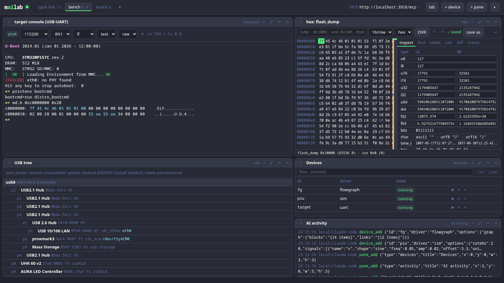

# mailab

**m**y **ai** **lab**: the AI owns the lab. mailab is an MCP server that
gives an AI your bench instruments, SDRs, logic analyzers, glitchers and DSP,
plus a live web UI where you watch, steer and collaborate with it.


## What's in it

**Instruments** (28 drivers; any instrument can run as several instances):
- **Power and meters:** Miniware MDP-P906, ISDT MP305, Rigol DM858E and
  MHO900 over SCPI.
- **Logic and RF:** sigrok logic analyzers (Sipeed SLogic), KC9531B power
  meter, tinySA Ultra, LiteVNA, Harogic HTRA, `rtl_power` sweeps.
- **SDRs and radios:** HackRF, bladeRF, RTL-SDR via SoapySDR; Icom radios over
  CI-V.
- **Security tools:** Proxmark3 / Proxmark5 (Iceman client), PicoGlitcher
  (findus), flashrom and XGecu (minipro) programmers.
- **Consoles:** USB-UART adapters (ttyUSB / ttyACM, Tigard, CP210x, CH340)
  with a colored web terminal, and line-based serial gadgets.
- **Screens and cameras:** webcams / V4L2, VNC remote desktops, the browser's
  own mic and camera.
- **Everything else:** a system monitor (CPU, memory, temperatures, GPU), a
  replay device for recorded sessions, and any program that speaks JSON lines.

[HW.md](HW.md) tracks what has been verified on hardware.

**DSP flowgraph**: GNU Radio-style blocks (numpy + liquid-dsp) that you or
the AI wire up live:
- **Modulation:** every common scheme (AM/DSB/SSB/FM/PM; OOK, ASK, PSK, DPSK,
  APSK, QAM 4–256, 2/4-FSK, MSK, GFSK, GMSK), with PRBS/pattern/framed bit
  sources.
- **Receive chain:** AWGN/CFO channel, matched filter, symbol and clock
  recovery, carrier recovery, slicer, BER meter, sync-word framer.
- **Views and I/O:** spectrum analyzer (RBW, max/min hold, averaging),
  triggered scope with measurements (Vpp, RMS, frequency, duty…),
  constellation, eye diagram, level trigger, audio out, audio in (any lab
  audio stream, e.g. a browser mic), IQ over TCP/UDP.
- **Decoders:** UART, SPI, I2C, Manchester built in, and any installed
  libsigrokdecode decoder (stackable, e.g. spi + spiflash) on flowgraph bits,
  captures or blobs.
- **Audio files:** an `audio_file` source reads WAV/FLAC/MP3/… (ffmpeg).
- **Realtime audio** (live on a browser mic, SDR demod output or audio files;
  state kept across chunks, `set_param` applies live, latency and gain
  reduction in the stats): RBJ biquads (LP/HP/BP/notch/peaking/shelves,
  cascaded), FIR, 50/60 Hz hum notch with harmonics, auto-tracking tone
  notch, compressor (knee, lookahead, RMS/peak, sidechain HPF), brickwall
  limiter, gate/expander, AGC, spectral noise reduction (Wiener /
  subtraction), de-click, DC blocker, and neural `denoise`: DeepFilterNet3
  on CUDA (pinned torch installed into the mailab venv on first use),
  RNNoise on CPU, NVIDIA Maxine detection (SDK not bundled). Templates
  (`load_template`): voice_cleanup, sdr_fm_audio, sdr_am_audio,
  hum_removal, broadcast; spectrum `overlay` draws before/after in one trace.
- **Scripting:** a `python` block for your own DSP.

**Views**: configurable panes that you and the AI share, organized in
dashboard tabs (rename, reorder, `#tab=` links), collapsible to their title
bar or maximized to the window:
- **Plots:** live charts, traces with spectrum markers and readings, waterfall,
  constellation, eye diagram, glitch scatter and findus-style parameter map.
- **Math:** graphing calculator, live math (KaTeX), value readouts.
- **Data:** markdown notes (`{{channel}}` / `{{channel|digits}}` show live
  values), JSON view, Kaitai Struct view (parse binary blobs:
  field tree + hex).
- **Lab:** flowgraph editor, audio, camera, device consoles, AI activity, lab chat.
- **Hardware:** USB tree with per-port hub power (uhubctl) and in-app "udev
  rules" that notify on matching devices; xterm.js serial terminal (Dracula
  colors, raw keystrokes or line mode).
- **Binary:** hex editor (jump expressions, poke / insert / delete with undo,
  search & replace with `??` wildcards, data inspector, CRCs and hashes,
  side-by-side diff), blob analysis (entropy, binwalk, `file`).
- **Boards:** trace PCB copper over PDF pages and photos; nets, a schematic
  graph and netlists come from the drawing.
- **Tables** everywhere sort by value (engineering notation aware), filter and
  export CSV / JSON; numeric setpoints open a tablet keypad with unit buttons.
- **Remote desktops:** a `vnc` device + pane (noVNC) for legacy GUIs in
  emulators and VMs (e.g. a Windows 3.1 dealer programmer): you drive it in the
  pane, the AI uses screenshot / type / key / click / wait_change.

**AI tools**: lab overview, device control, data reads, math and the
graphing calculator, Kaitai parsing, UI control, chat, and `batch`, which
runs many calls in one request with ~1 ms timing for tight sequences.

**Research**: FCC ID lookups (filings, frequencies and power, exhibits such
as internal photos and block diagrams, downloaded into the lab as blobs and
page images) and a local datasheet DB (find PDFs online, full-text search with
page numbers, rendered pages for pinouts and register maps), with a
`datasheets` pane. Needs poppler (`pdftotext`, `pdftoppm`).

**Media**: ffmpeg/sox decode and encode: audio files to raw PCM and back
(wav/flac/mp3/ogg/opus), video to frames and frames to mp4/webm/gif.

**Safety**: server-enforced rules on channels, an approval policy for risky
commands (power on, TX, glitching, flashing, USB port power, profile
overwrite), and an SSRF guard so web lookups only reach public addresses.



**Collaboration**: several people and AIs on one lab. Optional
read-write/read-only tokens, every AI call attributed in the activity feed, a
shared chat, and push into Claude Code through a channel bridge.

## Run

```sh
yarn install
yarn watch          # dev: esbuild --watch + nodemon, http://127.0.0.1:3000
yarn web            # prod: build the UI bundle, then forever
```

Connect an AI over MCP (Streamable HTTP):

```sh
claude mcp add --transport http mailab http://127.0.0.1:3000/mcp
```

Then ask it something like *"add the sim device, chart it and tell me the
RMS"* or *"build a QPSK link with 20 dB SNR and show me the constellation and
BER"*.

Python is managed by mailab: on first use it creates a venv in
`DATA_DIR/python` (with system site packages, so apt-installed SoapySDR and
liquid-dsp bindings stay visible) and pip-installs each Python driver's
requirements when you add the device (mp305 → pymp305, picoglitcher → findus,
…), logging progress to the device log. System libraries stay system-level:
`libliquid` (liquid-dsp ≥ 1.6) and SoapySDR. Set `MAILAB_MANAGE_PYTHON=0` or
`PYTHON=/path/to/python` to manage Python yourself.

### Docker

```sh
docker build -t mailab .
docker run --privileged --network host -v /dev:/dev -v mailab-data:/data \
  -e MAILAB_TOKENS="me:$(openssl rand -hex 24):rw" mailab
```

The container listens on all interfaces, so it requires `MAILAB_TOKENS`: it
refuses to start without them (`MAILAB_ALLOW_OPEN=1` overrides that on a
trusted network). Open the UI once as `http://host:3000/?token=<token>`; the
server swaps the token for an HttpOnly cookie and redirects to the clean URL.
API and MCP clients use `Authorization: Bearer`.

The image includes sigrok-cli, liquid-dsp, SoapySDR (HackRF/bladeRF/RTL-SDR),
hackrf tools, ffmpeg/v4l-utils, uhubctl, pymp305 and findus. It doesn't
include the SLogic libsigrok fork, vendor SDKs (Harogic), the Proxmark3
client, or the mdp-p906/ci-v checkouts; mount those and set `MDP_HOST_PATH` /
`CIV_PATH`.

### Configuration (env)

| Var | Default | |
|---|---|---|
| `PORT` / `HOST` | `3000` / `127.0.0.1` | a non-loopback HOST needs `MAILAB_TOKENS` |
| `MAILAB_TOKENS` | – | `name:token:human\|rw\|ro,…` turns on auth |
| `MAILAB_ALLOW_OPEN` | – | `1` = allow a non-loopback HOST without tokens (trusted networks) |
| `MAILAB_ALLOWED_HOSTS` | – | extra Host names accepted without tokens |
| `DATA_DIR` | `./data` | `lab.json`: devices, derived channels, panes, chat |
| `CHANNEL_CAPACITY` | `200000` | samples kept per channel |
| `MDP_HOST_PATH` / `CIV_PATH` | `~/mdp-p906/host` / `~/ci-v` | libraries loaded from checkouts |
| `SIGROK_CLI` / `PM3_CLIENT` / `PYTHON` | `sigrok-cli` / `~/pm5-og/client/proxmark3` if built, else `proxmark3` / `python3` | external tools |
| `MAILAB_MANAGE_PYTHON` | `1` | `0` = don't manage a venv |
| `MAILAB_MEDIA_DIRS` | – | extra dirs media tools and flowgraph file blocks may read/write (`DATA_DIR/media` always) |
| `MAILAB_HTTP_ALLOW` | – | local mirrors web lookups may reach (hosts, CIDRs); everything else must be a public address |
| `FCCID_MAX_BYTES` / `DATASHEET_MAX_BYTES` | 30 MB / 50 MB | download caps |
| `MOUSER_API_KEY`, `NEXAR_CLIENT_ID`+`NEXAR_CLIENT_SECRET`, `DIGIKEY_CLIENT_ID`+`DIGIKEY_CLIENT_SECRET`, `SEARXNG_URL` | – | optional datasheet search providers (off while unset) |

## Browser as an instrument

Add a `capture` pane and press **mic** and/or **camera** (browsers only start
media from a click). The page captures with getUserMedia and streams over the
UI WebSocket into a `browser` device (`device` in the pane, default `browser`):

- `<dev>_mic`: audio stream (int16 PCM, 8–48 kHz, mono/stereo; an AudioWorklet
  resamples to the chosen rate). Monitor it in an `audio` pane, or feed it to a
  flowgraph with an `audio_in` block (`params: {stream: "<dev>_mic"}`).
- `<dev>_mic_level` / `<dev>_mic_peak`: RMS and peak level in dBFS, 10 Hz.
- `<dev>_frame`: camera frames as JPEG (1 fps by default, at most 10, width
  capped by `maxWidth`); `<dev>_snapshot`: full-size frame from the pane's
  button or the device's `snapshot` command, which asks the capturing browser
  and returns the picture to the AI (times out after 5 s).

The device runs while a browser streams and stops when the tab closes. Only
`rw`/`human` identities may push media; the server caps rates, sizes and the
number of captures per browser. getUserMedia needs a secure context:
`http://localhost` works (tunnel with `ssh -L 3000:localhost:3000 lab` from a
laptop), a phone needs https (e.g. a reverse proxy with a certificate).

## Vision (OpenCV)

`python/vision_bridge.py` runs OpenCV (opencv-python-headless, pinned, installed
into the managed venv on first use) as one long-running process for every lab
image: camera frames (`<cam>_frame`), browser capture frames, screenshots,
photos uploaded with `image_write` or `PUT /api/images/<name>`.

- `vision_run`: a pipeline of ops on one image (crop, resize, gray, threshold,
  adaptive, blur, morph, canny, warp, align (ORB + homography onto a
  reference), contours, template (multi-scale), color, led, seven_seg, ocr
  (tesseract CLI), aruco (scale + pose), scale, measure (px / mm), diff, stats).
  Overlays go to `<image>_annotated`; `output` stores the processed image.
- `vision_watch`: regions of interest on an image stream, each of a kind (led,
  seven_seg, value_ocr, color, motion, template), evaluated whenever the image
  updates (fps cap, frames dropped while busy) into channels `<watch>_<roi>`;
  state changes ("LED turned red", display shows "Err") and `above`/`below`
  crossings become lab notifications `{type: "vision"}` pushed to MCP sessions.
  Watches persist with the lab. The `vision` pane is the ROI editor.

OCR needs the `tesseract` binary plus language data (uses `eng`, else the
first installed language).

## Collaboration

- `MAILAB_TOKENS="alice:secret:human,claude:secret2:rw,viewer:secret3:ro"` turns on
  auth for the UI, REST, WebSocket and MCP. Tokens go in a Bearer header, or
  in the UI's HttpOnly cookie set by a one-time `/?token=` login link.
  - `human`: people. Can do everything, and are the only ones who can approve
    risky AI commands, change the approval policy or remove locked safety rules.
  - `rw`: AIs. Drive the lab, but their risky commands wait for a human.
  - `ro`: look and chat.
- Without tokens there is one local user, and that user counts as human. An
  AI that can only reach the lab over MCP still can't approve its own commands
  (there is no approval tool), but an agent with a shell on the same machine
  could call the REST API directly. Give AIs `rw` tokens and people `human`
  tokens whenever an agent has shell access.
- Without tokens (local use) the server only accepts loopback `Host` headers
  (plus `MAILAB_ALLOWED_HOSTS`) and same-origin requests, which blocks DNS
  rebinding from web pages.
- The activity pane shows who made each MCP call (`alice/claude-code`).
- **Lab chat**: the chat pane for people, `chat_send` / `chat_read` for AIs.
- **Push into Claude Code**: chat messages arrive in a Claude Code session
  through the stdio channel bridge `bin/channel.js` (Claude Code channels
  only work over stdio). HTTP MCP sessions also receive each message as a
  `notifications/message` log event.

  ```json
  {"mcpServers": {"mailab-chat": {"command": "node", "args": ["/path/to/mailab/bin/channel.js"],
    "env": {"MAILAB_URL": "http://127.0.0.1:3000", "MAILAB_NAME": "claude", "MAILAB_TOKEN": "secret"}}}}
  ```

  `claude --dangerously-load-development-channels server:mailab-chat` (research preview)

## MCP tools

| Tool | |
|---|---|
| `lab_overview`, `lab_drivers` | what's in the lab, what can be added |
| `lab_profiles`, `lab_save`, `lab_load` | save / load the whole setup; overwriting or loading waits for approval with a diff |
| `safety_overview`, `rule_add`, `rule_remove` | server-side safety rules (conditions on channels → actions) and the approval policy |
| `device_add/remove/start/stop`, `device_command`, `device_log` | instruments, including the flowgraph (`device_command fg blocks` lists its block catalog) |
| `channel_read`, `channel_write` | time series (stats + downsampled data) |
| `trace_read`, `trace_write`, `image_get`, `image_write` | captures, spectra, screenshots, uploaded images |
| `vision_ops`, `vision_run`, `vision_watch`, `vision_unwatch`, `vision_watches` | OpenCV on lab images: pipelines, ROI watches on image streams → channels + notifications |
| `math_eval`, `math_derive`, `math_remove`, `plot` | analysis and the graphing calculator |
| `value_read`, `value_write`, `blob_write`, `blob_read`, `blob_analyze`, `kaitai_parse` | JSON values, binary blobs, analysis, Kaitai parsing |
| `blob_peek`, `blob_poke`, `blob_patch`, `blob_search`, `blob_replace`, `blob_checksum`, `blob_slice`, `blob_diff` | hex editing: typed reads / writes (u8…u64, f32/f64, LE/BE), poke / insert / delete / fill with undo ops, search & replace (hex `??` wildcards, text, regex), CRC-8/16/32 variants, sums, hashes, entropy; the `hex` pane is the same for people |
| `pane_types`, `pane_add`, `pane_update`, `pane_tabs`, `pane_remove`, `note` | the shared UI (panes carry `tab` and `collapsed`) |
| `usb_tree`, `usb_power`, `uart_ports` | USB tree (controllers, hubs, ports, drivers, /dev nodes, lab users), hub port power (approval), serial adapters with stable identities |
| `udev_rules`, `udev_rule_add`, `udev_rule_remove` | in-app rules: get notified when a matching USB device appears, disappears or changes |
| `subscribe`, `unsubscribe`, `subscriptions`, `notifications_read` | push lab events (rules, approvals, triggers, classifier clusters/matches, udev) into the MCP session |
| `classifier_status`, `classifier_add`, `classifier_remove` | log line clustering and templates (counts and numbers become channels) |
| `trend_read`, `trend_record` | long-term min/max/mean history (1 s … 1 h buckets, up to 2 years) |
| `media_probe`, `audio_to_pcm`, `audio_encode`, `video_frames`, `video_encode` | ffmpeg/sox media decode and encode |
| `chat_send`, `chat_read` | lab chat |
| `batch` | many calls in one request, ~1 ms timing, loops, result references |
| `sweep`, `optimize` | step 1-2 command parameters (linear/log/list) and tabulate channel readings; golden-section / hill-climb search for a min/max. One approval per plan when the policy matches |
| `fccid_search`, `fccid_exhibits`, `fccid_fetch` | FCC filings via fccid.io (cached in `DATA_DIR/cache/fccid`, 1.5 s between requests); fetch stores an exhibit as a blob + page images |
| `datasheet_search`, `datasheet_fetch`, `datasheet_find`, `datasheet_page` | local datasheet DB in `DATA_DIR/datasheets` + online candidates; find by text or section kind (pinout, registers, ratings, package, timing); render a page as a lab image |
| `recording_start`, `recording_stop`, `recordings` | record channels (globs), traces, values, events and logs to ndjson; play back with the `replay` driver (prefix, speed, loop) |
| `board_list`, `board_get`, `board_import`, `board_layer`, `board_draw`, `board_search`, `board_graph`, `board_netlist`, `board_view`, `board_delete` | PCB / schematic tracing: PDF pages (rendered + text extracted) and photos as aligned background layers; parts, pins, wires, vias, labels traced over them; nets come from the drawn geometry; graph queries (net, pin, neighbours, path), JSON/CSV/KiCad netlists, sharp rendered crops to look at. Deleting a board needs approval |

Every call shows up in the **AI activity** pane.

## Extending

**Driver**: a module in `src/devices/<name>/index.js`:

```js
module.exports = {
	name: "mydev",
	description: "...",
	options: { path: "serial port" },
	commands: { set: "{value}" },
	create: (options, io) => {
		// io.sample(field, value, {unit, t}), io.trace(name, {x, series}),
		// io.point(dataset, {x, y, class}), io.image(name, buffer, mime),
		// io.value(name, json), io.blob(name, buffer), io.log(text, level)
		return { start: () => Promise, stop: () => Promise, command: (name, args) => Promise };
	}
};
```

Register it in `src/devices/index.js`. For Python libraries, write a bridge
on `python/mailab_bridge.py` and wrap it with `processDriver.pythonPreset(...)`
(see `src/devices/mp305`).

**Pane**: a module in `public/panes/<type>.js` built on the GUI SDK
(`public/sdk`, on [qrp](https://github.com/nemanjan00/qrp)):

```js
export default pane((ctx) => table({
	rows: () => ctx.state.devices,
	key: (d) => d.id,
	columns: [{ title: "id", mono: true, value: (d) => d.id }, { title: "state", value: (d) => d.state }],
	empty: "no devices"
}));
```

Every SDK `table` sorts by clicking a header (numbers and engineering
notation like `-381.042 mV` by value, text naturally), filters (`text`,
`col:text`) and exports the visible rows as CSV / JSON. A column's `raw`
accessor gives the value to sort and export when the cell renders something
else; `tools: false` hides the filter/export row. The logic lives in
`src/utils/table` (jest-tested).

**Flowgraph block**: a class in `python/flowgraph_bridge.py` (audio blocks:
`python/audio_blocks.py` over the engines in `python/audio_dsp.py`) with
`params`, `doc` and `work(x, rate) -> (y, rate)`, or write it inline in a
`python` block.

## Develop

```sh
yarn test        # jest, incl. the python modem BER regression (python/test_modem.py)
yarn lint
yarn build       # UI bundle
```

[SPEC.md](SPEC.md) lists every requested feature and its status,
[HW.md](HW.md) the per-instrument hardware checklist, and
[CLAUDE.md](CLAUDE.md) the architecture notes for AI contributors.
