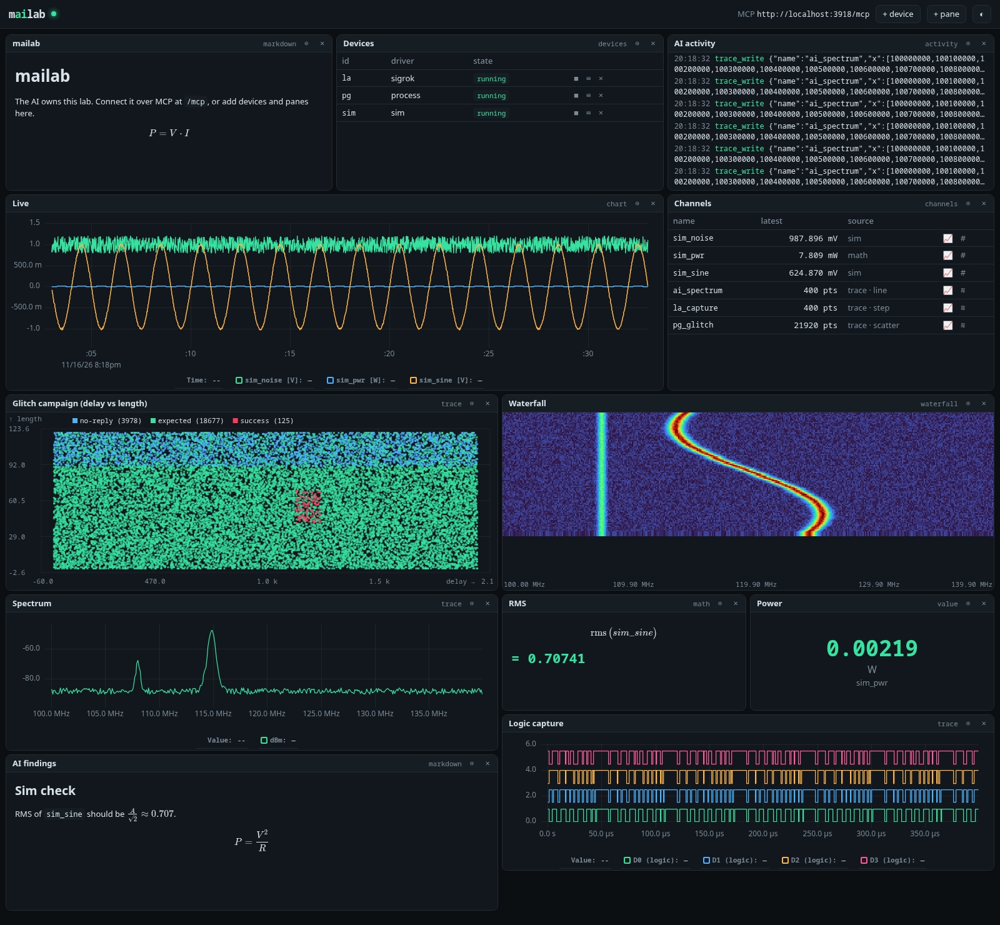

# mailab

**m**y **ai** **lab**: an MCP server that hands a hardware lab to an AI, plus a
live web UI where you watch (and steer) what it does.

- **Devices**: drivers for bench gear, SDRs, logic analyzers, RF tools and
  glitchers. Any program that speaks JSON lines can be a device too, which is
  how the Python libraries plug in. See [HW.md](HW.md) for what's supported and
  what still needs testing.
- **Channels**: live time series (`<device>_<field>`) in ring buffers.
- **Traces**: captured arrays such as spectra, VNA sweeps, scope and logic
  captures, and glitch scatter plots.
- **Math**: mathjs over channels and traces (`rms(psu_i)`, `max(mag(fft(scope_ch1)))`),
  plus derived channels computed per sample (`psu_v * psu_i`).
- **Panes**: a configurable grid of charts, traces, waterfalls, readouts,
  live math, markdown notes with KaTeX, consoles and an AI activity feed.
  You and the AI edit the same layout.



## Run

```sh
yarn install
yarn watch          # dev: esbuild --watch + nodemon, http://127.0.0.1:3000
yarn web            # prod: build the UI bundle, then forever
```

Connect an AI over MCP (Streamable HTTP):

```sh
claude mcp add --transport http mailab http://127.0.0.1:3000/mcp
```

Then ask it something like *"add the sim device, chart it and tell me the RMS"*.

### Docker

```sh
docker build -t mailab .
docker run --privileged --network host -v /dev:/dev -v mailab-data:/data \
  -e MAILAB_TOKENS="me:$(openssl rand -hex 24):rw" mailab
```

The container listens on all interfaces, so it requires `MAILAB_TOKENS`
(it refuses to start without them; `MAILAB_ALLOW_OPEN=1` overrides that on a
trusted network). Open the UI as `http://host:3000/?token=<token>` once.

The image includes sigrok-cli, liquid-dsp, SoapySDR (HackRF/bladeRF/RTL-SDR),
hackrf tools, ffmpeg/v4l-utils, uhubctl, pymp305 and findus. Not included:
the SLogic libsigrok fork, vendor SDKs (Harogic), the Proxmark3 client, and
the mdp-p906/ci-v checkouts (mount them and set `MDP_HOST_PATH` / `CIV_PATH`).

### Configuration (env)

| Var | Default | |
|---|---|---|
| `PORT` / `HOST` | `3000` / `127.0.0.1` | the lab drives real hardware, so keep it local |
| `DATA_DIR` | `./data` | `lab.json` holds devices, derived channels and panes |
| `CHANNEL_CAPACITY` | `200000` | samples kept per channel |
| `MDP_HOST_PATH` | `~/mdp-p906/host` | mdp-p906 host library |
| `CIV_PATH` | `~/ci-v` | ci-v library |
| `SIGROK_CLI` | `sigrok-cli` | |
| `PM3_CLIENT` | `proxmark3` | Proxmark3 client binary |
| `PYTHON` | `python3` | for python bridges |

Python bridges need their libraries: `pymp305`, `findus`, `SoapySDR` + `numpy`,
and `libliquid` for demodulation.

## Collaboration

Several people and AIs can share one lab:

- `MAILAB_TOKENS="alice:secret:rw,bob:secret2:rw,viewer:secret3:ro"` turns on
  auth for the UI, REST, WebSocket and MCP (Bearer token, `?token=`, or the
  UI's cookie). `ro` tokens can look and chat but can't change the lab.
  Set `HOST=0.0.0.0` to accept remote collaborators. A non-loopback `HOST`
  without tokens is refused at startup.
- Without tokens (local use) only loopback `Host` headers (plus
  `MAILAB_ALLOWED_HOSTS`) and same-origin requests are accepted, which blocks
  DNS-rebinding attacks from web pages.
- Every MCP call is attributed (`alice/claude-code`) in the AI activity pane.
- **Lab chat**: the chat pane for people, `chat_send` / `chat_read` for AIs.
- **Push to Claude Code**: chat messages arrive in a Claude Code session as
  channel events through the stdio bridge `bin/channel.js` (channels are
  stdio-only):

  ```json
  {"mcpServers": {"mailab-chat": {"command": "node", "args": ["/path/to/mailab/bin/channel.js"],
    "env": {"MAILAB_URL": "http://127.0.0.1:3000", "MAILAB_NAME": "claude", "MAILAB_TOKEN": "secret"}}}}
  ```

  `claude --dangerously-load-development-channels server:mailab-chat` (research preview).
  HTTP MCP sessions also get each chat message as a `notifications/message` log event.

## MCP tools

| Tool | |
|---|---|
| `lab_overview`, `lab_drivers` | what's in the lab, what can be added |
| `device_add/remove/start/stop`, `device_command`, `device_log` | instruments |
| `channel_read`, `channel_write` | time series (stats + downsampled data) |
| `trace_read`, `trace_write`, `image_get` | captures and screenshots |
| `math_eval`, `math_derive`, `math_remove` | analysis |
| `pane_types`, `pane_add`, `pane_update`, `pane_remove`, `note` | the user's UI |
| `value_read`, `value_write`, `blob_write`, `blob_read`, `kaitai_parse` | JSON values, binary blobs, Kaitai parsing |
| `chat_send`, `chat_read` | lab chat |
| `batch` | many calls in one request with ~1 ms timing |

Every call shows up in the **AI activity** pane.

## Writing a driver

A driver is a module in `src/devices/<name>/index.js`:

```js
module.exports = {
	name: "mydev",
	description: "...",
	options: { path: "serial port" },
	commands: { set: "{value}" },
	create: (options, io) => {
		// io.sample(field, value, {unit, t}), io.trace(name, {x, series}),
		// io.point(dataset, {x, y, class}), io.image(name, buffer, mime),
		// io.log(text, level), io.status(state, detail)
		return { start: () => Promise, stop: () => Promise, command: (name, args) => Promise };
	}
};
```

Register it in `src/devices/index.js`. For Python libraries, write a bridge
with `python/mailab_bridge.py` and a `processDriver.pythonPreset(...)`
(see `src/devices/mp305`).

## Develop

```sh
yarn test
yarn lint
```
