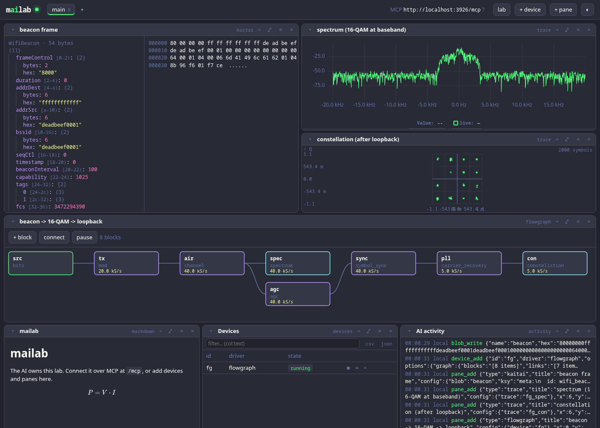

# Bytes → real OFDM → recovered constellation, in a few MCP calls

Craft an 802.11 beacon frame, parse it, modulate the bytes with a real
802.11a/g-style **OFDM** transmitter and watch the receiver lock on, equalize
and recover them — the whole thing an AI drives in a handful of tool calls.



```sh
# with mailab running (yarn watch):
python3 demos/beacon-to-iq/beacon.py            # or: beacon.py http://host:3000 <token>
```

The calls:

| call | |
|---|---|
| `blob_write` | the crafted beacon bytes → blob `beacon` |
| `device_add fg flowgraph` | `ofdm_mod → channel` then `spectrum`, and `ofdm_demod → bitview` |
| `pane_add kaitai` | the frame parsed into fields ([beacon.ksy](beacon.ksy)) |
| `pane_add trace fg_spec` | the OFDM spectrum (the ~16 MHz filled block) |
| `pane_add trace fg_rx_const` | the equalized subcarrier constellation (a clean 16-QAM grid) |
| `pane_add trace fg_rx_chan` | the LTF channel estimate |H| |
| `pane_add json fg_bits` | the bytes recovered after OFDM demod |
| `pane_add flowgraph fg` | the graph |

`kaitai_parse` reads the frame back as: frame control `0x8000` (beacon),
broadcast destination, BSSID `de:ad:be:ef:00:01`, beacon interval 100 TU,
SSID `mAIlab`, supported-rates tag, FCS.

## This is real OFDM — but a DSP demo, not a transmitter

`ofdm_mod` builds an 802.11a/g-style OFDM waveform and `ofdm_demod` recovers
it, so the beacon bytes come back out of a loopback `ofdm_mod → channel →
ofdm_demod` (see [python/ofdm.py](../../python/ofdm.py)).

**Faithful to 802.11a/g:**

- 64-point IFFT/FFT, 48 data + 4 pilot subcarriers on indices −26…26, the DC
  subcarrier and the 11 guard subcarriers nulled → the ~16.6-of-20 "filled
  block" spectrum you see in the pane.
- Pilots on subcarriers {−21, −7, 7, 21} with the BPSK polarity pattern
  {1, 1, 1, −1}, scrambled per OFDM symbol by the standard length-127 pilot
  polarity sequence.
- 16-sample (0.8 µs) cyclic prefix; 80-sample OFDM symbol.
- Short + Long training preamble: STF (10×16 = 160 samples) and LTF
  (GI2 of 32 + 2×64 = 160 samples).
- QAM per subcarrier with the MCS-style rate set — BPSK / QPSK / 16-QAM /
  64-QAM (this demo uses 16-QAM), plus 256-QAM as an extra — with the 802.11
  Gray mapping and K_MOD normalization.
- A data scrambler (generator x⁷ + x⁴ + 1).
- Receiver: STF autocorrelation **packet detection**, coarse/fine **carrier-
  frequency-offset** estimate + correction (STF then LTF), FFT, **LTF channel
  estimate**, per-subcarrier **zero-forcing equalization**, **pilot** residual-
  phase correction, QAM demap, descramble. In loopback it recovers the beacon
  bytes with BER ≈ 0.

**Simplified (what it omits vs. the full PHY):**

- **No convolutional code (K=7) and no interleaver** — this is an *uncoded*
  OFDM link, so its BER-vs-SNR follows the raw QAM curve, a few dB worse than a
  real coded 802.11 rate. The scrambler *is* included.
- **No SIGNAL field** (RATE/LENGTH) and no SERVICE/tail/pad framing: the
  receiver is told the scheme and symbol count instead of decoding a header.
- No inter-symbol windowing/ramping; a flat single-tap channel is assumed for
  the pilot tracking.

So it looks and demodulates like 802.11 OFDM, but it is **not a bit-compatible
802.11 frame** and no access point would decode it.

## Not a transmitter

- **Nothing radiates.** The signal loops through the `channel` block (AWGN at
  40 dB), the same way the modem toolkit is tested. There is no SDR in the chain.
- **Transmitting fabricated beacons over the air is spoofing / interference.**
  mailab's SDR TX path (`soapy_sink` / `tx_arm`) is deliberately gated: only the
  lab's allowed bands (`MAILAB_RF_REGION`, operator-configured extras), a
  person's approval per transmit, power caps and an auto-stop — 2.4 GHz Wi-Fi
  injection is not on that list. The licensed way to emit a beacon is a real
  Wi-Fi NIC in AP mode.
