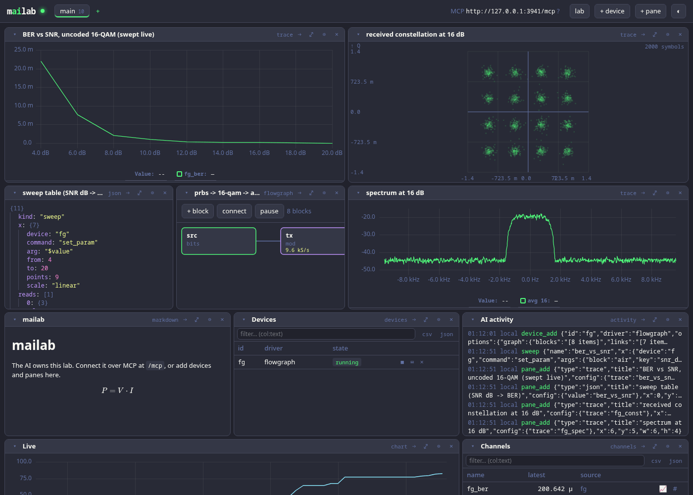

# QAM BER waterfall

A PRBS-15 bit stream 16-QAM-modulated through an AWGN channel whose SNR is
swept live with the `sweep` tool — a classic BER-vs-SNR waterfall, measured
inside the running lab.



## What it shows

```
bits (PRBS-15) -> mod (16-QAM, 8 sps) -> channel (AWGN, snr_db)
               -> symbol_sync -> constellation + slicer (16-QAM) -> ber
```

- **bits** generates a PRBS-15 sequence at 9600 bit/s (self-synchronizing, so
  the reference for BER comparison needs no alignment).
- **mod** maps to 16-QAM at 8 samples/symbol; **channel** adds AWGN at a
  settable SNR.
- **symbol_sync** (Gardner) retimes; **slicer** makes symbol decisions.
- **ber** compares decisions against its own PRBS-15 and reports the error
  rate over a sliding window.

The demo then runs a `sweep` (4 → 20 dB in 9 steps) that sets the channel's
`snr_db` per point and reads the BER block's windowed mean. The result table
is stored as value/trace `ber_vs_snr`.

Measured on this machine (liquid-dsp modem, ~1 min sweep):

| SNR (dB) | 4 | 6 | 8 | 10 | 12 | 14 | 16 | 18 | 20 |
|---|---|---|---|---|---|---|---|---|---|
| BER | 2.2e-2 | 7.7e-3 | 2.2e-3 | 1.0e-3 | 3.8e-4 | 2.0e-4 | 2.8e-4 | 1.6e-4 | 5e-5 |

Panes: BER waterfall table, live 16-QAM constellation, TX spectrum, and the
flowgraph graph.

## Run it

With mAIlab running (here on a throwaway `DATA_DIR`, port 3939):

```sh
DATA_DIR=$(mktemp -d) PORT=3939 node src/index.js
python3 demos/qam-ber/qam_ber.py http://127.0.0.1:3939
```

The script builds the graph and panes, then runs the SNR sweep (~1 min).
Open http://127.0.0.1:3939 to watch the constellation morph as the sweep
steps the SNR down and back up.
