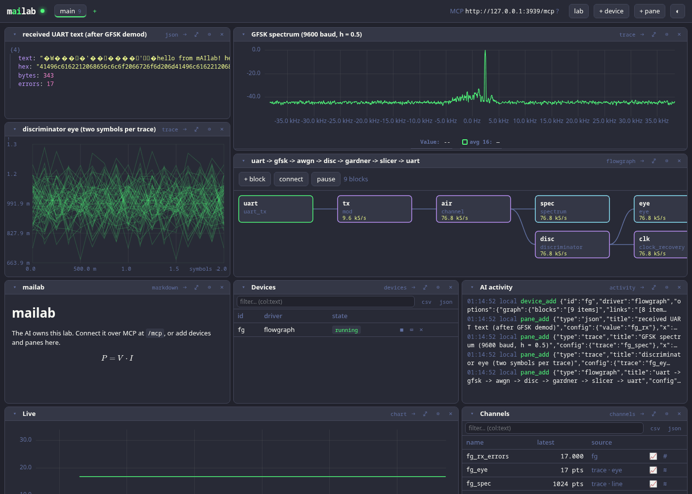

# UART over FSK

A UART byte stream GFSK-modulated, sent through an AWGN channel, and
demodulated back to text — entirely inside a mAIlab flowgraph.



## What it shows

The graph is a complete modem data path:

```
uart_tx -> mod (GFSK, h=0.5, BT=0.5) -> channel (AWGN) -> discriminator
        -> Gardner clock recovery -> 2-level slicer -> uart_rx
```

- **uart_tx** emits `"hello from mAIlab! "` as an 8N1 UART frame at 9600 baud,
  repeated every 3 s with the line held at mark (idle) in between.
- **mod** upsamples to 8 samples/symbol and GFSK-modulates (liquid-dsp CPFSK).
- **channel** adds AWGN at 16 dB SNR.
- **discriminator** FM-demodulates back to baseband symbols.
- **clock_recovery** (Gardner) retimes to 1 sample/symbol.
- **slicer** adapts a threshold from the symbol distribution (survives long
  idle runs) and outputs hard bits.
- **uart_rx** frames and decodes the bits back to text, counting framing
  errors (the counter includes the lock-in transient at graph start).

Taps: a live **spectrum** of the GFSK signal and a **discriminator eye**
diagram (two symbols per trace).

## Run it

With mAIlab running (here on a throwaway `DATA_DIR`, port 3939):

```sh
DATA_DIR=$(mktemp -d) PORT=3939 node src/index.js
python3 demos/uart-over-fsk/uart_fsk.py http://127.0.0.1:3939
```

Open http://127.0.0.1:3939 — the received text, spectrum, eye diagram and
the flowgraph graph panes are live.
