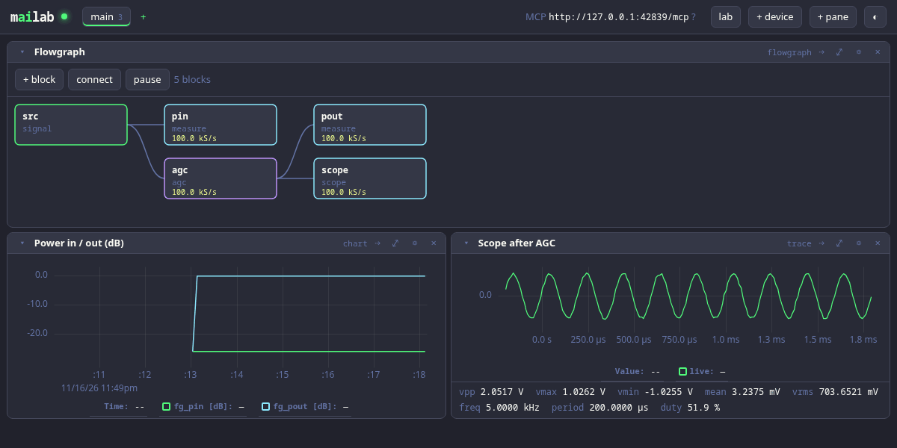

<!-- generated by bin/block-docs.js from the block catalog, about.md and example.json: edit those and run `yarn block-docs` -->

# `agc`

**dsp** · Filters and DSP · [all blocks](../README.md)

> automatic gain control (normalizes to unit power)

Automatic gain control for IQ (liquid agc_crcf): normalizes the signal to unit power with a loop `bandwidth`.
Put it in front of blocks that assume a known level: symbol timing and carrier recovery, slicers with fixed decision
thresholds, constellation views. Small bandwidths react slowly but don't modulate the signal; large ones track fades
fast. For audio levels use `audio_agc` (attack/release in ms, gain limits).

## Parameters

| name | default | description |
|---|---|---|
| `bandwidth` | `0.001` | loop bandwidth |

## Inputs and outputs

- **Input:** complex IQ
- **Output:** complex IQ normalized to unit power, same rate

## Example

A weak tone (amplitude 0.05, about -26 dBFS) brought to 0 dB: power before and after.



Ask the AI:

> The signal is too weak, normalize it with an AGC and show me the level before and after.

Graph ([example.json](example.json)):

```json
{
  "blocks": [
    {"id": "src", "type": "signal", "params": {"rate": 100000, "freq": 5000, "amp": 0.05, "noise": 0.002}},
    {"id": "pin", "type": "measure", "params": {"stat": "power_db"}},
    {"id": "agc", "type": "agc", "params": {"bandwidth": 0.01}},
    {"id": "pout", "type": "measure", "params": {"stat": "power_db"}},
    {"id": "scope", "type": "scope", "params": {"samples": 200, "measure": ["vpp"]}}
  ],
  "links": [["src", "pin"], ["src", "agc"], ["agc", "pout"], ["agc", "scope"]]
}
```

MCP calls:

```
device_add {"id": "fg", "driver": "flowgraph"}
device_command {"id": "fg", "command": "set_graph", "args": {"graph": <the graph above>}}
pane_add {"type": "flowgraph", "title": "Flowgraph", "config": {"device": "fg"}}
pane_add {"type": "chart", "title": "Power in / out (dB)", "config": {"channels": ["fg_pin", "fg_pout"], "seconds": 8}}
pane_add {"type": "trace", "title": "Scope after AGC", "config": {"traces": ["fg_scope"]}}
```

## Related

- [`audio_agc`](../audio_agc/README.md): audio level AGC to a target dBFS
- [`symbol_sync`](../symbol_sync/README.md): symbol timing recovery, one sample per symbol out
- [`measure`](../measure/README.md): one statistic of the stream as a channel
- [`carrier_recovery`](../carrier_recovery/README.md): decision-directed PLL removing carrier offset and phase
