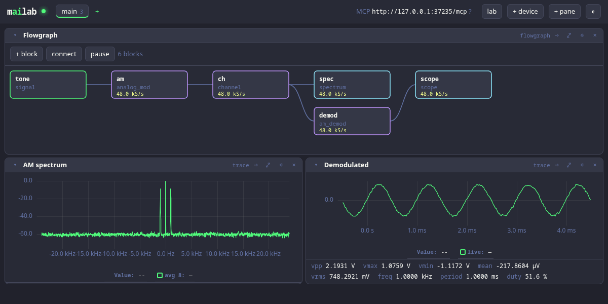

<!-- generated by bin/block-docs.js from the block catalog, about.md and example.json: edit those and run `yarn block-docs` -->

# `am_demod`

**dsp** · Modulation, demodulation and sync · [all blocks](../README.md)

> AM/SSB demodulator -&gt; real audio

AM / SSB demodulator (liquid ampmodem): `am` is an envelope detector for double-sideband AM, `usb` / `lsb`
recover single-sideband voice. The signal has to be centered at 0 Hz (for SSB: the suppressed carrier at 0 Hz) and
filtered to the channel. Follow with `dc_block` (AM leaves the carrier as DC), an audio low-pass and `audio`; the
`sdr_am_audio` template adds a heterodyne notch, noise reduction and AGC.

## Parameters

| name | default | description |
|---|---|---|
| `mode` | `"am"` | am\|usb\|lsb |

## Inputs and outputs

- **Input:** complex IQ (AM/SSB centered at 0 Hz)
- **Output:** real audio, same rate

## Example

A 1 kHz tone AM-modulated (80 %) through a 30 dB SNR channel: the AM spectrum (carrier + sidebands) and the demodulated tone.



Ask the AI:

> AM-modulate a 1 kHz tone, show its spectrum and the demodulated audio.

Graph ([example.json](example.json)):

```json
{
  "blocks": [
    {"id": "tone", "type": "signal", "params": {"rate": 48000, "freq": 1000, "amp": 1, "noise": 0}},
    {"id": "am", "type": "analog_mod", "params": {"mode": "am", "index": 0.8}},
    {"id": "ch", "type": "channel", "params": {"snr_db": 30}},
    {"id": "spec", "type": "spectrum", "params": {"fft": 2048, "traces": ["avg"]}},
    {"id": "demod", "type": "am_demod", "params": {"mode": "am"}},
    {"id": "scope", "type": "scope", "params": {"samples": 240, "measure": ["freq", "vpp"]}}
  ],
  "links": [["tone", "am"], ["am", "ch"], ["ch", "spec"], ["ch", "demod"], ["demod", "scope"]]
}
```

MCP calls:

```
device_add {"id": "fg", "driver": "flowgraph"}
device_command {"id": "fg", "command": "set_graph", "args": {"graph": <the graph above>}}
# a ready-made template that uses this block (replaces the graph):
device_command {"id": "fg", "command": "load_template", "args": {"name": "sdr_am_audio", "args": "driver=rtlsdr", "freq": 7100000, "mode": "lsb"}}
pane_add {"type": "flowgraph", "title": "Flowgraph", "config": {"device": "fg"}}
pane_add {"type": "trace", "title": "AM spectrum", "config": {"traces": ["fg_spec"]}}
pane_add {"type": "trace", "title": "Demodulated", "config": {"traces": ["fg_scope"]}}
```

## Related

- [`analog_mod`](../analog_mod/README.md): audio to AM, DSB, SSB, FM or PM baseband
- [`fm_demod`](../fm_demod/README.md): FM demodulator to audio
- [`auto_notch`](../auto_notch/README.md): finds and notches stationary tones automatically
- [`audio`](../audio/README.md): plays audio in the browser (lab audio stream)
