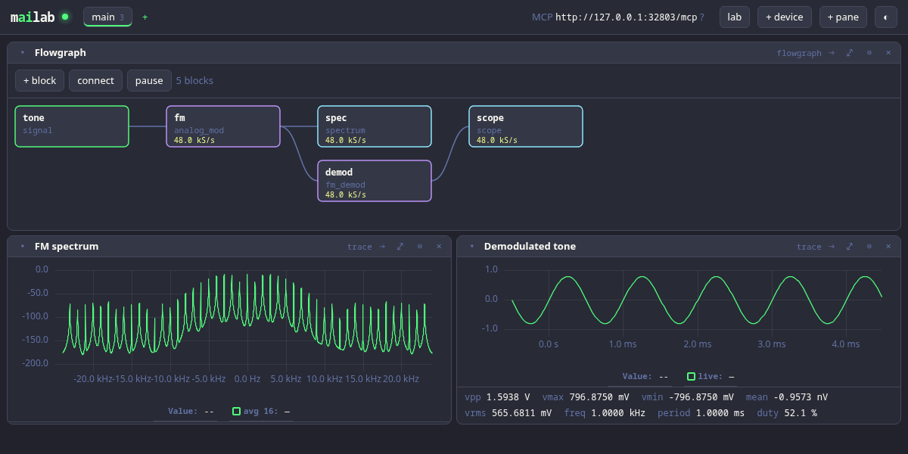

<!-- generated by bin/block-docs.js from the block catalog, about.md and example.json: edit those and run `yarn block-docs` -->

# `analog_mod`

**dsp** · Modulation, demodulation and sync · [all blocks](../README.md)

> real audio -&gt; AM / DSB / USB / LSB / FM / PM baseband

Analog modulator: real audio in, complex baseband out as AM (with carrier, `index` = modulation depth), DSB
(suppressed carrier), USB / LSB (single sideband), FM (`deviation` Hz) or PM (`index` radians). Use it to build test
signals for receivers (`analog_mod -> channel -> fm_demod -> audio`) or to feed a transmitter over `net_sink`.
Sample rate stays the same, so make sure it's high enough for the bandwidth (Carson: 2 x (deviation + audio bandwidth)).

## Parameters

| name | default | description |
|---|---|---|
| `mode` | `"fm"` | am\|dsb\|usb\|lsb\|fm\|pm |
| `deviation` | `5000` | FM Hz |
| `index` | `0.8` | AM index / PM radians |

## Inputs and outputs

- **Input:** real audio (complex: real part)
- **Output:** complex baseband IQ, same rate

## Example

A 1 kHz tone frequency-modulated with 5 kHz deviation at 48 kS/s: the Bessel-line spectrum, and the tone recovered by fm_demod.



Ask the AI:

> FM-modulate a 1 kHz tone with 5 kHz deviation, show the spectrum and demodulate it again.

Graph ([example.json](example.json)):

```json
{
  "blocks": [
    {"id": "tone", "type": "signal", "params": {"rate": 48000, "freq": 1000, "amp": 0.8, "noise": 0}},
    {"id": "fm", "type": "analog_mod", "params": {"mode": "fm", "deviation": 5000}},
    {"id": "spec", "type": "spectrum", "params": {"fft": 2048, "traces": ["avg"], "average": 16}},
    {"id": "demod", "type": "fm_demod", "params": {"deviation": 5000}},
    {"id": "scope", "type": "scope", "params": {"samples": 240, "measure": ["freq", "vpp"]}}
  ],
  "links": [["tone", "fm"], ["fm", "spec"], ["fm", "demod"], ["demod", "scope"]]
}
```

MCP calls:

```
device_add {"id": "fg", "driver": "flowgraph"}
device_command {"id": "fg", "command": "set_graph", "args": {"graph": <the graph above>}}
pane_add {"type": "flowgraph", "title": "Flowgraph", "config": {"device": "fg"}}
pane_add {"type": "trace", "title": "FM spectrum", "config": {"traces": ["fg_spec"]}}
pane_add {"type": "trace", "title": "Demodulated tone", "config": {"traces": ["fg_scope"]}}
```

## Related

- [`fm_demod`](../fm_demod/README.md): FM demodulator to audio
- [`am_demod`](../am_demod/README.md): AM / USB / LSB demodulator to audio
- [`signal`](../signal/README.md): complex tone plus noise, the basic test signal
- [`audio_file`](../audio_file/README.md): plays an audio file (WAV/FLAC/MP3/..., via ffmpeg) as real samples
