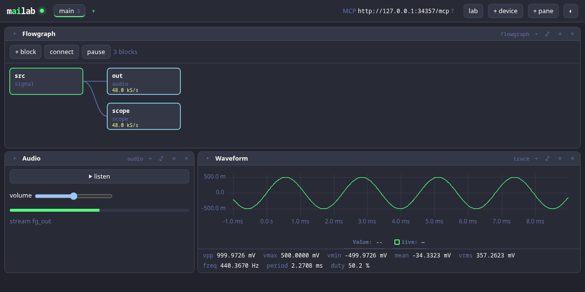

<!-- generated by bin/block-docs.js from the block catalog, about.md and example.json: edit those and run `yarn block-docs` -->

# `audio`

**sink** · Sinks and views · [all blocks](../README.md)

> play in the browser (audio pane on stream &lt;device&gt;_&lt;id&gt;); real input, resampled to `rate`

Plays real samples in the browser: the block publishes an audio stream `<device>_<id>` (int16 PCM, resampled to
`rate`), which an `audio` pane plays (press listen; browsers need a click before audio). Other graphs can take the
stream with `audio_in`. The end of every receiver and audio processing chain.

## Parameters

| name | default | description |
|---|---|---|
| `rate` | `24000` | output sample rate |
| `gain` | `1` | linear gain before clipping to [-1, 1] |

## Inputs and outputs

- **Input:** real audio (complex: real part)
- **Output:** audio stream &lt;device&gt;_&lt;id&gt; (int16 PCM at `rate`)

## Example

A 440 Hz tone as an audio stream: the audio pane (level meter) and the waveform.



Ask the AI:

> Play a 440 Hz tone in my browser.

Graph ([example.json](example.json)):

```json
{
  "blocks": [
    {"id": "src", "type": "signal", "params": {"rate": 48000, "freq": 440, "amp": 0.5, "noise": 0}},
    {"id": "out", "type": "audio", "params": {"rate": 48000, "gain": 1}},
    {"id": "scope", "type": "scope", "params": {"samples": 480, "measure": ["freq", "vrms"]}}
  ],
  "links": [["src", "out"], ["src", "scope"]]
}
```

MCP calls:

```
device_add {"id": "fg", "driver": "flowgraph"}
device_command {"id": "fg", "command": "set_graph", "args": {"graph": <the graph above>}}
pane_add {"type": "flowgraph", "title": "Flowgraph", "config": {"device": "fg"}}
pane_add {"type": "audio", "title": "Audio", "config": {"stream": "fg_out"}}
pane_add {"type": "trace", "title": "Waveform", "config": {"traces": ["fg_scope"]}}
```

## Related

- [`audio_file`](../audio_file/README.md): plays an audio file (WAV/FLAC/MP3/..., via ffmpeg) as real samples
- [`fm_demod`](../fm_demod/README.md): FM demodulator to audio
- [`limiter`](../limiter/README.md): brickwall lookahead limiter
- [`wav`](../wav/README.md): records audio to a WAV file
