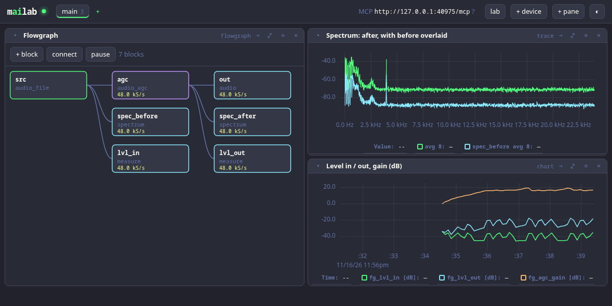

<!-- generated by bin/block-docs.js from the block catalog, about.md and example.json: edit those and run `yarn block-docs` -->

# `audio_agc`

**dsp** · Audio processing · [all blocks](../README.md)

> audio AGC: RMS level to target_db within min/max gain; attack (gain down) / release (gain up); holds the gain below noise_floor_db; gain -&gt; channel &lt;device&gt;_&lt;id&gt;_gain

Audio automatic gain control: brings the RMS level to `target_db` with gain between `min_gain_db` and
`max_gain_db`, reducing gain fast (`attack_ms`) and raising it slowly (`release_ms`); below `noise_floor_db` it holds
the gain so silence isn't pumped up into hiss. Use it after a demodulator or on a mic of unknown level, followed by a
`limiter`. The gain is a channel.

The example plays a generated test recording (`$MEDIA/demo.wav`: a buzzy voice-like signal with 50 Hz hum, a 4 kHz whistle, hiss and clicks); with a microphone, swap `src` for `audio_in` {stream: "browser_mic"}.

## Parameters

| name | default | description |
|---|---|---|
| `bypass` | `false` | pass the input through (same delay; live A/B) |
| `target_db` | `-20` | dBFS RMS |
| `max_gain_db` | `30` | most gain applied (quiet input) |
| `min_gain_db` | `-20` | most attenuation (loud input) |
| `attack_ms` | `20` | gain-down time constant |
| `release_ms` | `1000` | gain-up time constant |
| `noise_floor_db` | `-55` | no gain changes below |
| `rms_ms` | `50` | level detector RMS window |
| `fps` | `10` | gain-reduction channel updates per second |

## Inputs and outputs

- **Input:** real audio (complex: real part)
- **Output:** real audio, same rate; channel &lt;device&gt;_&lt;id&gt;_gain (dB)

## Example

The test recording played at 0.1x (about -40 dBFS) brought to -20 dBFS: level in/out and the AGC gain.



`$MEDIA` is your media directory (`DATA_DIR/media` or one of `MAILAB_MEDIA_DIRS`); the screenshot and tests use generated files (`demo.wav`: see `makeMedia` in `src/utils/block-docs`).

Ask the AI:

> The audio is way too quiet, add an AGC to -20 dBFS and show me the gain.

Graph ([example.json](example.json)):

```json
{
  "blocks": [
    {"id": "src", "type": "audio_file", "params": {"path": "$MEDIA/demo.wav", "rate": 48000, "gain": 0.1}},
    {"id": "agc", "type": "audio_agc", "params": {"target_db": -20, "max_gain_db": 30, "attack_ms": 20, "release_ms": 1000}},
    {"id": "out", "type": "audio", "params": {"rate": 48000}},
    {"id": "spec_before", "type": "spectrum", "params": {"fft": 4096, "traces": ["avg"], "average": 8, "fps": 4}},
    {"id": "spec_after", "type": "spectrum", "params": {"fft": 4096, "traces": ["avg"], "average": 8, "fps": 4, "overlay": ["spec_before"]}},
    {"id": "lvl_in", "type": "measure", "params": {"stat": "power_db"}},
    {"id": "lvl_out", "type": "measure", "params": {"stat": "power_db"}}
  ],
  "links": [["src", "agc"], ["agc", "out"], ["src", "spec_before"], ["agc", "spec_after"], ["src", "lvl_in"], ["agc", "lvl_out"]]
}
```

MCP calls:

```
device_add {"id": "fg", "driver": "flowgraph"}
device_command {"id": "fg", "command": "set_graph", "args": {"graph": <the graph above>}}
pane_add {"type": "flowgraph", "title": "Flowgraph", "config": {"device": "fg"}}
pane_add {"type": "trace", "title": "Spectrum: after, with before overlaid", "config": {"traces": ["fg_spec_after"]}}
pane_add {"type": "chart", "title": "Level in / out, gain (dB)", "config": {"channels": ["fg_lvl_in", "fg_lvl_out", "fg_agc_gain"], "seconds": 8}}
```

## Related

- [`agc`](../agc/README.md): normalizes IQ to unit power
- [`compressor`](../compressor/README.md): dynamics compressor with knee, lookahead, sidechain HPF
- [`limiter`](../limiter/README.md): brickwall lookahead limiter
