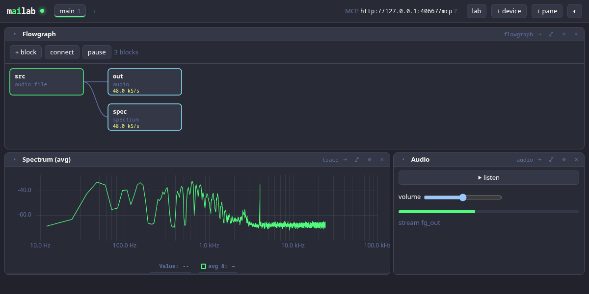

<!-- generated by bin/block-docs.js from the block catalog, about.md and example.json: edit those and run `yarn block-docs` -->

# `audio_file`

**source** · Sources · [all blocks](../README.md)

> audio file (wav/flac/mp3/ogg/… or a video's audio, decoded by ffmpeg) as real float samples

Decodes an audio file (WAV, FLAC, MP3, OGG, Opus, or the audio track of a video) with ffmpeg and plays it into
the graph as real samples at `rate`, paced like a live source (or as fast as the graph runs with `realtime: false`).
It is the usual input for building and tuning an audio processing chain before switching to a live microphone
(`audio_in`). Pick one `channel` of a multichannel file or mix them down. The file must be inside `DATA_DIR/media` or
`MAILAB_MEDIA_DIRS`. Typical chain: `audio_file -> biquad -> spectral_nr -> compressor -> audio`, or use
`load_template` (voice_cleanup, broadcast...) with `{path}`.

## Parameters

| name | default | description |
|---|---|---|
| `path` | `""` | file inside DATA_DIR/media or MAILAB_MEDIA_DIRS |
| `rate` | `48000` | output sample rate |
| `channel` | `0` | channel to take (0 = mix down to mono) |
| `loop` | `true` | restart at the end of the file (false = stop) |
| `realtime` | `true` | pace like a live source; false = as fast as the graph runs |
| `gain` | `1` | linear gain applied to the samples |

## Inputs and outputs

- **Input:** none (source)
- **Output:** real audio at `rate` (carried as complex with zero imaginary part)

## Example

A generated test recording (buzzy "voice", 50 Hz hum, 4 kHz whistle, hiss, clicks): its averaged spectrum and the audio stream.



`$MEDIA` is your media directory (`DATA_DIR/media` or one of `MAILAB_MEDIA_DIRS`); the screenshot and tests use generated files (`demo.wav`: see `makeMedia` in `src/utils/block-docs`).

Ask the AI:

> Load $MEDIA/demo.wav, let me listen to it and show its spectrum.

Graph ([example.json](example.json)):

```json
{
  "blocks": [
    {"id": "src", "type": "audio_file", "params": {"path": "$MEDIA/demo.wav", "rate": 48000}},
    {"id": "out", "type": "audio", "params": {"rate": 48000}},
    {"id": "spec", "type": "spectrum", "params": {"fft": 4096, "traces": ["avg"], "average": 8, "fps": 4}}
  ],
  "links": [["src", "out"], ["src", "spec"]]
}
```

MCP calls:

```
device_add {"id": "fg", "driver": "flowgraph"}
device_command {"id": "fg", "command": "set_graph", "args": {"graph": <the graph above>}}
pane_add {"type": "flowgraph", "title": "Flowgraph", "config": {"device": "fg"}}
pane_add {"type": "trace", "title": "Spectrum (avg)", "config": {"traces": ["fg_spec"], "logX": true}}
pane_add {"type": "audio", "title": "Audio", "config": {"stream": "fg_out"}}
```

## Related

- [`audio`](../audio/README.md): plays audio in the browser (lab audio stream)
- [`biquad`](../biquad/README.md): RBJ biquad: low/high/band-pass, notch, peaking, shelves
- [`spectral_nr`](../spectral_nr/README.md): spectral noise reduction (Wiener / subtraction)
- [`denoise`](../denoise/README.md): neural speech denoise (DeepFilterNet, RNNoise)
