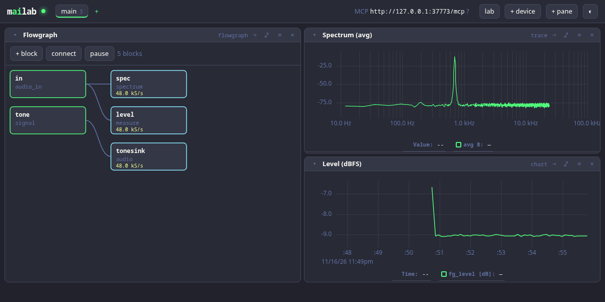

<!-- generated by bin/block-docs.js from the block catalog, about.md and example.json: edit those and run `yarn block-docs` -->

# `audio_in`

**source** · Sources · [all blocks](../README.md)

> lab audio stream in (e.g. a browser mic &lt;device&gt;_mic, or another graph's audio sink): real samples in [-1, 1) at the stream's rate

Brings a lab audio stream into the graph: a browser microphone (a `capture` pane streams it as
`<device>_mic`), another graph's `audio` sink, or any device that publishes audio. Samples arrive as real values in
[-1, 1) at the stream's rate; the flowgraph device subscribes to the stream and forwards it, dropping the oldest
chunks when the graph falls behind (`max_queue`). Use it for live audio processing on a mic (the `voice_cleanup`
template takes `{stream}`), for measuring an audio path, or for chaining two graphs. Typical chain:
`audio_in -> biquad -> denoise -> compressor -> audio`.

## Parameters

| name | default | description |
|---|---|---|
| `stream` | `""` | lab audio stream name |
| `channel` | `"mix"` | stereo streams: mix\|left\|right |
| `max_queue` | `32` | chunks buffered before the oldest is dropped |

## Inputs and outputs

- **Input:** none (source)
- **Output:** real audio in [-1, 1) at the lab stream's rate

## Example

A browser microphone (`browser_mic`, from a capture pane) analysed: spectrum and level in dBFS.



> **Screenshot uses a substitute:** headless Chrome has no microphone, so `in` listens to `fg_tonesink`, an `audio` sink in the same graph fed by a 700 Hz `signal` (a lab audio stream like any other).

Ask the AI:

> Take my browser mic, show its spectrum and level.

Graph ([example.json](example.json)):

```json
{
  "blocks": [
    {"id": "in", "type": "audio_in", "params": {"stream": "browser_mic"}},
    {"id": "spec", "type": "spectrum", "params": {"fft": 4096, "traces": ["avg"], "average": 8, "fps": 4}},
    {"id": "level", "type": "measure", "params": {"stat": "power_db", "fps": 10}}
  ],
  "links": [["in", "spec"], ["in", "level"]]
}
```

MCP calls:

```
device_add {"id": "fg", "driver": "flowgraph"}
device_command {"id": "fg", "command": "set_graph", "args": {"graph": <the graph above>}}
# a ready-made template that uses this block (replaces the graph):
device_command {"id": "fg", "command": "load_template", "args": {"name": "voice_cleanup", "stream": "browser_mic"}}
pane_add {"type": "flowgraph", "title": "Flowgraph", "config": {"device": "fg"}}
pane_add {"type": "trace", "title": "Spectrum (avg)", "config": {"traces": ["fg_spec"], "logX": true}}
pane_add {"type": "chart", "title": "Level (dBFS)", "config": {"channels": ["fg_level"], "seconds": 8}}
```

## Related

- [`audio`](../audio/README.md): plays audio in the browser (lab audio stream)
- [`audio_file`](../audio_file/README.md): plays an audio file (WAV/FLAC/MP3/..., via ffmpeg) as real samples
- [`denoise`](../denoise/README.md): neural speech denoise (DeepFilterNet, RNNoise)
- [`spectral_nr`](../spectral_nr/README.md): spectral noise reduction (Wiener / subtraction)
