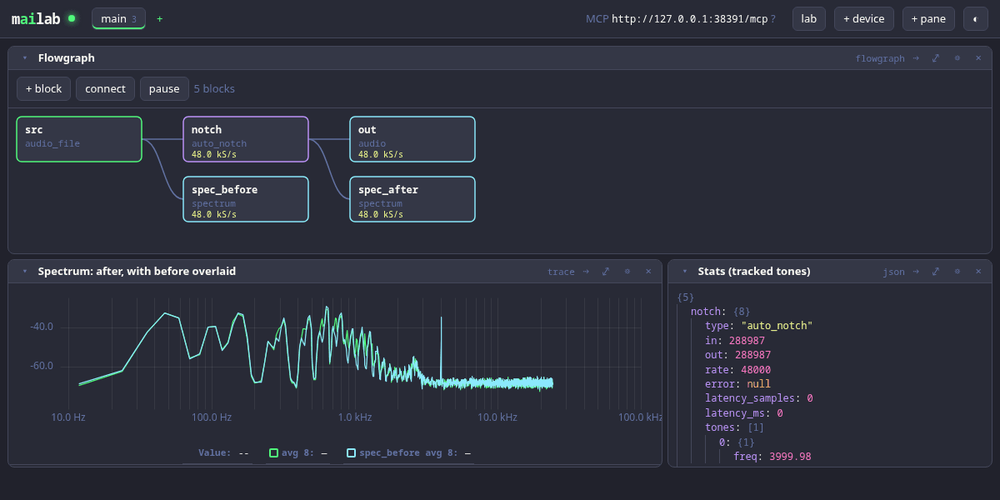

<!-- generated by bin/block-docs.js from the block catalog, about.md and example.json: edit those and run `yarn block-docs` -->

# `auto_notch`

**dsp** · Audio processing · [all blocks](../README.md)

> auto-tracking notch: finds the strongest stationary tones (long-term spectrum, min_snr_db above the floor, stable persist_s) and notches them, retuning as they drift; or notches the fixed `freqs` list

Finds and removes stationary tones automatically: it keeps a long-term spectrum (`resolution`, `average_s`),
picks up to `tones` peaks that stand `min_snr_db` above the floor for `persist_s`, and notches them, retuning as they
drift. Whistles, heterodynes on AM/SSB, coil whine. Give `freqs` to notch fixed frequencies instead. The tracked tones
are in the block's stats.

The example plays a generated test recording (`$MEDIA/demo.wav`: a buzzy voice-like signal with 50 Hz hum, a 4 kHz whistle, hiss and clicks); with a microphone, swap `src` for `audio_in` {stream: "browser_mic"}.

## Parameters

| name | default | description |
|---|---|---|
| `bypass` | `false` | pass the input through (same delay; live A/B) |
| `tones` | `1` | max tones removed |
| `freqs` | `[]` | fixed tone list Hz (disables tracking) |
| `fmin` | `80` | search range Hz |
| `fmax` | `8000` | search range upper edge Hz |
| `width` | `4` | notch width Hz |
| `min_snr_db` | `15` | peak above the median floor |
| `persist_s` | `0.5` | a tone must last this long |
| `hold_s` | `2` | keep a notch this long after the tone fades |
| `retune_hz` | `0.5` | retune when it drifts more |
| `resolution` | `2` | analysis resolution Hz |
| `average_s` | `1` | spectrum averaging time |

## Inputs and outputs

- **Input:** real audio (complex: real part)
- **Output:** real audio, same rate

## Example

The 4 kHz whistle found and notched automatically; the stats show the tracked tone.



`$MEDIA` is your media directory (`DATA_DIR/media` or one of `MAILAB_MEDIA_DIRS`); the screenshot and tests use generated files (`demo.wav`: see `makeMedia` in `src/utils/block-docs`).

Ask the AI:

> There's a whistle in the audio, find it and notch it out automatically.

Graph ([example.json](example.json)):

```json
{
  "blocks": [
    {"id": "notch", "type": "auto_notch", "params": {"tones": 1, "fmin": 200, "fmax": 6000}},
    {"id": "src", "type": "audio_file", "params": {"path": "$MEDIA/demo.wav", "rate": 48000}},
    {"id": "out", "type": "audio", "params": {"rate": 48000}},
    {"id": "spec_before", "type": "spectrum", "params": {"fft": 4096, "traces": ["avg"], "average": 8, "fps": 4}},
    {"id": "spec_after", "type": "spectrum", "params": {"fft": 4096, "traces": ["avg"], "average": 8, "fps": 4, "overlay": ["spec_before"]}}
  ],
  "links": [["src", "notch"], ["notch", "out"], ["src", "spec_before"], ["notch", "spec_after"]]
}
```

MCP calls:

```
device_add {"id": "fg", "driver": "flowgraph"}
device_command {"id": "fg", "command": "set_graph", "args": {"graph": <the graph above>}}
pane_add {"type": "flowgraph", "title": "Flowgraph", "config": {"device": "fg"}}
pane_add {"type": "trace", "title": "Spectrum: after, with before overlaid", "config": {"traces": ["fg_spec_after"], "logX": true}}
pane_add {"type": "json", "title": "Stats (tracked tones)", "config": {"value": "fg_stats", "depth": 4}}
```

## Related

- [`hum_notch`](../hum_notch/README.md): 50/60 Hz mains hum and harmonics remover
- [`biquad`](../biquad/README.md): RBJ biquad: low/high/band-pass, notch, peaking, shelves
- [`am_demod`](../am_demod/README.md): AM / USB / LSB demodulator to audio
