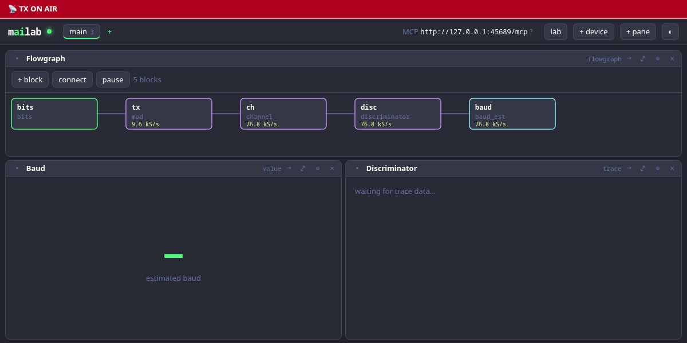

<!-- generated by bin/block-docs.js from the block catalog, about.md and example.json: edit those and run `yarn block-docs` -->

# `baud_est`

**sink** · Digital: bits, framing, BER, UART, protocol decode · [all blocks](../README.md)

> estimate the symbol rate of a 2-level FSK signal from level crossings: value &lt;device&gt;_&lt;id&gt; with the baud estimate

Baud estimation from the mid-level crossings of a demodulated or sliced stream. Feed it the output of a
`discriminator` (complex IQ in) or a sliced/NRZ bit stream (real values in): it measures the mean interval
between crossings, expects each crossing pair to span two symbol periods, and publishes the estimated baud
to `value <device>_<id>` a few times per second (`fps`). Handy when the air rate of an unknown FSK signal
has to be found before `clock_recovery` / `uart_rx` can be configured — or to confirm a drifted crystal.
Constant input (dead carrier) publishes no estimate.

## Parameters

| name | default | description |
|---|---|---|
| `fps` | `2` | value updates per second |
| `window` | `262144` | samples kept for the estimate |

## Inputs and outputs

- **Input:** real discriminated FSK / FM or complex IQ
- **Output:** value &lt;device&gt;_&lt;id&gt; (baud, rate)

## Example

A GFSK link at 9.6 kbaud through a channel: the discriminator output feeds a baud estimator that recovers the 9600 baud symbol rate live, shown as a number.



Ask the AI:

> Estimate the baud rate of a GFSK signal.

Graph ([example.json](example.json)):

```json
{
  "blocks": [
    {"id": "bits", "type": "bits", "params": {"pattern": "prbs9", "bitrate": 9600}},
    {"id": "tx", "type": "mod", "params": {"scheme": "gfsk", "sps": 8}},
    {"id": "ch", "type": "channel", "params": {"snr_db": 16}},
    {"id": "disc", "type": "discriminator", "params": {"sps": 8, "h": 0.5}},
    {"id": "baud", "type": "baud_est", "params": {"fps": 4}}
  ],
  "links": [["bits", "tx"], ["tx", "ch"], ["ch", "disc"], ["disc", "baud"]]
}
```

MCP calls:

```
device_add {"id": "fg", "driver": "flowgraph"}
device_command {"id": "fg", "command": "set_graph", "args": {"graph": <the graph above>}}
pane_add {"type": "flowgraph", "title": "Flowgraph", "config": {"device": "fg"}}
pane_add {"type": "value", "title": "Baud", "config": {"channel": "fg_baud", "label": "estimated baud"}}
pane_add {"type": "trace", "title": "Discriminator", "config": {"traces": ["fg_disc"]}}
```

## Related

- [`bits`](../bits/README.md): PRBS or pattern bit source, optionally framed
- [`discriminator`](../discriminator/README.md): FSK / FM discriminator, symbols as ±1
- [`clock_recovery`](../clock_recovery/README.md): Gardner timing recovery for FSK / OOK / real symbols
- [`uart_rx`](../uart_rx/README.md): UART receiver: line levels or bits to text
