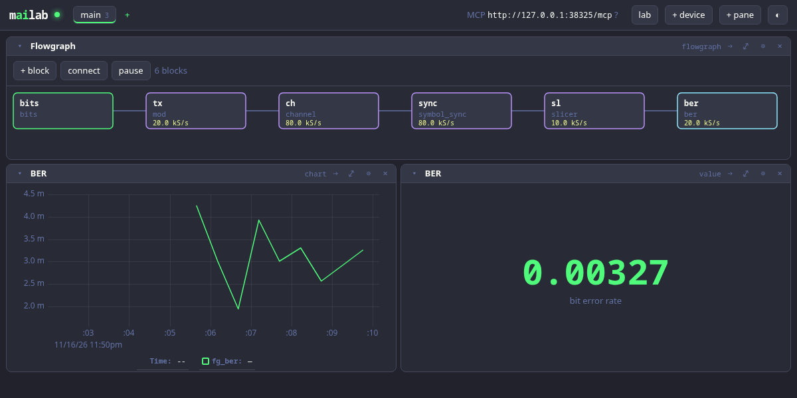

<!-- generated by bin/block-docs.js from the block catalog, about.md and example.json: edit those and run `yarn block-docs` -->

# `ber`

**sink** · Digital: bits, framing, BER, UART, protocol decode · [all blocks](../README.md)

> bit error rate against a PRBS (self-synchronizing, no alignment) -&gt; channels &lt;device&gt;_&lt;id&gt; (BER) and _errors

Bit error rate meter against a PRBS of order `prbs` (the transmitter's `bits` pattern). It synchronizes itself
from the received bits, so no alignment, delay or framing is needed, and publishes the BER per `window` bits plus a
running error count. Use it to compare receivers, tune loop bandwidths or sweep `channel` SNR (`set_param`) for a
waterfall curve. Phase ambiguities (a slicer locked 180 degrees off) show up as BER 0.5.

## Parameters

| name | default | description |
|---|---|---|
| `prbs` | `9` | PRBS order sent by the transmitter |
| `window` | `100000` | bits per BER estimate |
| `fps` | `2` | channel updates per second |

## Inputs and outputs

- **Input:** bits (0/1) carrying the PRBS
- **Output:** channels &lt;device&gt;_&lt;id&gt; (BER) and &lt;device&gt;_&lt;id&gt;_errors

## Example

A QPSK link through a channel at 0 dB SNR over the whole 80 kHz sample bandwidth (about 9 dB Es/N0 in the signal band after the matched filter): BER per 20 000 bits, as a chart and a number.



Ask the AI:

> Measure the bit error rate of a QPSK link at 0 dB SNR.

Graph ([example.json](example.json)):

```json
{
  "blocks": [
    {"id": "bits", "type": "bits", "params": {"pattern": "prbs9", "bitrate": 20000}},
    {"id": "tx", "type": "mod", "params": {"scheme": "qpsk", "sps": 8}},
    {"id": "ch", "type": "channel", "params": {"snr_db": 0}},
    {"id": "sync", "type": "symbol_sync", "params": {"sps": 8}},
    {"id": "sl", "type": "slicer", "params": {"scheme": "qpsk"}},
    {"id": "ber", "type": "ber", "params": {"prbs": 9, "window": 20000}}
  ],
  "links": [["bits", "tx"], ["tx", "ch"], ["ch", "sync"], ["sync", "sl"], ["sl", "ber"]]
}
```

MCP calls:

```
device_add {"id": "fg", "driver": "flowgraph"}
device_command {"id": "fg", "command": "set_graph", "args": {"graph": <the graph above>}}
pane_add {"type": "flowgraph", "title": "Flowgraph", "config": {"device": "fg"}}
pane_add {"type": "chart", "title": "BER", "config": {"channels": ["fg_ber"], "seconds": 8}}
pane_add {"type": "value", "title": "BER", "config": {"channel": "fg_ber", "precision": 5, "label": "bit error rate"}}
```

## Related

- [`bits`](../bits/README.md): PRBS or pattern bit source, optionally framed
- [`slicer`](../slicer/README.md): symbols to bits (linear schemes or 2/4-level real), with EVM
- [`channel`](../channel/README.md): AWGN, carrier offset, phase and gain between TX and RX
