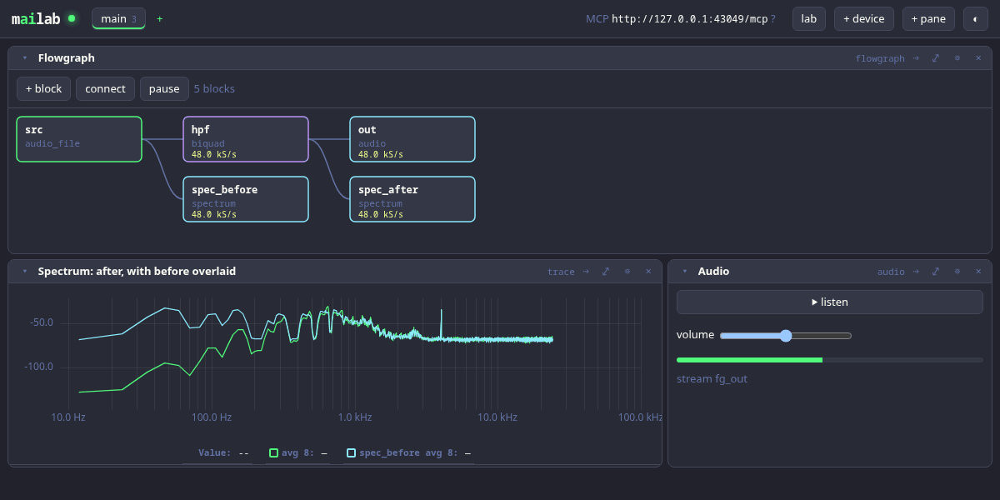

<!-- generated by bin/block-docs.js from the block catalog, about.md and example.json: edit those and run `yarn block-docs` -->

# `biquad`

**dsp** · Audio processing · [all blocks](../README.md)

> RBJ cookbook biquad: lowpass highpass bandpass notch peaking lowshelf highshelf allpass; `stages` identical sections in cascade (steeper). IIR: no added latency

Second-order IIR filter from the RBJ cookbook: lowpass, highpass, bandpass, notch, peaking EQ, low/high shelf,
allpass, with `stages` identical sections in cascade for a steeper slope. No added latency, and `freq`, `q` and
`gain_db` change live through `set_param` while audio plays. The everyday audio filter: an 80 Hz high-pass in front of
voice processing, a 3.4 kHz low-pass after a demodulator, a presence peak.

The example plays a generated test recording (`$MEDIA/demo.wav`: a buzzy voice-like signal with 50 Hz hum, a 4 kHz whistle, hiss and clicks); with a microphone, swap `src` for `audio_in` {stream: "browser_mic"}.

## Parameters

| name | default | description |
|---|---|---|
| `bypass` | `false` | pass the input through (same delay; live A/B) |
| `type` | `"lowpass"` | lowpass\|highpass\|bandpass\|notch\|peaking\|lowshelf\|highshelf\|allpass |
| `freq` | `1000` | Hz (corner / center) |
| `q` | `0.7071` | Q (notch/bandpass: f0 / bandwidth) |
| `gain_db` | `0` | peaking / shelf gain |
| `stages` | `1` | cascaded sections |

## Inputs and outputs

- **Input:** real audio (complex: real part)
- **Output:** real audio, same rate

## Example

A 300 Hz high-pass (2 stages, 24 dB/octave) on the test recording: the hum and low buzz harmonics are gone.



`$MEDIA` is your media directory (`DATA_DIR/media` or one of `MAILAB_MEDIA_DIRS`); the screenshot and tests use generated files (`demo.wav`: see `makeMedia` in `src/utils/block-docs`).

Ask the AI:

> High-pass the audio at 300 Hz, steep, and show me the spectrum before and after.

Graph ([example.json](example.json)):

```json
{
  "blocks": [
    {"id": "src", "type": "audio_file", "params": {"path": "$MEDIA/demo.wav", "rate": 48000}},
    {"id": "hpf", "type": "biquad", "params": {"type": "highpass", "freq": 300, "stages": 2}},
    {"id": "out", "type": "audio", "params": {"rate": 48000}},
    {"id": "spec_before", "type": "spectrum", "params": {"fft": 4096, "traces": ["avg"], "average": 8, "fps": 4}},
    {"id": "spec_after", "type": "spectrum", "params": {"fft": 4096, "traces": ["avg"], "average": 8, "fps": 4, "overlay": ["spec_before"]}}
  ],
  "links": [["src", "hpf"], ["hpf", "out"], ["src", "spec_before"], ["hpf", "spec_after"]]
}
```

MCP calls:

```
device_add {"id": "fg", "driver": "flowgraph"}
device_command {"id": "fg", "command": "set_graph", "args": {"graph": <the graph above>}}
pane_add {"type": "flowgraph", "title": "Flowgraph", "config": {"device": "fg"}}
pane_add {"type": "trace", "title": "Spectrum: after, with before overlaid", "config": {"traces": ["fg_spec_after"], "logX": true}}
pane_add {"type": "audio", "title": "Audio", "config": {"stream": "fg_out"}}
```

## Related

- [`fir_filter`](../fir_filter/README.md): linear-phase FIR low/high/band-pass, band-stop
- [`hum_notch`](../hum_notch/README.md): 50/60 Hz mains hum and harmonics remover
- [`dc_block`](../dc_block/README.md): removes DC offset
- [`lowpass`](../lowpass/README.md): Kaiser FIR low-pass / channel filter
