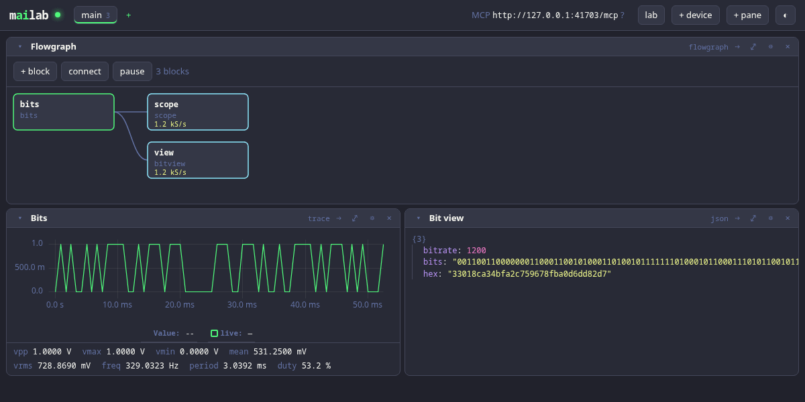

<!-- generated by bin/block-docs.js from the block catalog, about.md and example.json: edit those and run `yarn block-docs` -->

# `bits`

**source** · Digital: bits, framing, BER, UART, protocol decode · [all blocks](../README.md)

> bits at `bitrate`: prbs7/9/15/23/31, or a repeated pattern (hex:… text:… bits:…), optionally behind a sync word

A bit source at `bitrate`: a PRBS (prbs7, 9, 15, 23, 31: what `ber` checks against), or a repeated pattern given
as `hex:...`, `text:...` or `bits:...`, optionally sent behind a `preamble` and `sync` word (framed mode, for `framer`).
It is the start of every digital link test: `bits -> mod -> channel -> ... -> slicer -> ber`.

## Parameters

| name | default | description |
|---|---|---|
| `pattern` | `"prbs9"` | prbsN \| hex:… \| text:… \| bits:… |
| `bitrate` | `9600` | bits per second |
| `sync` | `""` | hex sync word sent before each pattern period (framed mode) |
| `preamble` | `""` | hex preamble before the sync word |

## Inputs and outputs

- **Input:** none (source)
- **Output:** bits (0/1 values) at `bitrate`

## Example

A PRBS9 bit stream at 1200 bit/s: the bits on a scope and in a bit view.



Ask the AI:

> Make a PRBS9 bit stream and show me the bits.

Graph ([example.json](example.json)):

```json
{
  "blocks": [
    {"id": "bits", "type": "bits", "params": {"pattern": "prbs9", "bitrate": 1200}},
    {"id": "scope", "type": "scope", "params": {"samples": 64, "trigger": "none", "measure": ["mean"]}},
    {"id": "view", "type": "bitview", "params": {"bits": 128}}
  ],
  "links": [["bits", "scope"], ["bits", "view"]]
}
```

MCP calls:

```
device_add {"id": "fg", "driver": "flowgraph"}
device_command {"id": "fg", "command": "set_graph", "args": {"graph": <the graph above>}}
pane_add {"type": "flowgraph", "title": "Flowgraph", "config": {"device": "fg"}}
pane_add {"type": "trace", "title": "Bits", "config": {"traces": ["fg_scope"]}}
pane_add {"type": "json", "title": "Bit view", "config": {"value": "fg_view"}}
```

## Related

- [`mod`](../mod/README.md): bits to IQ: PSK, QAM, APSK, OOK, FSK, MSK, GFSK, GMSK...
- [`ber`](../ber/README.md): bit error rate against a PRBS, self-synchronizing
- [`framer`](../framer/README.md): finds a sync word and cuts frames from bits
- [`bitview`](../bitview/README.md): shows the last bits of a stream as binary and hex
