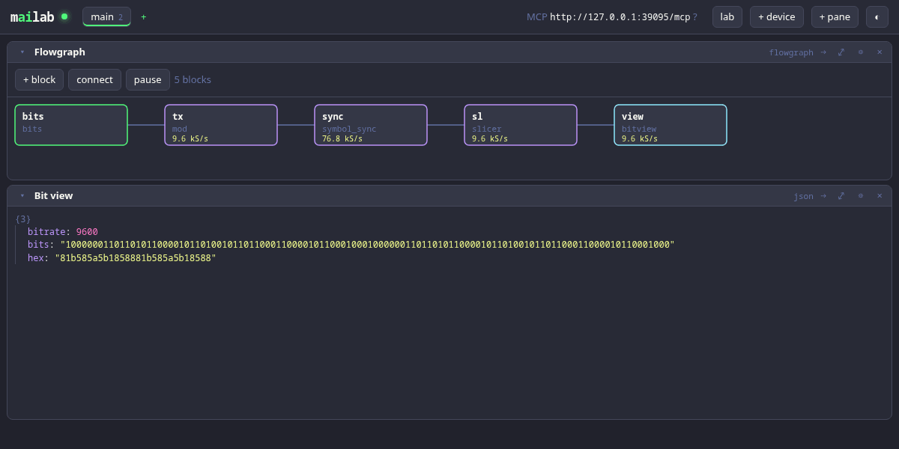

<!-- generated by bin/block-docs.js from the block catalog, about.md and example.json: edit those and run `yarn block-docs` -->

# `bitview`

**sink** · Digital: bits, framing, BER, UART, protocol decode · [all blocks](../README.md)

> show a bit stream: value &lt;device&gt;_&lt;id&gt; with the last bits (binary + hex) and a running blob

Shows the last `bits` bits of a stream as binary and hex in a value (and keeps the whole stream as a blob). The
first thing to look at after a `slicer` on an unknown signal: preambles (`0101...` / `aa`), sync words and repeating
structure stand out before you configure a `framer` or a decoder.

## Parameters

| name | default | description |
|---|---|---|
| `bits` | `256` | bits shown |
| `fps` | `4` | value updates per second |

## Inputs and outputs

- **Input:** bits (0/1)
- **Output:** value &lt;device&gt;_&lt;id&gt; (bitrate, bits, hex), blob &lt;device&gt;_&lt;id&gt;

## Example

The text "mailab " sent as BPSK and recovered: the received bits and their hex (`6d61696c616220` = "mailab ").



Ask the AI:

> Show me the raw bits the BPSK receiver produces.

Graph ([example.json](example.json)):

```json
{
  "blocks": [
    {"id": "bits", "type": "bits", "params": {"pattern": "text:mailab ", "bitrate": 9600}},
    {"id": "tx", "type": "mod", "params": {"scheme": "bpsk", "sps": 8}},
    {"id": "sync", "type": "symbol_sync", "params": {"sps": 8}},
    {"id": "sl", "type": "slicer", "params": {"scheme": "bpsk"}},
    {"id": "view", "type": "bitview", "params": {"bits": 112}}
  ],
  "links": [["bits", "tx"], ["tx", "sync"], ["sync", "sl"], ["sl", "view"]]
}
```

MCP calls:

```
device_add {"id": "fg", "driver": "flowgraph"}
device_command {"id": "fg", "command": "set_graph", "args": {"graph": <the graph above>}}
pane_add {"type": "flowgraph", "title": "Flowgraph", "config": {"device": "fg"}}
pane_add {"type": "json", "title": "Bit view", "config": {"value": "fg_view"}}
```

## Related

- [`bits`](../bits/README.md): PRBS or pattern bit source, optionally framed
- [`slicer`](../slicer/README.md): symbols to bits (linear schemes or 2/4-level real), with EVM
- [`framer`](../framer/README.md): finds a sync word and cuts frames from bits
- [`uart_rx`](../uart_rx/README.md): UART receiver: line levels or bits to text
