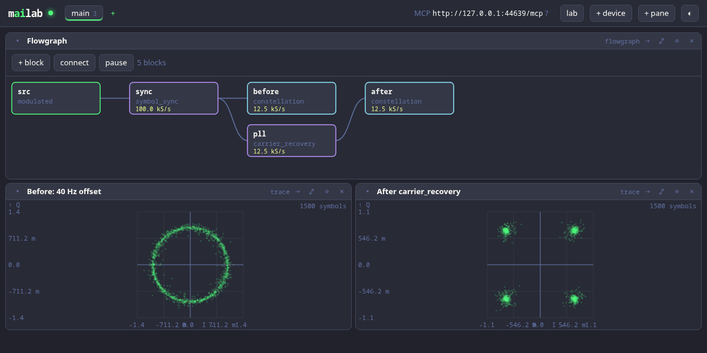

<!-- generated by bin/block-docs.js from the block catalog, about.md and example.json: edit those and run `yarn block-docs` -->

# `carrier_recovery`

**dsp** · Modulation, demodulation and sync · [all blocks](../README.md)

> decision-directed PLL on symbols (removes carrier offset / phase)

Decision-directed carrier PLL on symbols: removes a residual carrier frequency offset and phase by rotating each
symbol toward the nearest point of `scheme`'s constellation. It works one sample per symbol, so it goes after
`symbol_sync`; `bandwidth` trades lock range and speed against jitter. Like any decision-directed loop it has the
constellation's phase ambiguity (90 degrees for QPSK), so use differential schemes or a sync word when the absolute
phase matters.

## Parameters

| name | default | description |
|---|---|---|
| `scheme` | `"qpsk"` | constellation the decisions are made against (bpsk\|qpsk\|psk8\|qam16...) |
| `bandwidth` | `0.02` | loop bandwidth |

## Inputs and outputs

- **Input:** complex symbols (one sample per symbol)
- **Output:** phase/frequency-corrected complex symbols

## Example

QPSK with a 40 Hz carrier offset: the symbols spin around a ring before the PLL and sit on four points after it.



Ask the AI:

> There's a carrier offset on the QPSK signal, lock a carrier recovery loop onto it and show the constellation before and after.

Graph ([example.json](example.json)):

```json
{
  "blocks": [
    {"id": "src", "type": "modulated", "params": {"scheme": "qpsk", "sps": 8, "snr_db": 25, "cfo": 40}},
    {"id": "sync", "type": "symbol_sync", "params": {"sps": 8}},
    {"id": "before", "type": "constellation", "params": {"points": 1500}},
    {"id": "pll", "type": "carrier_recovery", "params": {"scheme": "qpsk", "bandwidth": 0.02}},
    {"id": "after", "type": "constellation", "params": {"points": 1500}}
  ],
  "links": [["src", "sync"], ["sync", "before"], ["sync", "pll"], ["pll", "after"]]
}
```

MCP calls:

```
device_add {"id": "fg", "driver": "flowgraph"}
device_command {"id": "fg", "command": "set_graph", "args": {"graph": <the graph above>}}
pane_add {"type": "flowgraph", "title": "Flowgraph", "config": {"device": "fg"}}
pane_add {"type": "trace", "title": "Before: 40 Hz offset", "config": {"traces": ["fg_before"]}}
pane_add {"type": "trace", "title": "After carrier_recovery", "config": {"traces": ["fg_after"]}}
```

## Related

- [`symbol_sync`](../symbol_sync/README.md): symbol timing recovery, one sample per symbol out
- [`channel`](../channel/README.md): AWGN, carrier offset, phase and gain between TX and RX
- [`slicer`](../slicer/README.md): symbols to bits (linear schemes or 2/4-level real), with EVM
- [`demod`](../demod/README.md): symbol decisions and EVM for a linear scheme
