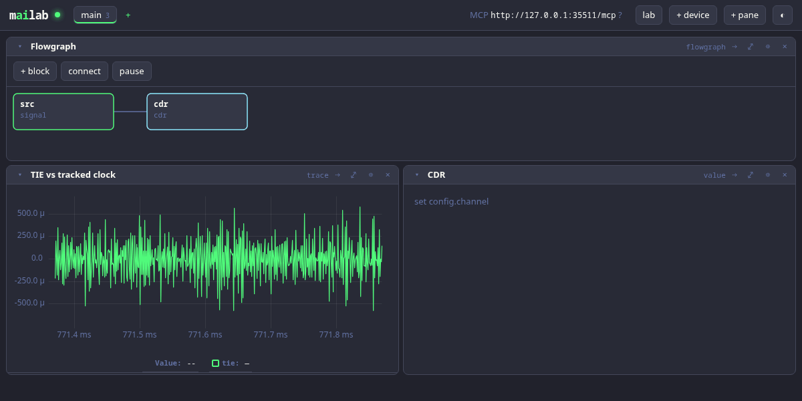

<!-- generated by bin/block-docs.js from the block catalog, about.md and example.json: edit those and run `yarn block-docs` -->

# `cdr`

**sink** · Filters and DSP · [all blocks](../README.md)

> second-order PLL tracking the threshold crossings (CDR): recovers the line rate and measures TIE against the tracked clock -&gt; trace &lt;device&gt;_&lt;id&gt; (TIE UI), channels &lt;device&gt;_&lt;id&gt;_freq (Hz) and &lt;device&gt;_&lt;id&gt;_locked (0/1), value summary. Kp/Ki are per-edge gains; the period is clamped to +/-5 % of nominal so loss of lock resyncs instead of runaway.

`cdr` tracks the threshold crossings of a clock or line code with a
second-order PLL (proportional `kp` + integral `ki` gain per edge) — the
libscopehal CDCDR / ClockPLL concept. It recovers the actual line rate
near the nominal `bitrate` and measures TIE against the *tracked* clock,
so slow frequency drift does not leak into the jitter number. The period is
clamped to ±5 % of nominal: when the edges can no longer be folded into
that window the PLL declares loss of lock and resyncs rather than running
away. Output: trace `<device>_<id>` (TIE in UI), channels
`<device>_<id>_freq` (Hz) and `<device>_<id>_locked` (0/1), plus a value
summary. Use `tie_jitter` for a rate you trust, `cdr` for a rate that
drifts.

## Parameters

| name | default | description |
|---|---|---|
| `bitrate` | `1000000` | nominal line rate Hz |
| `kp` | `0.3` | phase gain per edge |
| `ki` | `0.1` | frequency gain per edge |
| `keep` | `1000` | TIE points kept |
| `fps` | `5` | updates/s |

## Inputs and outputs

- **Input:** real waveform carrying a clock or line code near `bitrate`
- **Output:** trace &lt;device&gt;_&lt;id&gt; (TIE vs tracked clock, UI), channels &lt;device&gt;_&lt;id&gt;_freq / _locked, value &lt;device&gt;_&lt;id&gt;

## Example

CDR on a clean 1 MHz clock: the PLL tracks the crossings, reports ~1 MHz on the freq channel and locks.



Ask the AI:

> Recover the clock with the CDR PLL and show the tracked frequency and lock state.

Graph ([example.json](example.json)):

```json
{
  "blocks": [
    {"id": "src", "type": "signal", "params": {"rate": 16000000, "freq": 1000000, "amp": 1, "noise": 0.001}},
    {"id": "cdr", "type": "cdr", "params": {"bitrate": 1000000, "keep": 500}}
  ],
  "links": [["src", "cdr"]]
}
```

MCP calls:

```
device_add {"id": "fg", "driver": "flowgraph"}
device_command {"id": "fg", "command": "set_graph", "args": {"graph": <the graph above>}}
pane_add {"type": "flowgraph", "title": "Flowgraph", "config": {"device": "fg"}}
pane_add {"type": "trace", "title": "TIE vs tracked clock", "config": {"traces": ["fg_cdr"]}}
pane_add {"type": "value", "title": "CDR", "config": {"values": ["fg_cdr"]}}
```

## Related

- [`tie_jitter`](../tie_jitter/README.md): TIE / jitter measurement against an ideal UI grid
- [`eye_mask`](../eye_mask/README.md): eye diagram with a keep-out mask and hit statistics
- [`baud_est`](../baud_est/README.md): estimate the symbol rate of an FSK/OOK stream from its zero crossings
- [`clock_recovery`](../clock_recovery/README.md): Gardner timing recovery for FSK / OOK / real symbols
