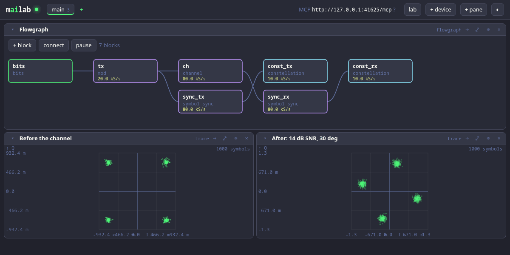

<!-- generated by bin/block-docs.js from the block catalog, about.md and example.json: edit those and run `yarn block-docs` -->

# `channel`

**dsp** · Channel and impairments · [all blocks](../README.md)

> test channel: AWGN at snr_db (relative to signal power), carrier offset, phase, gain

A test channel between a transmitter and a receiver: AWGN at `snr_db` relative to the measured signal power, a
carrier frequency offset `cfo`, a fixed `phase` rotation and a linear `gain`. Put it after `mod` (or `analog_mod`) to see
how a receiver copes: sweep `snr_db` with `set_param` while watching a `ber` meter or the EVM from `slicer`, add a few
hundred Hz of `cfo` to exercise `carrier_recovery`. Real input becomes complex.

## Parameters

| name | default | description |
|---|---|---|
| `snr_db` | `20` | AWGN SNR in dB (relative to the signal power) |
| `cfo` | `0` | carrier frequency offset Hz |
| `phase` | `0` | degrees |
| `gain` | `1` | linear gain |

## Inputs and outputs

- **Input:** complex IQ (real input becomes complex)
- **Output:** complex IQ, same rate

## Example

The same QPSK signal before and after a channel with 14 dB SNR and a 30 degree phase rotation, both after symbol timing recovery.



Ask the AI:

> Put a channel with 14 dB SNR and 30 degrees of phase rotation after a QPSK modulator and compare the constellations before and after.

Graph ([example.json](example.json)):

```json
{
  "blocks": [
    {"id": "bits", "type": "bits", "params": {"pattern": "prbs9", "bitrate": 20000}},
    {"id": "tx", "type": "mod", "params": {"scheme": "qpsk", "sps": 8}},
    {"id": "ch", "type": "channel", "params": {"snr_db": 14, "phase": 30}},
    {"id": "sync_tx", "type": "symbol_sync", "params": {"sps": 8}},
    {"id": "const_tx", "type": "constellation", "params": {"points": 1000}},
    {"id": "sync_rx", "type": "symbol_sync", "params": {"sps": 8}},
    {"id": "const_rx", "type": "constellation", "params": {"points": 1000}}
  ],
  "links": [["bits", "tx"], ["tx", "ch"], ["tx", "sync_tx"], ["sync_tx", "const_tx"], ["ch", "sync_rx"], ["sync_rx", "const_rx"]]
}
```

MCP calls:

```
device_add {"id": "fg", "driver": "flowgraph"}
device_command {"id": "fg", "command": "set_graph", "args": {"graph": <the graph above>}}
pane_add {"type": "flowgraph", "title": "Flowgraph", "config": {"device": "fg"}}
pane_add {"type": "trace", "title": "Before the channel", "config": {"traces": ["fg_const_tx"]}}
pane_add {"type": "trace", "title": "After: 14 dB SNR, 30 deg", "config": {"traces": ["fg_const_rx"]}}
```

## Related

- [`modulated`](../modulated/README.md): ready-made RRC-shaped digital test signal (PSK/QAM/APSK) with noise and offsets
- [`symbol_sync`](../symbol_sync/README.md): symbol timing recovery, one sample per symbol out
- [`carrier_recovery`](../carrier_recovery/README.md): decision-directed PLL removing carrier offset and phase
- [`ber`](../ber/README.md): bit error rate against a PRBS, self-synchronizing
