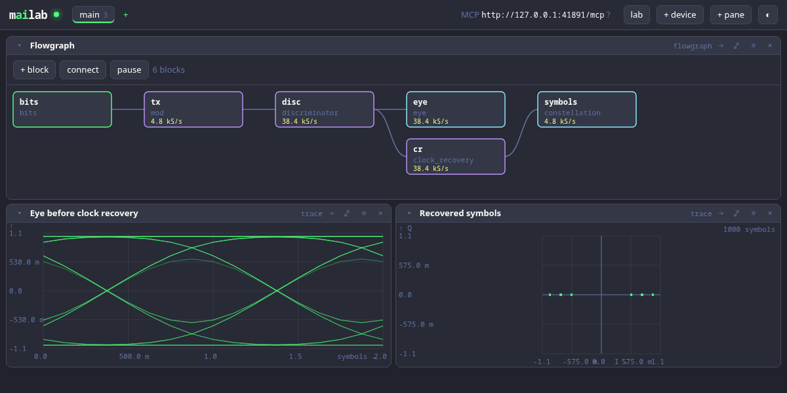

<!-- generated by bin/block-docs.js from the block catalog, about.md and example.json: edit those and run `yarn block-docs` -->

# `clock_recovery`

**dsp** · Modulation, demodulation and sync · [all blocks](../README.md)

> Gardner timing recovery for real or complex input (FSK after discriminator, OOK magnitude): one sample per symbol out

Gardner timing recovery for real or complex input: takes `sps` samples per symbol and outputs one sample per
symbol at the eye's center. It is the timing loop for FSK after `discriminator` and for OOK/ASK after `mag`
(with `dc_block` on), and it also works after a `matched_filter` on linear schemes. Follow with `slicer`.

## Parameters

| name | default | description |
|---|---|---|
| `sps` | `8` | samples per symbol |
| `bandwidth` | `0.005` | loop gain |
| `dc_block` | `false` | remove the mean first (OOK) |

## Inputs and outputs

- **Input:** real or complex at `sps` samples per symbol
- **Output:** one sample per symbol (rate / sps)

## Example

GFSK after the discriminator: the eye at 8 samples per symbol, and the clock-recovered symbols collapsing onto ±1 (plotted on the I axis).



Ask the AI:

> Recover the symbol clock on the GFSK signal and show me the recovered symbols.

Graph ([example.json](example.json)):

```json
{
  "blocks": [
    {"id": "bits", "type": "bits", "params": {"pattern": "prbs9", "bitrate": 4800}},
    {"id": "tx", "type": "mod", "params": {"scheme": "gfsk", "sps": 8}},
    {"id": "disc", "type": "discriminator", "params": {"sps": 8, "h": 0.5}},
    {"id": "eye", "type": "eye", "params": {"sps": 8, "traces": 64}},
    {"id": "cr", "type": "clock_recovery", "params": {"sps": 8, "bandwidth": 0.005}},
    {"id": "symbols", "type": "constellation", "params": {"points": 1000}}
  ],
  "links": [["bits", "tx"], ["tx", "disc"], ["disc", "eye"], ["disc", "cr"], ["cr", "symbols"]]
}
```

MCP calls:

```
device_add {"id": "fg", "driver": "flowgraph"}
device_command {"id": "fg", "command": "set_graph", "args": {"graph": <the graph above>}}
pane_add {"type": "flowgraph", "title": "Flowgraph", "config": {"device": "fg"}}
pane_add {"type": "trace", "title": "Eye before clock recovery", "config": {"traces": ["fg_eye"]}}
pane_add {"type": "trace", "title": "Recovered symbols", "config": {"traces": ["fg_symbols"]}}
```

## Related

- [`discriminator`](../discriminator/README.md): FSK / FM discriminator, symbols as ±1
- [`slicer`](../slicer/README.md): symbols to bits (linear schemes or 2/4-level real), with EVM
- [`mag`](../mag/README.md): magnitude |x|: envelope detector
- [`matched_filter`](../matched_filter/README.md): RRC receive filter matching the transmitter
