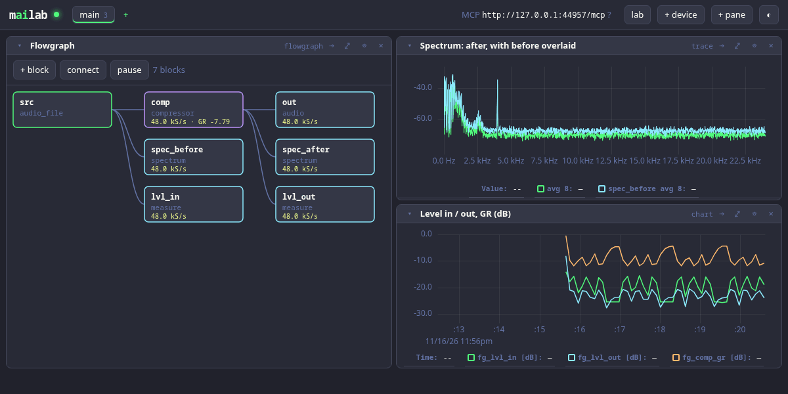

<!-- generated by bin/block-docs.js from the block catalog, about.md and example.json: edit those and run `yarn block-docs` -->

# `compressor`

**dsp** · Audio processing · [all blocks](../README.md)

> dynamics compressor: threshold, ratio, soft knee, attack/release (on gain, dB), makeup, optional lookahead, RMS or peak detector, sidechain HPF; gain reduction -&gt; channel &lt;device&gt;_&lt;id&gt;_gr

Dynamics compressor: above `threshold_db` the level rises only 1/`ratio` dB per input dB, with a soft `knee`,
`attack_ms` / `release_ms` smoothing of the gain, `makeup_db` after it, RMS or peak detection, an optional sidechain
high-pass (so bass doesn't pump the gain) and `lookahead_ms` so the gain leads transients. Evens out speech levels
before a limiter; the gain reduction is a channel. All parameters change live.

The example plays a generated test recording (`$MEDIA/demo.wav`: a buzzy voice-like signal with 50 Hz hum, a 4 kHz whistle, hiss and clicks); with a microphone, swap `src` for `audio_in` {stream: "browser_mic"}.

## Parameters

| name | default | description |
|---|---|---|
| `bypass` | `false` | pass the input through (same delay; live A/B) |
| `threshold_db` | `-24` | dBFS |
| `ratio` | `4` | input dB over threshold per output dB |
| `knee_db` | `6` | soft knee width |
| `attack_ms` | `5` | gain-reduction time constant |
| `release_ms` | `120` | recovery time constant |
| `makeup_db` | `0` | gain added after compression |
| `lookahead_ms` | `0` | delays the audio so the gain leads transients |
| `detector` | `"rms"` | rms\|peak |
| `rms_ms` | `5` | RMS window |
| `sidechain_hpf` | `0` | Hz, high-pass on the detector input (0 = off) |
| `fps` | `10` | gain-reduction channel updates per second |

## Inputs and outputs

- **Input:** real audio (complex: real part)
- **Output:** real audio, same rate; channel &lt;device&gt;_&lt;id&gt;_gr (gain reduction dB)

## Example

4:1 compression above -30 dBFS with 6 dB makeup on the test recording: level in/out and gain reduction.



`$MEDIA` is your media directory (`DATA_DIR/media` or one of `MAILAB_MEDIA_DIRS`); the screenshot and tests use generated files (`demo.wav`: see `makeMedia` in `src/utils/block-docs`).

Ask the AI:

> Compress the audio 4:1 above -30 dB and show me the gain reduction.

Graph ([example.json](example.json)):

```json
{
  "blocks": [
    {"id": "src", "type": "audio_file", "params": {"path": "$MEDIA/demo.wav", "rate": 48000}},
    {"id": "comp", "type": "compressor", "params": {"threshold_db": -30, "ratio": 4, "attack_ms": 5, "release_ms": 120, "makeup_db": 6}},
    {"id": "out", "type": "audio", "params": {"rate": 48000}},
    {"id": "spec_before", "type": "spectrum", "params": {"fft": 4096, "traces": ["avg"], "average": 8, "fps": 4}},
    {"id": "spec_after", "type": "spectrum", "params": {"fft": 4096, "traces": ["avg"], "average": 8, "fps": 4, "overlay": ["spec_before"]}},
    {"id": "lvl_in", "type": "measure", "params": {"stat": "power_db"}},
    {"id": "lvl_out", "type": "measure", "params": {"stat": "power_db"}}
  ],
  "links": [["src", "comp"], ["comp", "out"], ["src", "spec_before"], ["comp", "spec_after"], ["src", "lvl_in"], ["comp", "lvl_out"]]
}
```

MCP calls:

```
device_add {"id": "fg", "driver": "flowgraph"}
device_command {"id": "fg", "command": "set_graph", "args": {"graph": <the graph above>}}
# a ready-made template that uses this block (replaces the graph):
device_command {"id": "fg", "command": "load_template", "args": {"name": "broadcast", "path": "$MEDIA/demo.wav"}}
pane_add {"type": "flowgraph", "title": "Flowgraph", "config": {"device": "fg"}}
pane_add {"type": "trace", "title": "Spectrum: after, with before overlaid", "config": {"traces": ["fg_spec_after"]}}
pane_add {"type": "chart", "title": "Level in / out, GR (dB)", "config": {"channels": ["fg_lvl_in", "fg_lvl_out", "fg_comp_gr"], "seconds": 8}}
```

## Related

- [`limiter`](../limiter/README.md): brickwall lookahead limiter
- [`gate`](../gate/README.md): noise gate / downward expander
- [`audio_agc`](../audio_agc/README.md): audio level AGC to a target dBFS
