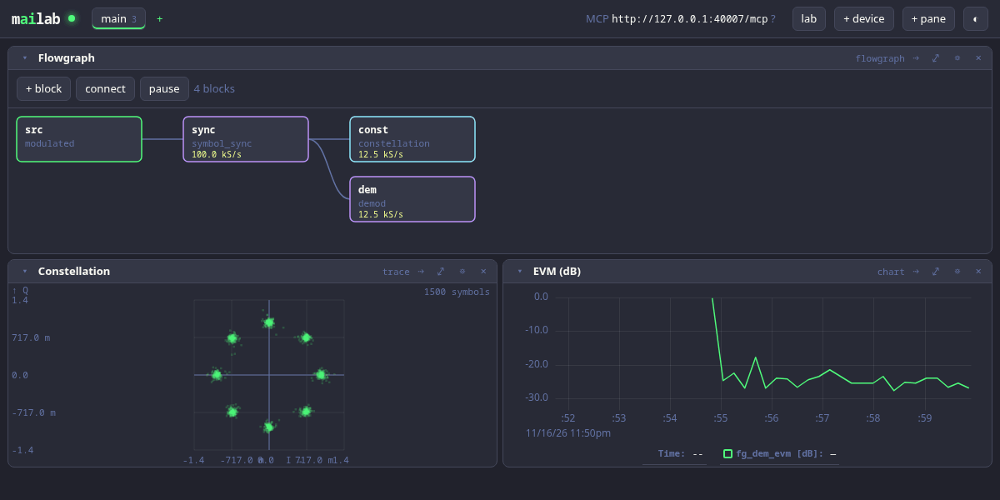

<!-- generated by bin/block-docs.js from the block catalog, about.md and example.json: edit those and run `yarn block-docs` -->

# `constellation`

**sink** · Sinks and views · [all blocks](../README.md)

> I/Q scatter -&gt; trace &lt;device&gt;_&lt;id&gt; (mode constellation)

I/Q scatter plot of the last `points` samples (the trace pane draws it in constellation mode). Feed it one sample
per symbol (after `symbol_sync` or `clock_recovery`) to judge a receiver: tight clusters mean good SNR, a ring means a
carrier offset (add `carrier_recovery`), smeared clusters mean timing problems. Fed raw samples it shows the pulse
shape's trajectories.

## Parameters

| name | default | description |
|---|---|---|
| `points` | `2000` | most recent symbols plotted |
| `fps` | `10` | trace updates per second |

## Inputs and outputs

- **Input:** complex symbols
- **Output:** trace &lt;device&gt;_&lt;id&gt; (mode constellation)

## Example

8-PSK at 20 dB SNR after symbol timing recovery, and its EVM.



Ask the AI:

> Show me the constellation of the 8-PSK signal and its EVM.

Graph ([example.json](example.json)):

```json
{
  "blocks": [
    {"id": "src", "type": "modulated", "params": {"scheme": "psk8", "sps": 8, "snr_db": 20}},
    {"id": "sync", "type": "symbol_sync", "params": {"sps": 8}},
    {"id": "const", "type": "constellation", "params": {"points": 1500}},
    {"id": "dem", "type": "demod", "params": {"scheme": "psk8"}}
  ],
  "links": [["src", "sync"], ["sync", "const"], ["sync", "dem"]]
}
```

MCP calls:

```
device_add {"id": "fg", "driver": "flowgraph"}
device_command {"id": "fg", "command": "set_graph", "args": {"graph": <the graph above>}}
pane_add {"type": "flowgraph", "title": "Flowgraph", "config": {"device": "fg"}}
pane_add {"type": "trace", "title": "Constellation", "config": {"traces": ["fg_const"]}}
pane_add {"type": "chart", "title": "EVM (dB)", "config": {"channels": ["fg_dem_evm"], "seconds": 8}}
```

## Related

- [`symbol_sync`](../symbol_sync/README.md): symbol timing recovery, one sample per symbol out
- [`carrier_recovery`](../carrier_recovery/README.md): decision-directed PLL removing carrier offset and phase
- [`demod`](../demod/README.md): symbol decisions and EVM for a linear scheme
- [`eye`](../eye/README.md): eye diagram
