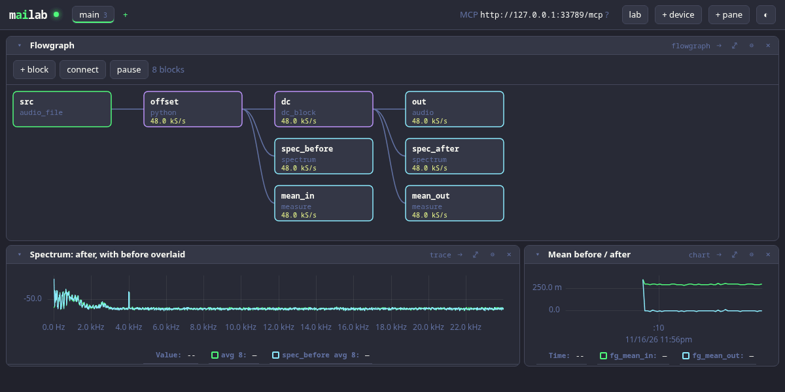

<!-- generated by bin/block-docs.js from the block catalog, about.md and example.json: edit those and run `yarn block-docs` -->

# `dc_block`

**dsp** · Audio processing · [all blocks](../README.md)

> DC blocker (one-pole high-pass)

One-pole DC blocker (high-pass at `cutoff` Hz): removes a DC offset or very slow drift, e.g. after
`am_demod` (the carrier becomes DC) or `fm_demod` (a frequency offset becomes DC), or on a sound card with a biased
input. Put it before dynamics processing, which would otherwise react to the offset.

The example plays a generated test recording (`$MEDIA/demo.wav`: a buzzy voice-like signal with 50 Hz hum, a 4 kHz whistle, hiss and clicks); with a microphone, swap `src` for `audio_in` {stream: "browser_mic"}.

## Parameters

| name | default | description |
|---|---|---|
| `bypass` | `false` | pass the input through (same delay; live A/B) |
| `cutoff` | `10` | Hz |

## Inputs and outputs

- **Input:** real audio (complex: real part)
- **Output:** real audio, same rate

## Example

The test recording with 0.3 of DC added (python block): the mean before and after the DC blocker.



`$MEDIA` is your media directory (`DATA_DIR/media` or one of `MAILAB_MEDIA_DIRS`); the screenshot and tests use generated files (`demo.wav`: see `makeMedia` in `src/utils/block-docs`).

Ask the AI:

> Remove the DC offset from the audio and show me the mean level before and after.

Graph ([example.json](example.json)):

```json
{
  "blocks": [
    {"id": "src", "type": "audio_file", "params": {"path": "$MEDIA/demo.wav", "rate": 48000}},
    {"id": "offset", "type": "python", "params": {"code": "def work(x, rate):\n    return np.real(x) + 0.3"}},
    {"id": "dc", "type": "dc_block", "params": {"cutoff": 10}},
    {"id": "out", "type": "audio", "params": {"rate": 48000}},
    {"id": "spec_before", "type": "spectrum", "params": {"fft": 4096, "traces": ["avg"], "average": 8, "fps": 4}},
    {"id": "spec_after", "type": "spectrum", "params": {"fft": 4096, "traces": ["avg"], "average": 8, "fps": 4, "overlay": ["spec_before"]}},
    {"id": "mean_in", "type": "measure", "params": {"stat": "mean"}},
    {"id": "mean_out", "type": "measure", "params": {"stat": "mean"}}
  ],
  "links": [["src", "offset"], ["offset", "dc"], ["dc", "out"], ["offset", "spec_before"], ["dc", "spec_after"], ["offset", "mean_in"], ["dc", "mean_out"]]
}
```

MCP calls:

```
device_add {"id": "fg", "driver": "flowgraph"}
device_command {"id": "fg", "command": "set_graph", "args": {"graph": <the graph above>}}
pane_add {"type": "flowgraph", "title": "Flowgraph", "config": {"device": "fg"}}
pane_add {"type": "trace", "title": "Spectrum: after, with before overlaid", "config": {"traces": ["fg_spec_after"]}}
pane_add {"type": "chart", "title": "Mean before / after", "config": {"channels": ["fg_mean_in", "fg_mean_out"], "seconds": 8}}
```

## Related

- [`biquad`](../biquad/README.md): RBJ biquad: low/high/band-pass, notch, peaking, shelves
- [`hum_notch`](../hum_notch/README.md): 50/60 Hz mains hum and harmonics remover
- [`am_demod`](../am_demod/README.md): AM / USB / LSB demodulator to audio
