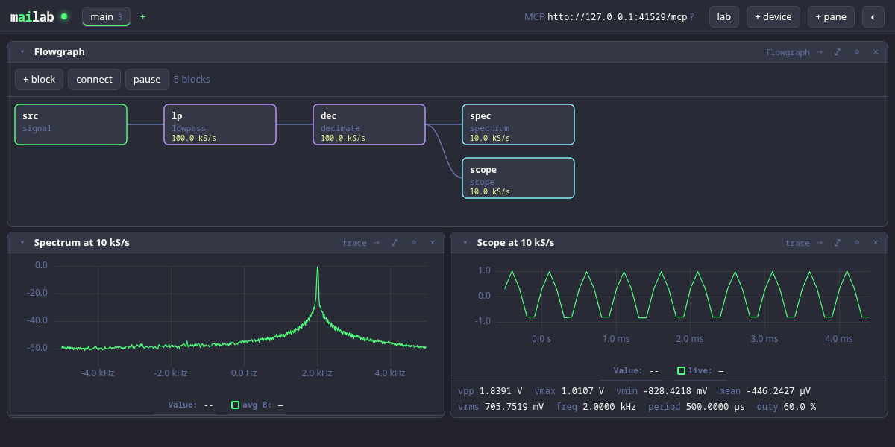

<!-- generated by bin/block-docs.js from the block catalog, about.md and example.json: edit those and run `yarn block-docs` -->

# `decimate`

**dsp** · Filters and DSP · [all blocks](../README.md)

> keep every n-th sample (no filtering; put a lowpass first)

Keeps every `n`-th sample: the output rate is the input rate divided by `n`. It does no filtering, so anything
above the new Nyquist frequency aliases; put a `lowpass` with a cutoff below `rate / (2n)` in front, or use `resample`,
which filters for you and allows any ratio. Cheap and exact for integer ratios.

## Parameters

| name | default | description |
|---|---|---|
| `n` | `10` | decimation factor (output rate = input rate / n) |

## Inputs and outputs

- **Input:** any
- **Output:** same kind at rate / n

## Example

A 2 kHz tone at 100 kS/s, low-passed to 4 kHz and decimated by 10: spectrum and scope at 10 kS/s.



Ask the AI:

> Decimate the signal by 10 (with an anti-alias filter first) and show the result.

Graph ([example.json](example.json)):

```json
{
  "blocks": [
    {"id": "src", "type": "signal", "params": {"rate": 100000, "freq": 2000, "noise": 0.05}},
    {"id": "lp", "type": "lowpass", "params": {"cutoff": 4000, "taps": 127}},
    {"id": "dec", "type": "decimate", "params": {"n": 10}},
    {"id": "spec", "type": "spectrum", "params": {"fft": 512, "traces": ["avg"]}},
    {"id": "scope", "type": "scope", "params": {"samples": 50, "measure": ["freq"]}}
  ],
  "links": [["src", "lp"], ["lp", "dec"], ["dec", "spec"], ["dec", "scope"]]
}
```

MCP calls:

```
device_add {"id": "fg", "driver": "flowgraph"}
device_command {"id": "fg", "command": "set_graph", "args": {"graph": <the graph above>}}
pane_add {"type": "flowgraph", "title": "Flowgraph", "config": {"device": "fg"}}
pane_add {"type": "trace", "title": "Spectrum at 10 kS/s", "config": {"traces": ["fg_spec"]}}
pane_add {"type": "trace", "title": "Scope at 10 kS/s", "config": {"traces": ["fg_scope"]}}
```

## Related

- [`resample`](../resample/README.md): any-ratio, anti-aliased resampler to a new rate
- [`lowpass`](../lowpass/README.md): Kaiser FIR low-pass / channel filter
- [`spectrum`](../spectrum/README.md): spectrum analyzer trace: RBW, window, max/min hold, averaging
