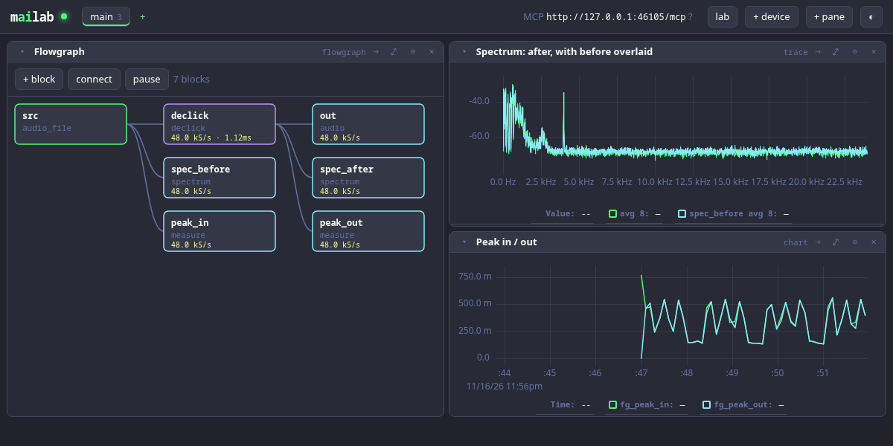

<!-- generated by bin/block-docs.js from the block catalog, about.md and example.json: edit those and run `yarn block-docs` -->

# `declick`

**dsp** · Audio processing · [all blocks](../README.md)

> de-click / de-crackle: impulses found on the 2nd difference vs a running level are interpolated over; mode crackle uses a lower threshold; latency = max_ms + 2 width

De-click / de-crackle: impulses are detected on the second difference against a running level and
interpolated over (up to `max_ms` long, `width` samples of margin). `mode: crackle` lowers the threshold for dense
vinyl crackle. Repairs clicks from bad connections, switching transients and record noise without dulling the audio.

The example plays a generated test recording (`$MEDIA/demo.wav`: a buzzy voice-like signal with 50 Hz hum, a 4 kHz whistle, hiss and clicks); with a microphone, swap `src` for `audio_in` {stream: "browser_mic"}.

## Parameters

| name | default | description |
|---|---|---|
| `bypass` | `false` | pass the input through (same delay; live A/B) |
| `mode` | `"click"` | click\|crackle |
| `threshold` | `0` | x running level (0 = per mode: 8 / 4) |
| `max_ms` | `1` | longest click repaired |
| `width` | `2` | samples added on both sides |
| `level_ms` | `5` | running level time constant |

## Inputs and outputs

- **Input:** real audio (complex: real part)
- **Output:** real audio, same rate

## Example

Clicks in the test recording (about 5 per second, peaking near -2 dBFS): peak level before and after the de-clicker.



`$MEDIA` is your media directory (`DATA_DIR/media` or one of `MAILAB_MEDIA_DIRS`); the screenshot and tests use generated files (`demo.wav`: see `makeMedia` in `src/utils/block-docs`).

Ask the AI:

> There are clicks in the recording, remove them and show me the peak level before and after.

Graph ([example.json](example.json)):

```json
{
  "blocks": [
    {"id": "src", "type": "audio_file", "params": {"path": "$MEDIA/demo.wav", "rate": 48000}},
    {"id": "declick", "type": "declick", "params": {"mode": "click"}},
    {"id": "out", "type": "audio", "params": {"rate": 48000}},
    {"id": "spec_before", "type": "spectrum", "params": {"fft": 4096, "traces": ["avg"], "average": 8, "fps": 4}},
    {"id": "spec_after", "type": "spectrum", "params": {"fft": 4096, "traces": ["avg"], "average": 8, "fps": 4, "overlay": ["spec_before"]}},
    {"id": "peak_in", "type": "measure", "params": {"stat": "peak"}},
    {"id": "peak_out", "type": "measure", "params": {"stat": "peak"}}
  ],
  "links": [["src", "declick"], ["declick", "out"], ["src", "spec_before"], ["declick", "spec_after"], ["src", "peak_in"], ["declick", "peak_out"]]
}
```

MCP calls:

```
device_add {"id": "fg", "driver": "flowgraph"}
device_command {"id": "fg", "command": "set_graph", "args": {"graph": <the graph above>}}
pane_add {"type": "flowgraph", "title": "Flowgraph", "config": {"device": "fg"}}
pane_add {"type": "trace", "title": "Spectrum: after, with before overlaid", "config": {"traces": ["fg_spec_after"]}}
pane_add {"type": "chart", "title": "Peak in / out", "config": {"channels": ["fg_peak_in", "fg_peak_out"], "seconds": 8}}
```

## Related

- [`spectral_nr`](../spectral_nr/README.md): spectral noise reduction (Wiener / subtraction)
- [`limiter`](../limiter/README.md): brickwall lookahead limiter
- [`audio_file`](../audio_file/README.md): plays an audio file (WAV/FLAC/MP3/..., via ffmpeg) as real samples
