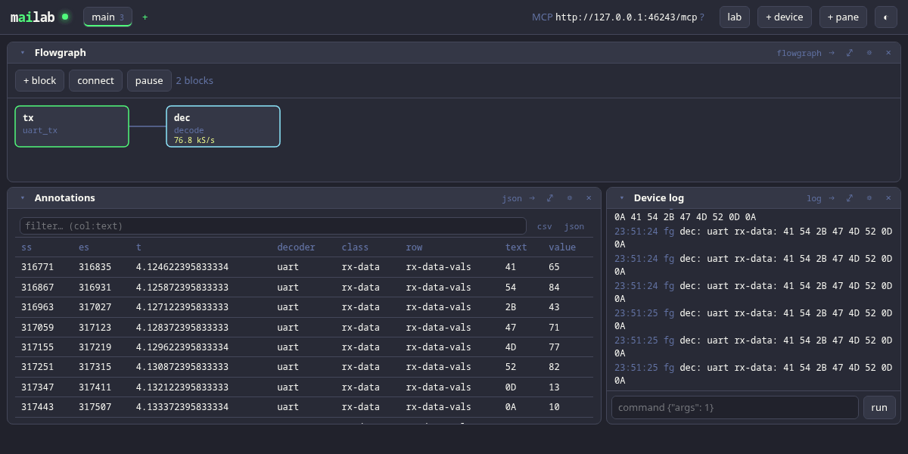

<!-- generated by bin/block-docs.js from the block catalog, about.md and example.json: edit those and run `yarn block-docs` -->

# `decode`

**sink** · Digital: bits, framing, BER, UART, protocol decode · [all blocks](../README.md)

> protocol decoder on logic samples (bit k of each input word = channel k; analog/float input is thresholded into channel 0): libsigrokdecode decoder scripts (uart spi i2c can onewire_link spiflash... any installed id, stack for stacked decoders) or builtin numpy uart/spi/i2c/manchester. Annotations -&gt; value &lt;device&gt;_&lt;id&gt; (table of the last rows), event &lt;device&gt;_&lt;id&gt;, log lines per class, blob of decoded data bytes, count channel

Protocol decoder on logic samples: bit k of each input word is channel k (analog input is thresholded into
channel 0). Runs the real libsigrokdecode decoder scripts (uart, spi, i2c, can, onewire_link, spiflash... any installed
decoder, stackable) or builtin numpy decoders (uart, spi, i2c, manchester) when sigrok isn't installed. Annotations
land in a table value, events, log lines and a blob of data bytes. Feed it from `uart_tx`, a logic stream over
`net_source` (u8/u16 words), or push captures with the device's `feed` command; one-shot decodes of a capture use the
`decode` command instead of a block.

## Parameters

| name | default | description |
|---|---|---|
| `decoder` | `"uart"` | decoder id (sigrok id or builtin uart\|spi\|i2c\|manchester) |
| `engine` | `"auto"` | auto (sigrok if installed, else builtin) \| sigrok \| builtin |
| `options` | `{}` | decoder options, sigrok names, e.g. {baudrate: 9600, parity: 'even'} / {cpol, cpha} / {bitrate, convention} |
| `channels` | `{}` | decoder channel -&gt; input bit, e.g. {clk: 0, mosi: 1, cs: 3} (default per decoder) |
| `stack` | `[]` | stacked decoders, e.g. ['spiflash'] or [{id, options}] |
| `samplerate` | `0` | Hz; 0 = the input stream rate |
| `threshold` | `null` | analog threshold (default adaptive) |
| `annotations` | `[]` | annotation classes kept (default all but per-bit ones) |
| `keep` | `200` | rows kept in the value |
| `fps` | `4` | value/event updates per second |

## Inputs and outputs

- **Input:** logic words (bit k = channel k) or analog/real (thresholded into channel 0)
- **Output:** value &lt;device&gt;_&lt;id&gt; (annotation table), event &lt;device&gt;_&lt;id&gt;, log lines, blob &lt;device&gt;_&lt;id&gt; (data bytes), channel &lt;device&gt;_&lt;id&gt;_count

## Example

uart_tx at 9600 baud decoded by the uart decoder (sigrok when installed, else builtin): the annotation table.



Ask the AI:

> Decode the UART line with the sigrok uart decoder at 9600 baud and show me the annotations.

Graph ([example.json](example.json)):

```json
{
  "blocks": [
    {"id": "tx", "type": "uart_tx", "params": {"text": "AT+GMR\r\n", "baud": 9600, "sps": 8, "repeat_ms": 200}},
    {"id": "dec", "type": "decode", "params": {"decoder": "uart", "options": {"baudrate": 9600}, "annotations": ["rx-data"], "keep": 40}}
  ],
  "links": [["tx", "dec"]]
}
```

MCP calls:

```
device_add {"id": "fg", "driver": "flowgraph"}
device_command {"id": "fg", "command": "set_graph", "args": {"graph": <the graph above>}}
pane_add {"type": "flowgraph", "title": "Flowgraph", "config": {"device": "fg"}}
pane_add {"type": "json", "title": "Annotations", "config": {"value": "fg_dec", "view": "table"}}
pane_add {"type": "log", "title": "Device log", "config": {"device": "fg"}}
```

## Related

- [`uart_tx`](../uart_tx/README.md): UART transmitter: text or hex to line levels
- [`uart_rx`](../uart_rx/README.md): UART receiver: line levels or bits to text
- [`net_source`](../net_source/README.md): IQ or logic samples in over TCP / UDP
- [`framer`](../framer/README.md): finds a sync word and cuts frames from bits
