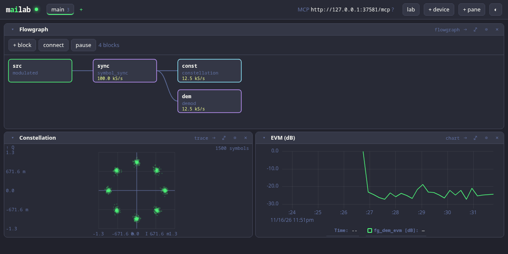

<!-- generated by bin/block-docs.js from the block catalog, about.md and example.json: edit those and run `yarn block-docs` -->

# `demod`

**dsp** · Modulation, demodulation and sync · [all blocks](../README.md)

> symbol decisions + EVM; outputs symbol indices, EVM -&gt; channel &lt;device&gt;_&lt;id&gt;_evm

Symbol decisions for a linear `scheme`: outputs the symbol index of the nearest constellation point for each
input symbol and publishes the EVM (error vector magnitude, dB) as a channel. Use it as a link-quality meter on a
received constellation. To get bits out (for `ber`, `framer`, `bitview`) use `slicer`, which also measures EVM.

## Parameters

| name | default | description |
|---|---|---|
| `scheme` | `"qpsk"` | constellation (bpsk\|qpsk\|psk8\|qam16\|qam64\|apsk16...) |
| `fps` | `5` | EVM updates per second |

## Inputs and outputs

- **Input:** complex symbols (one sample per symbol)
- **Output:** symbol indices (float); channel &lt;device&gt;_&lt;id&gt;_evm (dB)

## Example

8-PSK at 20 dB SNR after timing recovery: its constellation and the EVM channel.



Ask the AI:

> Measure the EVM of the 8-PSK signal.

Graph ([example.json](example.json)):

```json
{
  "blocks": [
    {"id": "src", "type": "modulated", "params": {"scheme": "psk8", "sps": 8, "snr_db": 20}},
    {"id": "sync", "type": "symbol_sync", "params": {"sps": 8}},
    {"id": "const", "type": "constellation", "params": {"points": 1500}},
    {"id": "dem", "type": "demod", "params": {"scheme": "psk8", "fps": 5}}
  ],
  "links": [["src", "sync"], ["sync", "const"], ["sync", "dem"]]
}
```

MCP calls:

```
device_add {"id": "fg", "driver": "flowgraph"}
device_command {"id": "fg", "command": "set_graph", "args": {"graph": <the graph above>}}
pane_add {"type": "flowgraph", "title": "Flowgraph", "config": {"device": "fg"}}
pane_add {"type": "trace", "title": "Constellation", "config": {"traces": ["fg_const"]}}
pane_add {"type": "chart", "title": "EVM (dB)", "config": {"channels": ["fg_dem_evm"], "seconds": 8}}
```

## Related

- [`slicer`](../slicer/README.md): symbols to bits (linear schemes or 2/4-level real), with EVM
- [`symbol_sync`](../symbol_sync/README.md): symbol timing recovery, one sample per symbol out
- [`constellation`](../constellation/README.md): I/Q scatter of symbols
