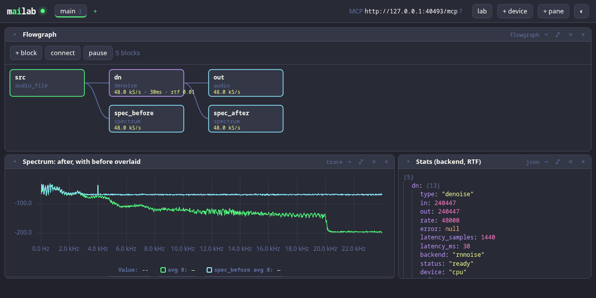

<!-- generated by bin/block-docs.js from the block catalog, about.md and example.json: edit those and run `yarn block-docs` -->

# `denoise`

**dsp** · Audio processing · [all blocks](../README.md)

> neural denoise: backend deepfilternet (DeepFilterNet3, PyTorch CUDA; installed into the mailab venv on first use: torch==2.15.0 cu134 + deepfilternet 0.5.6, audio passes through meanwhile), rnnoise (CPU, librnnoise), maxine (NVIDIA SDK, detection only), auto (deepfilternet if installed with CUDA, else rnnoise). Resamples to 48 kHz; stats: rtf, device, status, latency

Neural speech denoising. Backends: `deepfilternet` (DeepFilterNet3 on a CUDA GPU; installed into the mailab
venv on first use, audio passes through meanwhile), `rnnoise` (Xiph RNNoise on CPU, needs librnnoise), `maxine`
(NVIDIA Maxine, detection only), `auto` (deepfilternet with CUDA, else rnnoise). It resamples to 48 kHz internally;
the stats show the backend, device, real-time factor and latency. Use it for voice on a noisy mic or radio channel;
the `voice_cleanup` template wraps it with filters and dynamics.

The example plays a generated test recording (`$MEDIA/demo.wav`: a buzzy voice-like signal with 50 Hz hum, a 4 kHz whistle, hiss and clicks); with a microphone, swap `src` for `audio_in` {stream: "browser_mic"}.

## Parameters

| name | default | description |
|---|---|---|
| `bypass` | `false` | pass the input through (same delay; live A/B) |
| `backend` | `"auto"` | auto\|deepfilternet\|rnnoise\|maxine |
| `mix` | `1` | wet/dry |
| `atten_db` | `0` | limit noise attenuation to this many dB (0 = unlimited) |
| `hop_ms` | `20` | deepfilternet: audio per inference (latency) |
| `look_ms` | `40` | deepfilternet: future context per hop (latency) |
| `context_ms` | `400` | deepfilternet: past context per hop (cost) |
| `device` | `"auto"` | deepfilternet: auto\|cuda\|cpu |
| `install` | `true` | deepfilternet: pip install if missing |

## Inputs and outputs

- **Input:** real audio (complex: real part)
- **Output:** real audio, same rate

## Example

RNNoise on the test recording: the spectrum before and after, and the block stats (backend, RTF, latency).

**Needs:** librnnoise (CPU) or a CUDA GPU for DeepFilterNet (installed on first use).



`$MEDIA` is your media directory (`DATA_DIR/media` or one of `MAILAB_MEDIA_DIRS`); the screenshot and tests use generated files (`demo.wav`: see `makeMedia` in `src/utils/block-docs`).

Ask the AI:

> Clean up the noisy voice with the neural denoiser.

Graph ([example.json](example.json)):

```json
{
  "blocks": [
    {"id": "dn", "type": "denoise", "params": {"backend": "rnnoise"}},
    {"id": "src", "type": "audio_file", "params": {"path": "$MEDIA/demo.wav", "rate": 48000}},
    {"id": "out", "type": "audio", "params": {"rate": 48000}},
    {"id": "spec_before", "type": "spectrum", "params": {"fft": 4096, "traces": ["avg"], "average": 8, "fps": 4}},
    {"id": "spec_after", "type": "spectrum", "params": {"fft": 4096, "traces": ["avg"], "average": 8, "fps": 4, "overlay": ["spec_before"]}}
  ],
  "links": [["src", "dn"], ["dn", "out"], ["src", "spec_before"], ["dn", "spec_after"]]
}
```

MCP calls:

```
device_add {"id": "fg", "driver": "flowgraph"}
device_command {"id": "fg", "command": "set_graph", "args": {"graph": <the graph above>}}
# a ready-made template that uses this block (replaces the graph):
device_command {"id": "fg", "command": "load_template", "args": {"name": "voice_cleanup", "path": "$MEDIA/demo.wav", "backend": "rnnoise"}}
pane_add {"type": "flowgraph", "title": "Flowgraph", "config": {"device": "fg"}}
pane_add {"type": "trace", "title": "Spectrum: after, with before overlaid", "config": {"traces": ["fg_spec_after"]}}
pane_add {"type": "json", "title": "Stats (backend, RTF)", "config": {"value": "fg_stats", "depth": 2}}
```

## Related

- [`spectral_nr`](../spectral_nr/README.md): spectral noise reduction (Wiener / subtraction)
- [`audio_in`](../audio_in/README.md): a lab audio stream (browser mic, another graph) into the graph
- [`gate`](../gate/README.md): noise gate / downward expander
