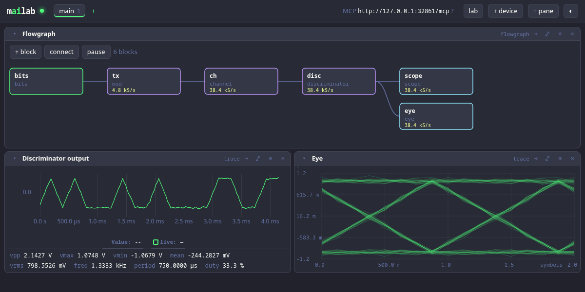

<!-- generated by bin/block-docs.js from the block catalog, about.md and example.json: edit those and run `yarn block-docs` -->

# `discriminator`

**dsp** · Modulation, demodulation and sync · [all blocks](../README.md)

> FSK/FM discriminator -&gt; real, scaled so CPFSK symbols are ±1 (±1/±3 for 4fsk); integrates over a symbol by default (fixes GMSK/GFSK ISI)

FSK / FM discriminator: the phase difference between samples, scaled with the signal's modulation index `h` so
CPFSK symbols come out as ±1 (±1/±3 for 4fsk). By default it averages over one symbol (`integrate`), which removes most
of the inter-symbol interference of Gaussian-filtered GFSK/GMSK. Follow with `clock_recovery` (one sample per symbol)
and `slicer` (`levels` 2 or 4).

## Parameters

| name | default | description |
|---|---|---|
| `sps` | `8` | samples per symbol |
| `h` | `1` | modulation index of the signal |
| `integrate` | `true` | average over one symbol |

## Inputs and outputs

- **Input:** complex IQ (FSK/FM at `sps` samples per symbol)
- **Output:** real, ±1 per symbol level

## Example

2-FSK at 18 dB SNR after the discriminator: scope and eye diagram of the ±1 levels.



Ask the AI:

> Demodulate the 2-FSK signal with a discriminator and show its eye.

Graph ([example.json](example.json)):

```json
{
  "blocks": [
    {"id": "bits", "type": "bits", "params": {"pattern": "prbs9", "bitrate": 4800}},
    {"id": "tx", "type": "mod", "params": {"scheme": "2fsk", "sps": 8}},
    {"id": "ch", "type": "channel", "params": {"snr_db": 18}},
    {"id": "disc", "type": "discriminator", "params": {"sps": 8, "h": 1}},
    {"id": "scope", "type": "scope", "params": {"samples": 160, "trigger": "none"}},
    {"id": "eye", "type": "eye", "params": {"sps": 8, "traces": 64}}
  ],
  "links": [["bits", "tx"], ["tx", "ch"], ["ch", "disc"], ["disc", "scope"], ["disc", "eye"]]
}
```

MCP calls:

```
device_add {"id": "fg", "driver": "flowgraph"}
device_command {"id": "fg", "command": "set_graph", "args": {"graph": <the graph above>}}
pane_add {"type": "flowgraph", "title": "Flowgraph", "config": {"device": "fg"}}
pane_add {"type": "trace", "title": "Discriminator output", "config": {"traces": ["fg_scope"]}}
pane_add {"type": "trace", "title": "Eye", "config": {"traces": ["fg_eye"]}}
```

## Related

- [`mod`](../mod/README.md): bits to IQ: PSK, QAM, APSK, OOK, FSK, MSK, GFSK, GMSK...
- [`clock_recovery`](../clock_recovery/README.md): Gardner timing recovery for FSK / OOK / real symbols
- [`slicer`](../slicer/README.md): symbols to bits (linear schemes or 2/4-level real), with EVM
- [`eye`](../eye/README.md): eye diagram
