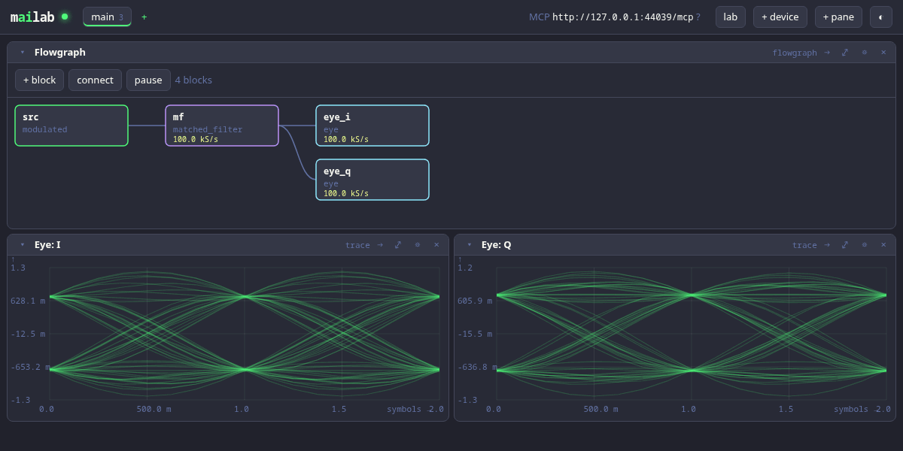

<!-- generated by bin/block-docs.js from the block catalog, about.md and example.json: edit those and run `yarn block-docs` -->

# `eye`

**sink** · Sinks and views · [all blocks](../README.md)

> eye diagram -&gt; trace &lt;device&gt;_&lt;id&gt; (mode eye); input at sps samples/symbol

Eye diagram: overlays `traces` two-symbol-long segments of the input (at `sps` samples per symbol), real or
imaginary `part`. The vertical opening shows noise margin, the horizontal opening timing margin; a closed eye means
inter-symbol interference (missing matched filter) or too much noise. Look at it after `matched_filter` (linear
schemes) or `discriminator` (FSK), before timing recovery.

## Parameters

| name | default | description |
|---|---|---|
| `sps` | `8` | samples per symbol |
| `traces` | `64` | overlaid two-symbol segments |
| `fps` | `5` | trace updates per second |
| `part` | `"real"` | real\|imag |

## Inputs and outputs

- **Input:** complex IQ or real at `sps` samples per symbol
- **Output:** trace &lt;device&gt;_&lt;id&gt; (mode eye)

## Example

QPSK at 25 dB SNR after a matched filter: eye of the I and the Q component.



Ask the AI:

> Show me the eye diagram of the QPSK signal, both I and Q.

Graph ([example.json](example.json)):

```json
{
  "blocks": [
    {"id": "src", "type": "modulated", "params": {"scheme": "qpsk", "sps": 8, "snr_db": 25}},
    {"id": "mf", "type": "matched_filter", "params": {"sps": 8}},
    {"id": "eye_i", "type": "eye", "params": {"sps": 8, "traces": 64, "part": "real"}},
    {"id": "eye_q", "type": "eye", "params": {"sps": 8, "traces": 64, "part": "imag"}}
  ],
  "links": [["src", "mf"], ["mf", "eye_i"], ["mf", "eye_q"]]
}
```

MCP calls:

```
device_add {"id": "fg", "driver": "flowgraph"}
device_command {"id": "fg", "command": "set_graph", "args": {"graph": <the graph above>}}
pane_add {"type": "flowgraph", "title": "Flowgraph", "config": {"device": "fg"}}
pane_add {"type": "trace", "title": "Eye: I", "config": {"traces": ["fg_eye_i"]}}
pane_add {"type": "trace", "title": "Eye: Q", "config": {"traces": ["fg_eye_q"]}}
```

## Related

- [`matched_filter`](../matched_filter/README.md): RRC receive filter matching the transmitter
- [`clock_recovery`](../clock_recovery/README.md): Gardner timing recovery for FSK / OOK / real symbols
- [`discriminator`](../discriminator/README.md): FSK / FM discriminator, symbols as ±1
- [`scope`](../scope/README.md): triggered oscilloscope with measurements
