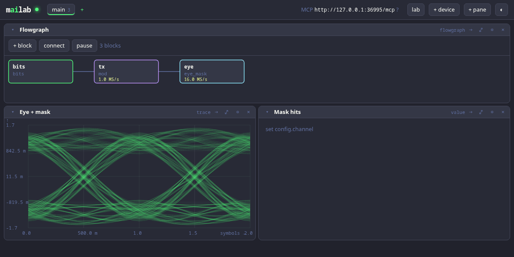

<!-- generated by bin/block-docs.js from the block catalog, about.md and example.json: edit those and run `yarn block-docs` -->

# `eye_mask`

**sink** · Sinks and views · [all blocks](../README.md)

> eye diagram with a keep-out mask (libscopehal EyeMask style) -&gt; trace &lt;device&gt;_&lt;id&gt; (mode eye) plus value &lt;device&gt;_&lt;id&gt;: hits / samples / pct of overlay samples inside the mask. Mask is a polygon [[x_ui, y], ...] with x in UI (0..2 across the two-symbol window) and y in observed amplitude units; the classic shape is a hexagon around the crossings at x = 1.

`eye_mask` is `eye` plus the mask-compliance test from libscopehal's
EyeMask decoder: it overlays two-symbol segments (at `sps` samples per
symbol, real or imaginary `part`) *and* counts how many overlay samples
fall inside a keep-out polygon. The mask is a polygon `[[x_ui, y], ...]`
with `x` in UI across the two-symbol window (the crossing sits at x = 1)
and `y` in observed amplitude units; the default is the classic hexagon
around the crossing. A signal that never enters the mask has margin —
every hit eats into it. Output: trace `<device>_<id>` (mode eye) and value
`<device>_<id>` with `hits`, `samples` and `pct` inside the mask. Note the
value semantics: `pct` *high* = failing. Pair with `cdr`/`tie_jitter` when
the eye closes from timing rather than noise.

## Parameters

| name | default | description |
|---|---|---|
| `sps` | `8` | samples per symbol |
| `traces` | `128` | overlaid two-symbol segments |
| `fps` | `5` | updates/s |
| `part` | `"real"` | real\|imag |
| `mask` | `"[[0.55,-0.5],[0.85,-0.85],[1.15,-0.85],[1.45,-0.5],[1.45,0.5],[1.15,0.85],[0.85,0.85],[0.55,0.5]]"` | keep-out polygon [[x_ui, y], ...] |

## Inputs and outputs

- **Input:** complex IQ or real at `sps` samples per symbol
- **Output:** trace &lt;device&gt;_&lt;id&gt; (mode eye), value &lt;device&gt;_&lt;id&gt; (mask hit stats)

## Example

Eye with mask compliance: PRBS9 as BPSK at 16 samples per symbol; RRC shaping carries the crossings through the keep-out mask.



Ask the AI:

> Show the eye with the keep-out mask and report the mask hit percentage.

Graph ([example.json](example.json)):

```json
{
  "blocks": [
    {"id": "bits", "type": "bits", "params": {"pattern": "prbs9", "bitrate": 1000000}},
    {"id": "tx", "type": "mod", "params": {"scheme": "bpsk", "sps": 16, "beta": 0.35}},
    {"id": "eye", "type": "eye_mask", "params": {"sps": 16, "traces": 256}}
  ],
  "links": [["bits", "tx"], ["tx", "eye"]]
}
```

MCP calls:

```
device_add {"id": "fg", "driver": "flowgraph"}
device_command {"id": "fg", "command": "set_graph", "args": {"graph": <the graph above>}}
pane_add {"type": "flowgraph", "title": "Flowgraph", "config": {"device": "fg"}}
pane_add {"type": "trace", "title": "Eye + mask", "config": {"traces": ["fg_eye"]}}
pane_add {"type": "value", "title": "Mask hits", "config": {"values": ["fg_eye"]}}
```

## Related

- [`eye`](../eye/README.md): eye diagram
- [`cdr`](../cdr/README.md): clock/data recovery (CDR) with a second-order PLL
- [`tie_jitter`](../tie_jitter/README.md): TIE / jitter measurement against an ideal UI grid
- [`matched_filter`](../matched_filter/README.md): RRC receive filter matching the transmitter
- [`scope`](../scope/README.md): triggered oscilloscope with measurements
