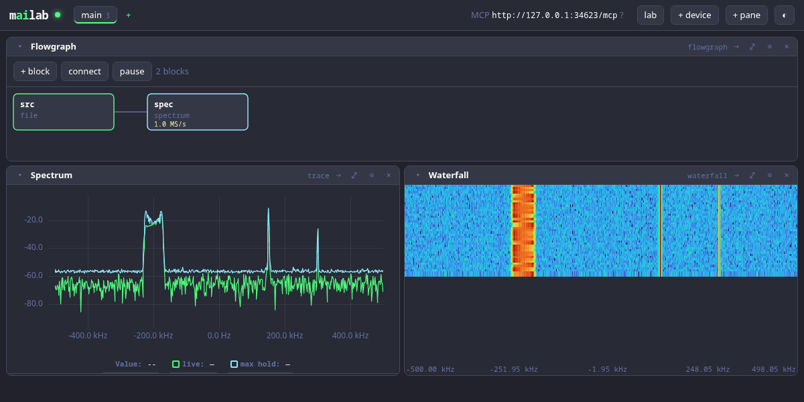

<!-- generated by bin/block-docs.js from the block catalog, about.md and example.json: edit those and run `yarn block-docs` -->

# `file`

**source** · Sources · [all blocks](../README.md)

> raw cf32 IQ file, played back in real time

Plays a raw complex-float32 (cf32, GNU Radio's "complex" file sink format, `rtl_sdr` converted with `csdr` or
SDR++ baseband recordings saved as raw cf32) IQ recording back in real time at `rate`, looping by default. Use it to
develop a receive chain against a capture instead of live hardware, or to replay a signal you recorded earlier. The
path must be inside `DATA_DIR/media` or a directory in `MAILAB_MEDIA_DIRS` (absolute path), so a graph can't read
arbitrary files. Typical chain: `file -> shift -> lowpass -> resample -> fm_demod -> audio`.

## Parameters

| name | default | description |
|---|---|---|
| `path` | `""` | cf32 file inside DATA_DIR/media or MAILAB_MEDIA_DIRS |
| `rate` | `1000000` | sample rate |
| `loop` | `true` | restart at the end of the file (false = stop) |

## Inputs and outputs

- **Input:** none (source)
- **Output:** complex IQ at `rate` (cf32 samples from the file)

## Example

A generated 1 MS/s recording (an FM carrier at -200 kHz and two CW tones at +150 / +300 kHz) on a spectrum and waterfall.



`$MEDIA` is your media directory (`DATA_DIR/media` or one of `MAILAB_MEDIA_DIRS`); the screenshot and tests use generated files (`demo.cf32`: see `makeMedia` in `src/utils/block-docs`).

Ask the AI:

> Play back $MEDIA/demo.cf32 at 1 MS/s and show me the spectrum and a waterfall.

Graph ([example.json](example.json)):

```json
{
  "blocks": [
    {"id": "src", "type": "file", "params": {"path": "$MEDIA/demo.cf32", "rate": 1000000}},
    {"id": "spec", "type": "spectrum", "params": {"rbw": 2000, "traces": ["live", "max"], "points": 600}}
  ],
  "links": [["src", "spec"]]
}
```

MCP calls:

```
device_add {"id": "fg", "driver": "flowgraph"}
device_command {"id": "fg", "command": "set_graph", "args": {"graph": <the graph above>}}
pane_add {"type": "flowgraph", "title": "Flowgraph", "config": {"device": "fg"}}
pane_add {"type": "trace", "title": "Spectrum", "config": {"traces": ["fg_spec"]}}
pane_add {"type": "waterfall", "title": "Waterfall", "config": {"trace": "fg_spec", "rows": 80}}
```

## Related

- [`spectrum`](../spectrum/README.md): spectrum analyzer trace: RBW, window, max/min hold, averaging
- [`net_source`](../net_source/README.md): IQ or logic samples in over TCP / UDP
- [`soapy`](../soapy/README.md): live IQ from a SoapySDR receiver (RTL-SDR, HackRF, bladeRF...)
- [`shift`](../shift/README.md): moves a signal at +offset Hz to 0 Hz
