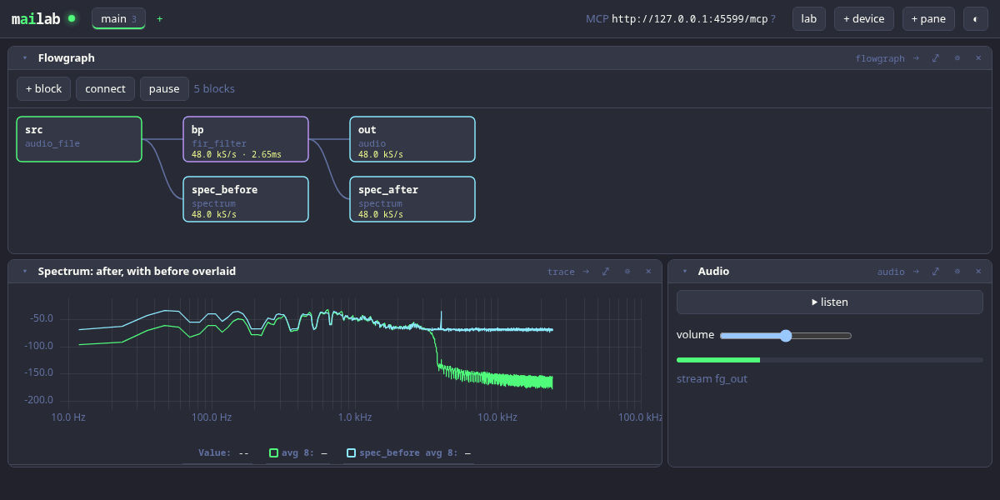

<!-- generated by bin/block-docs.js from the block catalog, about.md and example.json: edit those and run `yarn block-docs` -->

# `fir_filter`

**dsp** · Audio processing · [all blocks](../README.md)

> linear-phase windowed-sinc FIR (Kaiser): lowpass highpass bandpass bandstop; latency (taps-1)/2

Linear-phase windowed-sinc FIR (Kaiser window, `beta` sets the stopband): lowpass, highpass, bandpass,
bandstop. Unlike `biquad` it has constant group delay (latency (taps-1)/2 samples, shown in the stats) and a very flat
passband, so use it where phase matters or a brick-wall band edge is wanted, e.g. a telephone band 300-3400 Hz.

The example plays a generated test recording (`$MEDIA/demo.wav`: a buzzy voice-like signal with 50 Hz hum, a 4 kHz whistle, hiss and clicks); with a microphone, swap `src` for `audio_in` {stream: "browser_mic"}.

## Parameters

| name | default | description |
|---|---|---|
| `bypass` | `false` | pass the input through (same delay; live A/B) |
| `type` | `"lowpass"` | lowpass\|highpass\|bandpass\|bandstop |
| `freq` | `3000` | cutoff / lower edge Hz |
| `freq2` | `6000` | upper edge Hz (band types) |
| `taps` | `101` | odd |
| `beta` | `6` | Kaiser beta (stopband) |

## Inputs and outputs

- **Input:** real audio (complex: real part)
- **Output:** real audio, same rate

## Example

A 300-3400 Hz band-pass (255 taps) on the test recording: everything outside the telephone band drops.



`$MEDIA` is your media directory (`DATA_DIR/media` or one of `MAILAB_MEDIA_DIRS`); the screenshot and tests use generated files (`demo.wav`: see `makeMedia` in `src/utils/block-docs`).

Ask the AI:

> Band-pass the audio to 300-3400 Hz with a linear-phase FIR.

Graph ([example.json](example.json)):

```json
{
  "blocks": [
    {"id": "src", "type": "audio_file", "params": {"path": "$MEDIA/demo.wav", "rate": 48000}},
    {"id": "bp", "type": "fir_filter", "params": {"type": "bandpass", "freq": 300, "freq2": 3400, "taps": 255}},
    {"id": "out", "type": "audio", "params": {"rate": 48000}},
    {"id": "spec_before", "type": "spectrum", "params": {"fft": 4096, "traces": ["avg"], "average": 8, "fps": 4}},
    {"id": "spec_after", "type": "spectrum", "params": {"fft": 4096, "traces": ["avg"], "average": 8, "fps": 4, "overlay": ["spec_before"]}}
  ],
  "links": [["src", "bp"], ["bp", "out"], ["src", "spec_before"], ["bp", "spec_after"]]
}
```

MCP calls:

```
device_add {"id": "fg", "driver": "flowgraph"}
device_command {"id": "fg", "command": "set_graph", "args": {"graph": <the graph above>}}
pane_add {"type": "flowgraph", "title": "Flowgraph", "config": {"device": "fg"}}
pane_add {"type": "trace", "title": "Spectrum: after, with before overlaid", "config": {"traces": ["fg_spec_after"], "logX": true}}
pane_add {"type": "audio", "title": "Audio", "config": {"stream": "fg_out"}}
```

## Related

- [`biquad`](../biquad/README.md): RBJ biquad: low/high/band-pass, notch, peaking, shelves
- [`lowpass`](../lowpass/README.md): Kaiser FIR low-pass / channel filter
- [`hum_notch`](../hum_notch/README.md): 50/60 Hz mains hum and harmonics remover
