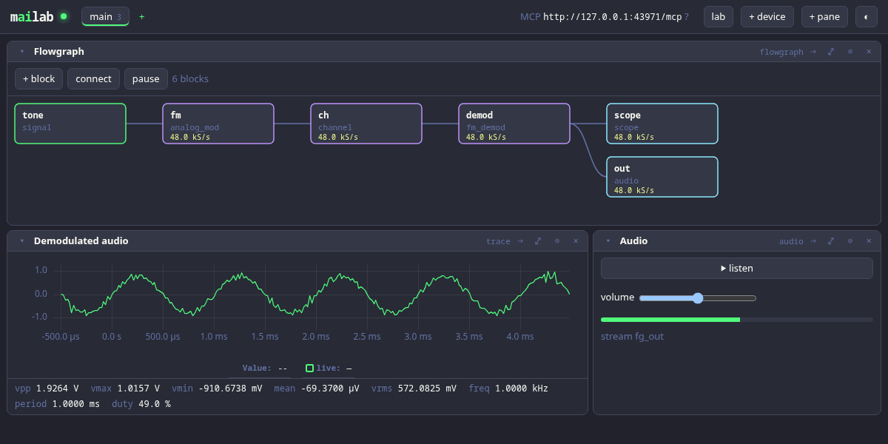

<!-- generated by bin/block-docs.js from the block catalog, about.md and example.json: edit those and run `yarn block-docs` -->

# `fm_demod`

**dsp** · Modulation, demodulation and sync · [all blocks](../README.md)

> FM demodulator -&gt; real audio

FM demodulator (liquid freqdem): complex baseband in, real audio out, scaled so a `deviation` Hz swing gives ±1.
The FM signal must be centered at 0 Hz (use `shift`) and filtered to its channel (`lowpass`); for voice, resample to
48 kHz first and follow with `dc_block`, a 3.4 kHz low-pass and an `audio` sink. The `sdr_fm_audio` template builds
the whole NBFM receiver.

## Parameters

| name | default | description |
|---|---|---|
| `deviation` | `5000` | Hz |

## Inputs and outputs

- **Input:** complex IQ (FM centered at 0 Hz)
- **Output:** real audio, same rate

## Example

An FM test signal (1 kHz tone, 5 kHz deviation) through a 25 dB SNR channel, demodulated: scope with frequency measurement, and audio.



Ask the AI:

> Demodulate the FM signal and let me hear it; show the recovered audio on a scope.

Graph ([example.json](example.json)):

```json
{
  "blocks": [
    {"id": "tone", "type": "signal", "params": {"rate": 48000, "freq": 1000, "amp": 0.8, "noise": 0}},
    {"id": "fm", "type": "analog_mod", "params": {"mode": "fm", "deviation": 5000}},
    {"id": "ch", "type": "channel", "params": {"snr_db": 25}},
    {"id": "demod", "type": "fm_demod", "params": {"deviation": 5000}},
    {"id": "scope", "type": "scope", "params": {"samples": 240, "measure": ["freq", "vpp"]}},
    {"id": "out", "type": "audio", "params": {"rate": 48000, "gain": 0.5}}
  ],
  "links": [["tone", "fm"], ["fm", "ch"], ["ch", "demod"], ["demod", "scope"], ["demod", "out"]]
}
```

MCP calls:

```
device_add {"id": "fg", "driver": "flowgraph"}
device_command {"id": "fg", "command": "set_graph", "args": {"graph": <the graph above>}}
# a ready-made template that uses this block (replaces the graph):
device_command {"id": "fg", "command": "load_template", "args": {"name": "sdr_fm_audio", "args": "driver=rtlsdr", "freq": 145500000}}
pane_add {"type": "flowgraph", "title": "Flowgraph", "config": {"device": "fg"}}
pane_add {"type": "trace", "title": "Demodulated audio", "config": {"traces": ["fg_scope"]}}
pane_add {"type": "audio", "title": "Audio", "config": {"stream": "fg_out"}}
```

## Related

- [`analog_mod`](../analog_mod/README.md): audio to AM, DSB, SSB, FM or PM baseband
- [`soapy`](../soapy/README.md): live IQ from a SoapySDR receiver (RTL-SDR, HackRF, bladeRF...)
- [`resample`](../resample/README.md): any-ratio, anti-aliased resampler to a new rate
- [`audio`](../audio/README.md): plays audio in the browser (lab audio stream)
