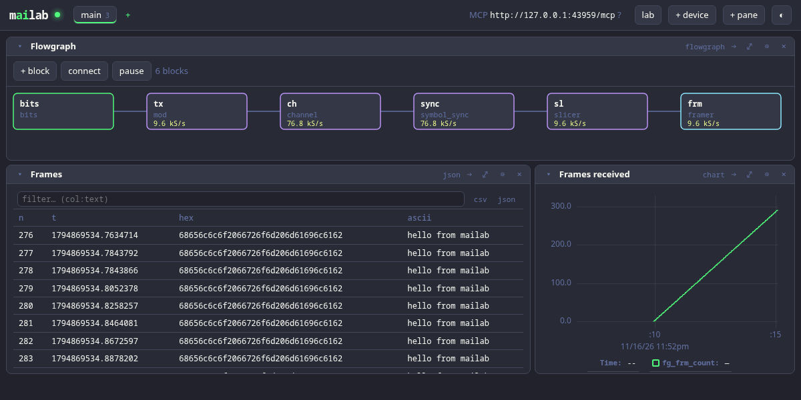

<!-- generated by bin/block-docs.js from the block catalog, about.md and example.json: edit those and run `yarn block-docs` -->

# `framer`

**sink** · Digital: bits, framing, BER, UART, protocol decode · [all blocks](../README.md)

> find a sync word in a bit stream, cut frames: value &lt;device&gt;_&lt;id&gt; (last frames: hex/ascii), blob of payloads, count channel

Finds a `sync` word in a bit stream (allowing `max_errors` bit errors) and cuts the `frame_bytes` that follow it
into frames: the last `keep` frames as a value (number, time, hex, ascii), the payloads as a blob (parse them with a
Kaitai struct) and a frame counter. The receive half of a packet link: `... -> slicer -> framer`, with
`bits {sync, preamble, pattern}` as the transmitter.

## Parameters

| name | default | description |
|---|---|---|
| `sync` | `"2dd4"` | sync word (hex) |
| `max_errors` | `0` | allowed bit errors in the sync word |
| `frame_bytes` | `16` | payload bytes after the sync word |
| `keep` | `20` | frames kept in the value |

## Inputs and outputs

- **Input:** bits (0/1)
- **Output:** value &lt;device&gt;_&lt;id&gt; (frames: n, t, hex, ascii), blob &lt;device&gt;_&lt;id&gt; (payloads), channel &lt;device&gt;_&lt;id&gt;_count

## Example

Framed text (`aaaa` preamble, `2dd4` sync, "hello from mailab") over a noisy BPSK link: the decoded frames as a table.



Ask the AI:

> Send framed packets over BPSK with sync word 2dd4 and show me the frames the receiver finds.

Graph ([example.json](example.json)):

```json
{
  "blocks": [
    {"id": "bits", "type": "bits", "params": {"pattern": "text:hello from mailab", "preamble": "aaaa", "sync": "2dd4", "bitrate": 9600}},
    {"id": "tx", "type": "mod", "params": {"scheme": "bpsk", "sps": 8}},
    {"id": "ch", "type": "channel", "params": {"snr_db": 15}},
    {"id": "sync", "type": "symbol_sync", "params": {"sps": 8}},
    {"id": "sl", "type": "slicer", "params": {"scheme": "bpsk"}},
    {"id": "frm", "type": "framer", "params": {"sync": "2dd4", "frame_bytes": 17, "keep": 20}}
  ],
  "links": [["bits", "tx"], ["tx", "ch"], ["ch", "sync"], ["sync", "sl"], ["sl", "frm"]]
}
```

MCP calls:

```
device_add {"id": "fg", "driver": "flowgraph"}
device_command {"id": "fg", "command": "set_graph", "args": {"graph": <the graph above>}}
pane_add {"type": "flowgraph", "title": "Flowgraph", "config": {"device": "fg"}}
pane_add {"type": "json", "title": "Frames", "config": {"value": "fg_frm", "view": "table"}}
pane_add {"type": "chart", "title": "Frames received", "config": {"channels": ["fg_frm_count"], "seconds": 8}}
```

## Related

- [`bits`](../bits/README.md): PRBS or pattern bit source, optionally framed
- [`slicer`](../slicer/README.md): symbols to bits (linear schemes or 2/4-level real), with EVM
- [`bitview`](../bitview/README.md): shows the last bits of a stream as binary and hex
- [`decode`](../decode/README.md): sigrok / builtin protocol decoder on logic samples (UART, SPI, I2C...)
