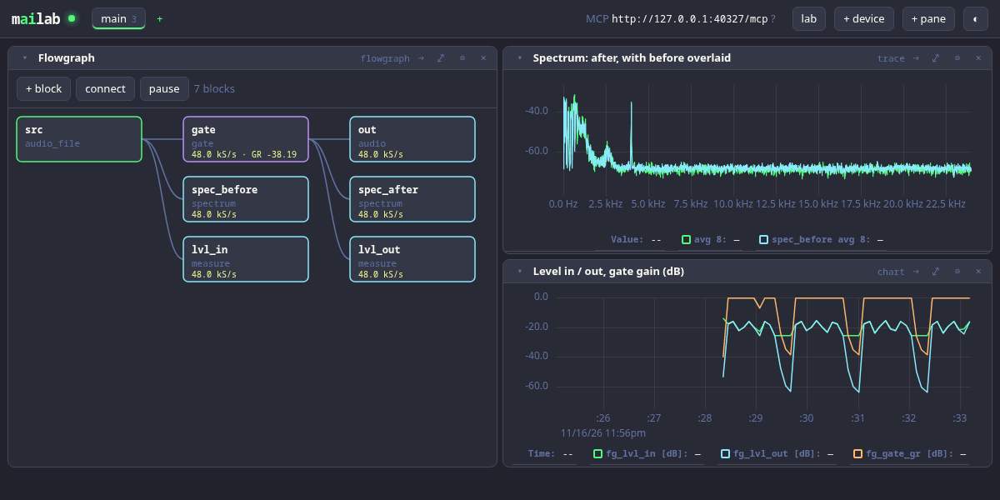

<!-- generated by bin/block-docs.js from the block catalog, about.md and example.json: edit those and run `yarn block-docs` -->

# `gate`

**dsp** · Audio processing · [all blocks](../README.md)

> noise gate (ratio 0: open above threshold, close below threshold - hysteresis after hold) or downward expander (ratio &gt; 1); attenuation limited to range_db; gain -&gt; channel &lt;device&gt;_&lt;id&gt;_gr

Noise gate (`ratio` 0) or downward expander (`ratio` > 1): below `threshold_db` the audio is attenuated by up
to `range_db`. The gate opens above the threshold and closes `hysteresis_db` below it after `hold_ms`, with
`attack_ms` / `release_ms` ramps, so it doesn't chatter. Silences hiss and hum between words; for noise during speech
use `spectral_nr` or `denoise`.

The example plays a generated test recording (`$MEDIA/demo.wav`: a buzzy voice-like signal with 50 Hz hum, a 4 kHz whistle, hiss and clicks); with a microphone, swap `src` for `audio_in` {stream: "browser_mic"}.

## Parameters

| name | default | description |
|---|---|---|
| `bypass` | `false` | pass the input through (same delay; live A/B) |
| `threshold_db` | `-50` | dBFS (RMS) |
| `hysteresis_db` | `6` | closes this far below threshold |
| `hold_ms` | `50` | stay open after the level drops |
| `attack_ms` | `1` | opening |
| `release_ms` | `100` | closing |
| `range_db` | `-60` | max attenuation |
| `ratio` | `0` | 0 = gate, &gt; 1 = expander ratio |
| `rms_ms` | `5` | level detector RMS window |
| `sidechain_hpf` | `0` | Hz |
| `fps` | `10` | gain-reduction channel updates per second |

## Inputs and outputs

- **Input:** real audio (complex: real part)
- **Output:** real audio, same rate; channel &lt;device&gt;_&lt;id&gt;_gr (gain dB)

## Example

A gate at -20 dBFS on the test recording: it closes in the pauses between "syllables" (level out drops), gain in dB.



`$MEDIA` is your media directory (`DATA_DIR/media` or one of `MAILAB_MEDIA_DIRS`); the screenshot and tests use generated files (`demo.wav`: see `makeMedia` in `src/utils/block-docs`).

Ask the AI:

> Gate the audio so the background noise between words is muted.

Graph ([example.json](example.json)):

```json
{
  "blocks": [
    {"id": "src", "type": "audio_file", "params": {"path": "$MEDIA/demo.wav", "rate": 48000}},
    {"id": "gate", "type": "gate", "params": {"threshold_db": -20, "hysteresis_db": 3, "hold_ms": 50, "range_db": -40}},
    {"id": "out", "type": "audio", "params": {"rate": 48000}},
    {"id": "spec_before", "type": "spectrum", "params": {"fft": 4096, "traces": ["avg"], "average": 8, "fps": 4}},
    {"id": "spec_after", "type": "spectrum", "params": {"fft": 4096, "traces": ["avg"], "average": 8, "fps": 4, "overlay": ["spec_before"]}},
    {"id": "lvl_in", "type": "measure", "params": {"stat": "power_db"}},
    {"id": "lvl_out", "type": "measure", "params": {"stat": "power_db"}}
  ],
  "links": [["src", "gate"], ["gate", "out"], ["src", "spec_before"], ["gate", "spec_after"], ["src", "lvl_in"], ["gate", "lvl_out"]]
}
```

MCP calls:

```
device_add {"id": "fg", "driver": "flowgraph"}
device_command {"id": "fg", "command": "set_graph", "args": {"graph": <the graph above>}}
pane_add {"type": "flowgraph", "title": "Flowgraph", "config": {"device": "fg"}}
pane_add {"type": "trace", "title": "Spectrum: after, with before overlaid", "config": {"traces": ["fg_spec_after"]}}
pane_add {"type": "chart", "title": "Level in / out, gate gain (dB)", "config": {"channels": ["fg_lvl_in", "fg_lvl_out", "fg_gate_gr"], "seconds": 8}}
```

## Related

- [`compressor`](../compressor/README.md): dynamics compressor with knee, lookahead, sidechain HPF
- [`spectral_nr`](../spectral_nr/README.md): spectral noise reduction (Wiener / subtraction)
- [`audio_agc`](../audio_agc/README.md): audio level AGC to a target dBFS
