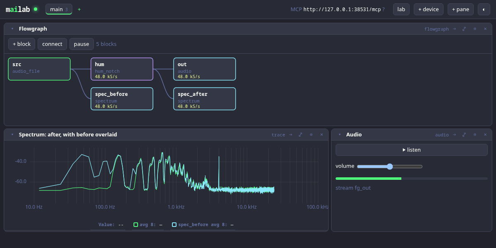

<!-- generated by bin/block-docs.js from the block catalog, about.md and example.json: edit those and run `yarn block-docs` -->

# `hum_notch`

**dsp** · Audio processing · [all blocks](../README.md)

> mains hum remover: notches at f0 (50/60 Hz, or auto) and its harmonics, constant width in Hz (or Q)

Removes mains hum: narrow notches at `freq` (50 or 60 Hz, or `auto` to pick it from the first second) and its
`harmonics`, each `width` Hz wide (or a fixed `q`), so the audio between the harmonics is untouched. Put it early in
the chain, after a `dc_block`. The `hum_removal` template combines it with `auto_notch`.

The example plays a generated test recording (`$MEDIA/demo.wav`: a buzzy voice-like signal with 50 Hz hum, a 4 kHz whistle, hiss and clicks); with a microphone, swap `src` for `audio_in` {stream: "browser_mic"}.

## Parameters

| name | default | description |
|---|---|---|
| `bypass` | `false` | pass the input through (same delay; live A/B) |
| `freq` | `50` | 50 \| 60 \| auto (picked from the first second) |
| `harmonics` | `10` | notches incl. f0 |
| `width` | `2` | notch -3 dB width Hz |
| `q` | `0` | fixed Q instead of width (0 = use width) |

## Inputs and outputs

- **Input:** real audio (complex: real part)
- **Output:** real audio, same rate

## Example

50 Hz hum and harmonics notched out of the test recording (log frequency axis).



`$MEDIA` is your media directory (`DATA_DIR/media` or one of `MAILAB_MEDIA_DIRS`); the screenshot and tests use generated files (`demo.wav`: see `makeMedia` in `src/utils/block-docs`).

Ask the AI:

> There's 50 Hz hum on the recording, notch it out with harmonics.

Graph ([example.json](example.json)):

```json
{
  "blocks": [
    {"id": "src", "type": "audio_file", "params": {"path": "$MEDIA/demo.wav", "rate": 48000}},
    {"id": "hum", "type": "hum_notch", "params": {"freq": 50, "harmonics": 10, "width": 2}},
    {"id": "out", "type": "audio", "params": {"rate": 48000}},
    {"id": "spec_before", "type": "spectrum", "params": {"fft": 4096, "traces": ["avg"], "average": 8, "fps": 4}},
    {"id": "spec_after", "type": "spectrum", "params": {"fft": 4096, "traces": ["avg"], "average": 8, "fps": 4, "overlay": ["spec_before"]}}
  ],
  "links": [["src", "hum"], ["hum", "out"], ["src", "spec_before"], ["hum", "spec_after"]]
}
```

MCP calls:

```
device_add {"id": "fg", "driver": "flowgraph"}
device_command {"id": "fg", "command": "set_graph", "args": {"graph": <the graph above>}}
# a ready-made template that uses this block (replaces the graph):
device_command {"id": "fg", "command": "load_template", "args": {"name": "hum_removal", "path": "$MEDIA/demo.wav", "hum": 50}}
pane_add {"type": "flowgraph", "title": "Flowgraph", "config": {"device": "fg"}}
pane_add {"type": "trace", "title": "Spectrum: after, with before overlaid", "config": {"traces": ["fg_spec_after"], "logX": true}}
pane_add {"type": "audio", "title": "Audio", "config": {"stream": "fg_out"}}
```

## Related

- [`auto_notch`](../auto_notch/README.md): finds and notches stationary tones automatically
- [`biquad`](../biquad/README.md): RBJ biquad: low/high/band-pass, notch, peaking, shelves
- [`dc_block`](../dc_block/README.md): removes DC offset
