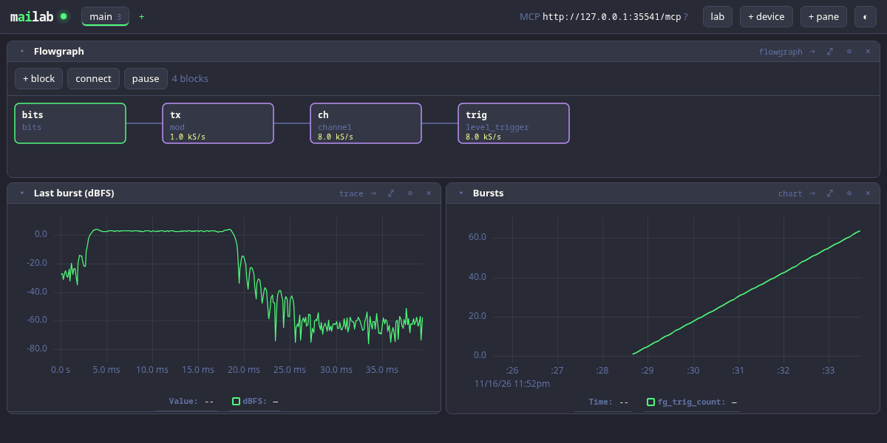

<!-- generated by bin/block-docs.js from the block catalog, about.md and example.json: edit those and run `yarn block-docs` -->

# `level_trigger`

**dsp** · Filters and DSP · [all blocks](../README.md)

> power squelch / level trigger: passes samples only while the level is above threshold_db (+ pretrigger, hold); each burst -&gt; log, channel &lt;device&gt;_&lt;id&gt;_count, blob &lt;device&gt;_&lt;id&gt; (cf32 IQ) and trace &lt;device&gt;_&lt;id&gt;_burst (|x| dB)

Power squelch and burst catcher: while the instantaneous level is above `threshold_db` (dBFS) it passes samples
downstream (`pass`), with `pretrigger_ms` of history before the edge and `hold_ms` after the level drops. Every
finished burst is logged and published: count channel, an event, the raw cf32 IQ as a blob (for later analysis or
replay) and its envelope as a trace. Use it to capture key fobs, sensors and other bursty transmitters, or to keep a
demodulator quiet between transmissions.

## Parameters

| name | default | description |
|---|---|---|
| `threshold_db` | `-30` | dBFS |
| `pretrigger_ms` | `2` | samples kept from before the trigger |
| `hold_ms` | `20` | stay open after the level drops |
| `max_burst_ms` | `2000` | cut very long bursts |
| `pass` | `true` | gate the stream to downstream blocks |

## Inputs and outputs

- **Input:** complex IQ or real
- **Output:** gated samples while a burst is open (`pass`); per burst: log line, event + blob &lt;device&gt;_&lt;id&gt; (cf32), trace &lt;device&gt;_&lt;id&gt;_burst (dBFS envelope), channel &lt;device&gt;_&lt;id&gt;_count

## Example

OOK bursts (16 ms on, 64 ms off) over noise: the envelope of the last captured burst and the burst counter.



Ask the AI:

> Catch the bursts above -15 dBFS, count them and show me the last one.

Graph ([example.json](example.json)):

```json
{
  "blocks": [
    {"id": "bits", "type": "bits", "params": {"pattern": "hex:ffff0000000000000000", "bitrate": 1000}},
    {"id": "tx", "type": "mod", "params": {"scheme": "ook", "sps": 8}},
    {"id": "ch", "type": "channel", "params": {"snr_db": 30}},
    {"id": "trig", "type": "level_trigger", "params": {"threshold_db": -15, "pretrigger_ms": 2, "hold_ms": 5}}
  ],
  "links": [["bits", "tx"], ["tx", "ch"], ["ch", "trig"]]
}
```

MCP calls:

```
device_add {"id": "fg", "driver": "flowgraph"}
device_command {"id": "fg", "command": "set_graph", "args": {"graph": <the graph above>}}
pane_add {"type": "flowgraph", "title": "Flowgraph", "config": {"device": "fg"}}
pane_add {"type": "trace", "title": "Last burst (dBFS)", "config": {"traces": ["fg_trig_burst"]}}
pane_add {"type": "chart", "title": "Bursts", "config": {"channels": ["fg_trig_count"], "seconds": 8}}
```

## Related

- [`mag`](../mag/README.md): magnitude |x|: envelope detector
- [`measure`](../measure/README.md): one statistic of the stream as a channel
- [`spectrum`](../spectrum/README.md): spectrum analyzer trace: RBW, window, max/min hold, averaging
- [`framer`](../framer/README.md): finds a sync word and cuts frames from bits
