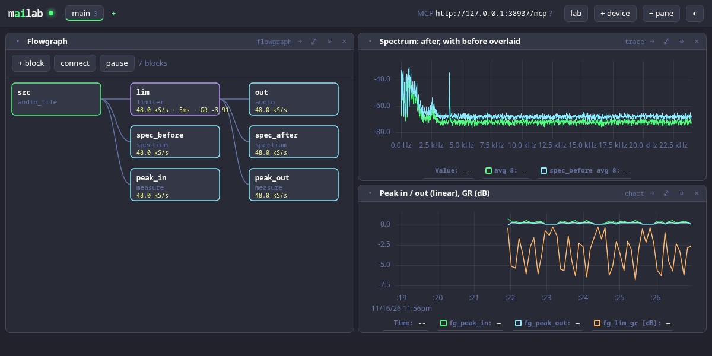

<!-- generated by bin/block-docs.js from the block catalog, about.md and example.json: edit those and run `yarn block-docs` -->

# `limiter`

**dsp** · Audio processing · [all blocks](../README.md)

> brickwall lookahead limiter: output never exceeds ceiling_db; gain reduction -&gt; channel &lt;device&gt;_&lt;id&gt;_gr

Brickwall lookahead limiter: the output never exceeds `ceiling_db`. It delays the audio by `lookahead_ms` so
the gain is already down when a peak arrives, then recovers with `release_ms`. The last block before an `audio` sink,
a WAV file or a transmitter, protecting against clipping after gain stages; gain reduction is a channel.

The example plays a generated test recording (`$MEDIA/demo.wav`: a buzzy voice-like signal with 50 Hz hum, a 4 kHz whistle, hiss and clicks); with a microphone, swap `src` for `audio_in` {stream: "browser_mic"}.

## Parameters

| name | default | description |
|---|---|---|
| `bypass` | `false` | pass the input through (same delay; live A/B) |
| `ceiling_db` | `-1` | dBFS |
| `lookahead_ms` | `5` | = latency |
| `release_ms` | `60` | gain recovery time constant |
| `fps` | `10` | gain-reduction channel updates per second |

## Inputs and outputs

- **Input:** real audio (complex: real part)
- **Output:** real audio, same rate; channel &lt;device&gt;_&lt;id&gt;_gr (gain reduction dB)

## Example

A -12 dBFS ceiling on the test recording (clicks peak near -2 dBFS): peak in vs out, and gain reduction.



`$MEDIA` is your media directory (`DATA_DIR/media` or one of `MAILAB_MEDIA_DIRS`); the screenshot and tests use generated files (`demo.wav`: see `makeMedia` in `src/utils/block-docs`).

Ask the AI:

> Limit the audio to -12 dBFS and show me the peaks before and after.

Graph ([example.json](example.json)):

```json
{
  "blocks": [
    {"id": "src", "type": "audio_file", "params": {"path": "$MEDIA/demo.wav", "rate": 48000}},
    {"id": "lim", "type": "limiter", "params": {"ceiling_db": -12, "lookahead_ms": 5, "release_ms": 60}},
    {"id": "out", "type": "audio", "params": {"rate": 48000}},
    {"id": "spec_before", "type": "spectrum", "params": {"fft": 4096, "traces": ["avg"], "average": 8, "fps": 4}},
    {"id": "spec_after", "type": "spectrum", "params": {"fft": 4096, "traces": ["avg"], "average": 8, "fps": 4, "overlay": ["spec_before"]}},
    {"id": "peak_in", "type": "measure", "params": {"stat": "peak"}},
    {"id": "peak_out", "type": "measure", "params": {"stat": "peak"}}
  ],
  "links": [["src", "lim"], ["lim", "out"], ["src", "spec_before"], ["lim", "spec_after"], ["src", "peak_in"], ["lim", "peak_out"]]
}
```

MCP calls:

```
device_add {"id": "fg", "driver": "flowgraph"}
device_command {"id": "fg", "command": "set_graph", "args": {"graph": <the graph above>}}
pane_add {"type": "flowgraph", "title": "Flowgraph", "config": {"device": "fg"}}
pane_add {"type": "trace", "title": "Spectrum: after, with before overlaid", "config": {"traces": ["fg_spec_after"]}}
pane_add {"type": "chart", "title": "Peak in / out (linear), GR (dB)", "config": {"channels": ["fg_peak_in", "fg_peak_out", "fg_lim_gr"], "seconds": 8}}
```

## Related

- [`compressor`](../compressor/README.md): dynamics compressor with knee, lookahead, sidechain HPF
- [`audio_agc`](../audio_agc/README.md): audio level AGC to a target dBFS
- [`audio`](../audio/README.md): plays audio in the browser (lab audio stream)
