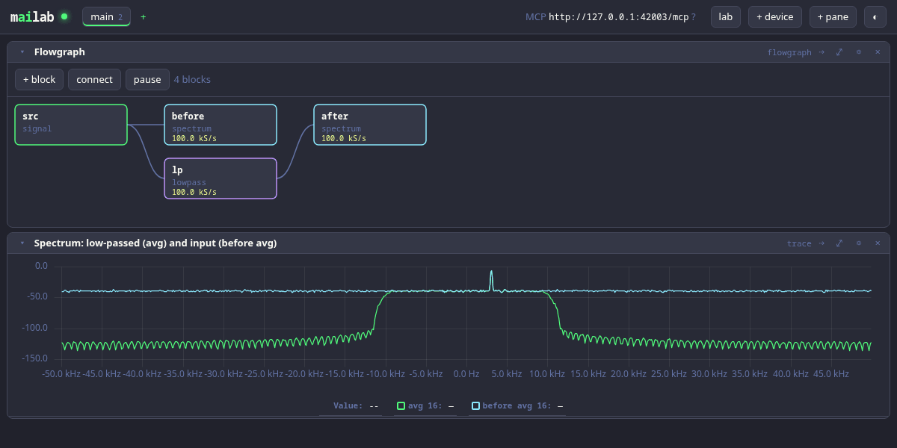

<!-- generated by bin/block-docs.js from the block catalog, about.md and example.json: edit those and run `yarn block-docs` -->

# `lowpass`

**dsp** · Filters and DSP · [all blocks](../README.md)

> Kaiser FIR low-pass

Kaiser-windowed FIR low-pass (liquid firfilt) on complex or real samples: passes |f| below `cutoff`, more `taps`
give a sharper transition at the cost of delay and CPU. On complex IQ it is a channel filter (a band of ±cutoff around
0 Hz), so it usually follows `shift` and precedes `resample` or `decimate`. For audio-style filters (high-pass,
band-pass, notch, shelves) use `biquad` or `fir_filter`.

## Parameters

| name | default | description |
|---|---|---|
| `cutoff` | `10000` | Hz |
| `taps` | `63` | FIR length (more = sharper transition, more delay) |

## Inputs and outputs

- **Input:** complex IQ or real
- **Output:** same kind, same rate

## Example

Noise at 100 kS/s through a 10 kHz low-pass: the output spectrum with the input overlaid.



Ask the AI:

> Low-pass the noisy signal at 10 kHz and show the spectrum before and after.

Graph ([example.json](example.json)):

```json
{
  "blocks": [
    {"id": "src", "type": "signal", "params": {"rate": 100000, "freq": 3000, "amp": 0.5, "noise": 0.3}},
    {"id": "before", "type": "spectrum", "params": {"fft": 1024, "traces": ["avg"], "average": 16}},
    {"id": "lp", "type": "lowpass", "params": {"cutoff": 10000, "taps": 127}},
    {"id": "after", "type": "spectrum", "params": {"fft": 1024, "traces": ["avg"], "average": 16, "overlay": ["before"]}}
  ],
  "links": [["src", "before"], ["src", "lp"], ["lp", "after"]]
}
```

MCP calls:

```
device_add {"id": "fg", "driver": "flowgraph"}
device_command {"id": "fg", "command": "set_graph", "args": {"graph": <the graph above>}}
pane_add {"type": "flowgraph", "title": "Flowgraph", "config": {"device": "fg"}}
pane_add {"type": "trace", "title": "Spectrum: low-passed (avg) and input (before avg)", "config": {"traces": ["fg_after"]}}
```

## Related

- [`shift`](../shift/README.md): moves a signal at +offset Hz to 0 Hz
- [`resample`](../resample/README.md): any-ratio, anti-aliased resampler to a new rate
- [`decimate`](../decimate/README.md): keeps every n-th sample (no filtering)
- [`fir_filter`](../fir_filter/README.md): linear-phase FIR low/high/band-pass, band-stop
