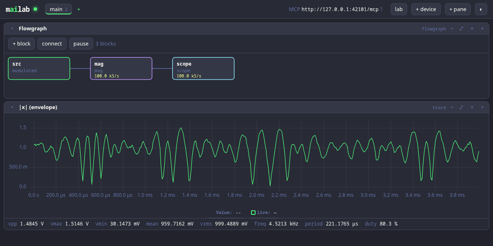

<!-- generated by bin/block-docs.js from the block catalog, about.md and example.json: edit those and run `yarn block-docs` -->

# `mag`

**dsp** · Filters and DSP · [all blocks](../README.md)

> |x|

Magnitude |x| of complex samples (real output). The envelope detector for OOK/ASK, burst detection and
amplitude measurements: `mag -> scope` shows a signal's envelope, `mag -> clock_recovery` (with `dc_block`) recovers
OOK symbols, `mag -> measure` gives an amplitude readout.

## Parameters

No parameters.

## Inputs and outputs

- **Input:** complex IQ or real
- **Output:** real |x|, same rate

## Example

The envelope of an RRC-shaped QPSK signal (it is not constant: the pulse shaping makes it vary between symbols).



Ask the AI:

> Show me the envelope of the QPSK signal on a scope.

Graph ([example.json](example.json)):

```json
{
  "blocks": [
    {"id": "src", "type": "modulated", "params": {"scheme": "qpsk", "sps": 8, "snr_db": 30}},
    {"id": "mag", "type": "mag", "params": {}},
    {"id": "scope", "type": "scope", "params": {"samples": 400, "trigger": "none", "traces": ["live"], "measure": ["vpp", "mean"]}}
  ],
  "links": [["src", "mag"], ["mag", "scope"]]
}
```

MCP calls:

```
device_add {"id": "fg", "driver": "flowgraph"}
device_command {"id": "fg", "command": "set_graph", "args": {"graph": <the graph above>}}
pane_add {"type": "flowgraph", "title": "Flowgraph", "config": {"device": "fg"}}
pane_add {"type": "trace", "title": "|x| (envelope)", "config": {"traces": ["fg_scope"]}}
```

## Related

- [`scope`](../scope/README.md): triggered oscilloscope with measurements
- [`level_trigger`](../level_trigger/README.md): power squelch: catches bursts above a level (blob, trace, log)
- [`clock_recovery`](../clock_recovery/README.md): Gardner timing recovery for FSK / OOK / real symbols
- [`measure`](../measure/README.md): one statistic of the stream as a channel
