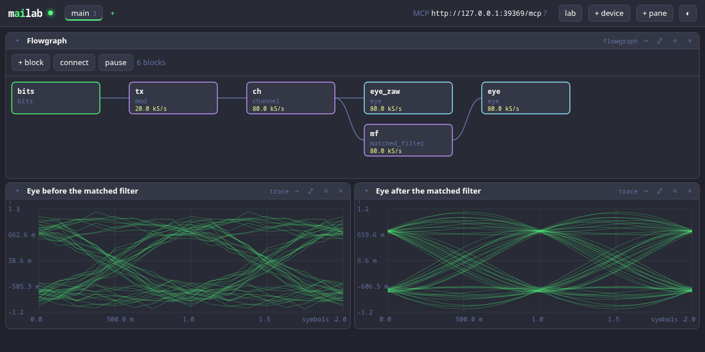

<!-- generated by bin/block-docs.js from the block catalog, about.md and example.json: edit those and run `yarn block-docs` -->

# `matched_filter`

**dsp** · Filters and DSP · [all blocks](../README.md)

> RRC receive (matched) filter, same sps/beta as the transmitter; then e.g. clock_recovery

Root-raised-cosine receive filter matching the transmitter's RRC shaping (same `sps` and `beta`). Transmit RRC
times receive RRC is a raised cosine, which has no inter-symbol interference at the symbol instants and maximizes SNR,
so the eye opens. Use it before `clock_recovery` or an `eye` view; `symbol_sync` already contains one (don't put both).

## Parameters

| name | default | description |
|---|---|---|
| `sps` | `8` | samples per symbol (as the transmitter) |
| `beta` | `0.35` | RRC roll-off (as the transmitter) |

## Inputs and outputs

- **Input:** complex IQ at `sps` samples per symbol
- **Output:** complex IQ, same rate

## Example

QPSK at 20 dB SNR: the eye before the matched filter (transmit RRC only) and after it (open eye).



Ask the AI:

> Show the eye diagram of the received QPSK before and after a matched filter.

Graph ([example.json](example.json)):

```json
{
  "blocks": [
    {"id": "bits", "type": "bits", "params": {"pattern": "prbs9", "bitrate": 20000}},
    {"id": "tx", "type": "mod", "params": {"scheme": "qpsk", "sps": 8}},
    {"id": "ch", "type": "channel", "params": {"snr_db": 20}},
    {"id": "eye_raw", "type": "eye", "params": {"sps": 8, "traces": 48}},
    {"id": "mf", "type": "matched_filter", "params": {"sps": 8, "beta": 0.35}},
    {"id": "eye", "type": "eye", "params": {"sps": 8, "traces": 48}}
  ],
  "links": [["bits", "tx"], ["tx", "ch"], ["ch", "eye_raw"], ["ch", "mf"], ["mf", "eye"]]
}
```

MCP calls:

```
device_add {"id": "fg", "driver": "flowgraph"}
device_command {"id": "fg", "command": "set_graph", "args": {"graph": <the graph above>}}
pane_add {"type": "flowgraph", "title": "Flowgraph", "config": {"device": "fg"}}
pane_add {"type": "trace", "title": "Eye before the matched filter", "config": {"traces": ["fg_eye_raw"]}}
pane_add {"type": "trace", "title": "Eye after the matched filter", "config": {"traces": ["fg_eye"]}}
```

## Related

- [`mod`](../mod/README.md): bits to IQ: PSK, QAM, APSK, OOK, FSK, MSK, GFSK, GMSK...
- [`eye`](../eye/README.md): eye diagram
- [`clock_recovery`](../clock_recovery/README.md): Gardner timing recovery for FSK / OOK / real symbols
- [`symbol_sync`](../symbol_sync/README.md): symbol timing recovery, one sample per symbol out
