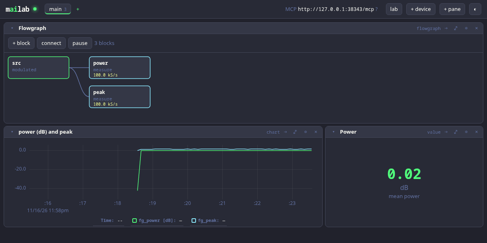

<!-- generated by bin/block-docs.js from the block catalog, about.md and example.json: edit those and run `yarn block-docs` -->

# `measure`

**sink** · Sinks and views · [all blocks](../README.md)

> statistic of the stream -&gt; channel &lt;device&gt;_&lt;id&gt;

Publishes one statistic of the stream as a channel, `fps` times a second: `power_db` (mean power, dB), `rms`,
`mean`, `peak` or the `last` sample. Channels are what the rest of the lab works with: chart and value panes, math,
safety rules, trends, `channel_read` for the AI. Put one anywhere in a chain as a probe.

## Parameters

| name | default | description |
|---|---|---|
| `stat` | `"power_db"` | power_db\|rms\|mean\|peak\|last |
| `fps` | `10` | channel samples per second |
| `unit` | `""` | channel unit (default dB for power_db) |

## Inputs and outputs

- **Input:** complex IQ or real
- **Output:** channel &lt;device&gt;_&lt;id&gt;

## Example

Power (dB) and peak of a QPSK signal at 25 dB SNR, as channels in a chart and a readout.



Ask the AI:

> Measure the power of the signal and chart it.

Graph ([example.json](example.json)):

```json
{
  "blocks": [
    {"id": "src", "type": "modulated", "params": {"scheme": "qpsk", "sps": 8, "snr_db": 25}},
    {"id": "power", "type": "measure", "params": {"stat": "power_db"}},
    {"id": "peak", "type": "measure", "params": {"stat": "peak"}}
  ],
  "links": [["src", "power"], ["src", "peak"]]
}
```

MCP calls:

```
device_add {"id": "fg", "driver": "flowgraph"}
device_command {"id": "fg", "command": "set_graph", "args": {"graph": <the graph above>}}
pane_add {"type": "flowgraph", "title": "Flowgraph", "config": {"device": "fg"}}
pane_add {"type": "chart", "title": "power (dB) and peak", "config": {"channels": ["fg_power", "fg_peak"], "seconds": 8}}
pane_add {"type": "value", "title": "Power", "config": {"channel": "fg_power", "precision": 2, "label": "mean power"}}
```

## Related

- [`scope`](../scope/README.md): triggered oscilloscope with measurements
- [`spectrum`](../spectrum/README.md): spectrum analyzer trace: RBW, window, max/min hold, averaging
- [`agc`](../agc/README.md): normalizes IQ to unit power
- [`level_trigger`](../level_trigger/README.md): power squelch: catches bursts above a level (blob, trace, log)
