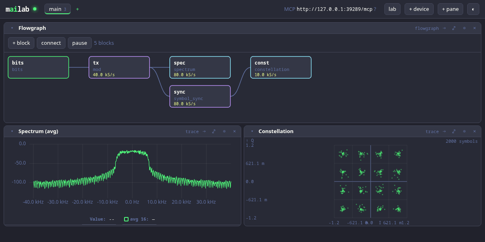

<!-- generated by bin/block-docs.js from the block catalog, about.md and example.json: edit those and run `yarn block-docs` -->

# `mod`

**dsp** · Modulation, demodulation and sync · [all blocks](../README.md)

> bits -&gt; baseband IQ. Linear (liquid): bpsk qpsk psk8..256 dpsk* ask* qam4..256 apsk* ook pi4dqpsk V29 …; CPFSK: 2fsk 4fsk msk gfsk gmsk. Output rate = bitrate / bits-per-symbol * sps

Digital modulator: bits in, complex baseband out. Linear schemes (bpsk, qpsk, psk8..256, dpsk, ask, qam4..256,
apsk, ook, pi4dqpsk, V.29...) are root-raised-cosine shaped with roll-off `beta`; CPFSK schemes (2fsk, 4fsk, msk,
gfsk, gmsk) use modulation index `h` and Gaussian `bt`. The output rate is bitrate / bits-per-symbol x `sps`. Feed it
from `bits` (PRBS for BER, or a framed pattern), follow with `channel` for impairments, and receive with
`symbol_sync` + `slicer` (linear) or `discriminator` + `clock_recovery` + `slicer` (FSK).

## Parameters

| name | default | description |
|---|---|---|
| `scheme` | `"qpsk"` | modulation |
| `sps` | `8` | samples per symbol |
| `beta` | `0.35` | RRC roll-off (linear) |
| `h` | `null` | modulation index (CPFSK; default per scheme) |
| `bt` | `null` | Gaussian BT (gfsk/gmsk) |

## Inputs and outputs

- **Input:** bits (0/1)
- **Output:** complex IQ at bitrate / bits-per-symbol * sps

## Example

PRBS9 bits as 16-QAM: the transmitted spectrum and the constellation after symbol timing recovery.



Ask the AI:

> Modulate a PRBS9 bit stream as 16-QAM at 8 samples per symbol and show the spectrum and constellation.

Graph ([example.json](example.json)):

```json
{
  "blocks": [
    {"id": "bits", "type": "bits", "params": {"pattern": "prbs9", "bitrate": 40000}},
    {"id": "tx", "type": "mod", "params": {"scheme": "qam16", "sps": 8, "beta": 0.35}},
    {"id": "spec", "type": "spectrum", "params": {"fft": 1024, "traces": ["avg"], "average": 16}},
    {"id": "sync", "type": "symbol_sync", "params": {"sps": 8, "bandwidth": 0.01}},
    {"id": "const", "type": "constellation", "params": {"points": 2000}}
  ],
  "links": [["bits", "tx"], ["tx", "spec"], ["tx", "sync"], ["sync", "const"]]
}
```

MCP calls:

```
device_add {"id": "fg", "driver": "flowgraph"}
device_command {"id": "fg", "command": "set_graph", "args": {"graph": <the graph above>}}
pane_add {"type": "flowgraph", "title": "Flowgraph", "config": {"device": "fg"}}
pane_add {"type": "trace", "title": "Spectrum (avg)", "config": {"traces": ["fg_spec"]}}
pane_add {"type": "trace", "title": "Constellation", "config": {"traces": ["fg_const"]}}
```

## Related

- [`bits`](../bits/README.md): PRBS or pattern bit source, optionally framed
- [`channel`](../channel/README.md): AWGN, carrier offset, phase and gain between TX and RX
- [`symbol_sync`](../symbol_sync/README.md): symbol timing recovery, one sample per symbol out
- [`discriminator`](../discriminator/README.md): FSK / FM discriminator, symbols as ±1
