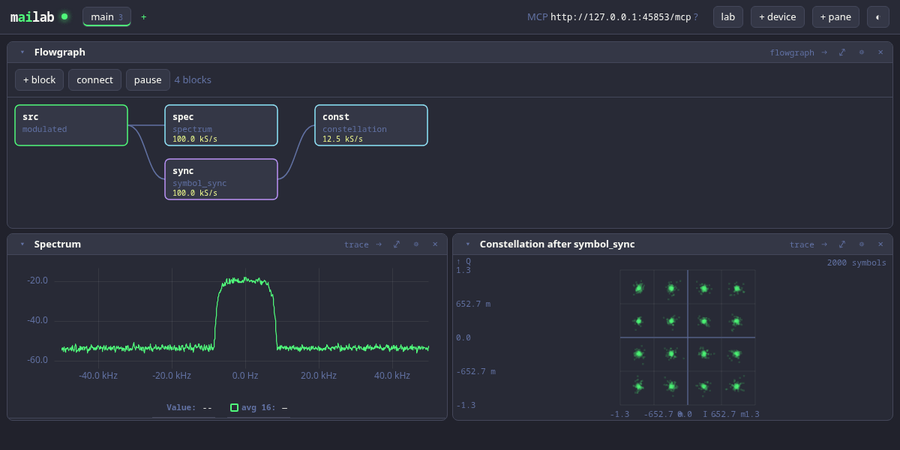

<!-- generated by bin/block-docs.js from the block catalog, about.md and example.json: edit those and run `yarn block-docs` -->

# `modulated`

**source** · Sources · [all blocks](../README.md)

> random symbols, RRC-shaped (test signal for constellation/eye/demod)

A ready-made digitally modulated test signal: random symbols of `scheme` (bpsk, qpsk, psk8, qam16, qam64,
apsk16 and every other liquid-dsp linear scheme), root-raised-cosine shaped at `sps` samples per symbol, with AWGN at
`snr_db`, an optional carrier offset (`cfo`) and phase. It saves wiring `bits -> mod -> channel` when you only need a
signal to look at or to exercise a receiver: symbol timing, carrier recovery, demodulation, EVM. It does not carry a
known bit pattern, so use `bits` + `mod` when you need a BER measurement.

## Parameters

| name | default | description |
|---|---|---|
| `scheme` | `"qpsk"` | bpsk\|qpsk\|psk8\|qam16\|qam64\|apsk16... |
| `rate` | `100000` | sample rate |
| `sps` | `8` | samples per symbol |
| `beta` | `0.35` | RRC roll-off |
| `snr_db` | `25` | AWGN SNR in dB (relative to signal power) |
| `cfo` | `0` | carrier offset Hz |
| `phase` | `0` | degrees |

## Inputs and outputs

- **Input:** none (source)
- **Output:** complex IQ at `rate` (RRC-shaped symbols, `sps` samples each)

## Example

16-QAM at 25 dB SNR: the occupied spectrum, and the constellation after symbol timing recovery.



Ask the AI:

> Give me a 16-QAM test signal and show its spectrum and constellation.

Graph ([example.json](example.json)):

```json
{
  "blocks": [
    {"id": "src", "type": "modulated", "params": {"scheme": "qam16", "sps": 8, "snr_db": 25}},
    {"id": "spec", "type": "spectrum", "params": {"fft": 1024, "traces": ["avg"], "average": 16}},
    {"id": "sync", "type": "symbol_sync", "params": {"sps": 8, "bandwidth": 0.01}},
    {"id": "const", "type": "constellation", "params": {"points": 2000}}
  ],
  "links": [["src", "spec"], ["src", "sync"], ["sync", "const"]]
}
```

MCP calls:

```
device_add {"id": "fg", "driver": "flowgraph"}
device_command {"id": "fg", "command": "set_graph", "args": {"graph": <the graph above>}}
pane_add {"type": "flowgraph", "title": "Flowgraph", "config": {"device": "fg"}}
pane_add {"type": "trace", "title": "Spectrum", "config": {"traces": ["fg_spec"]}}
pane_add {"type": "trace", "title": "Constellation after symbol_sync", "config": {"traces": ["fg_const"]}}
```

## Related

- [`mod`](../mod/README.md): bits to IQ: PSK, QAM, APSK, OOK, FSK, MSK, GFSK, GMSK...
- [`symbol_sync`](../symbol_sync/README.md): symbol timing recovery, one sample per symbol out
- [`constellation`](../constellation/README.md): I/Q scatter of symbols
- [`eye`](../eye/README.md): eye diagram
