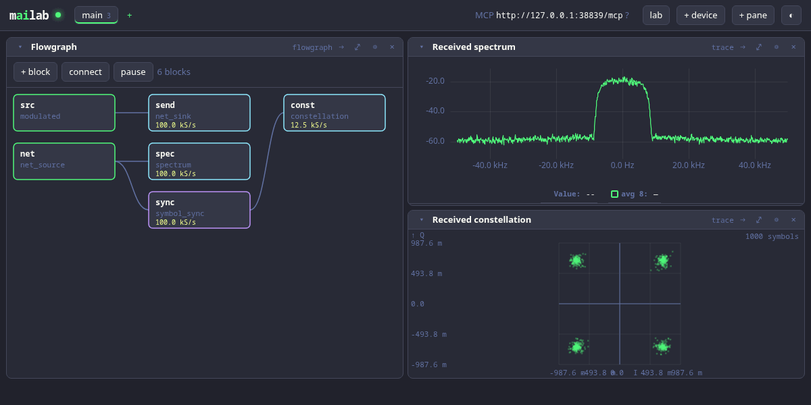

<!-- generated by bin/block-docs.js from the block catalog, about.md and example.json: edit those and run `yarn block-docs` -->

# `net_sink`

**sink** · Network · [all blocks](../README.md)

> IQ out over TCP/UDP (raw interleaved cf32/cs16/cu8)

Sends the stream out over TCP (server: one client at a time; client) or UDP as raw interleaved cf32, cs16 or
cu8 IQ, or logic words. Feed GNU Radio, SDR++, inspectrum/`nc > file` recorders, a transmitter on another machine, or
another mailab graph's `net_source`. UDP datagrams are 8 KB; a TCP peer that disconnects is dropped and re-accepted.

## Parameters

| name | default | description |
|---|---|---|
| `mode` | `"tcp-server"` | tcp-server\|tcp-client\|udp |
| `host` | `"127.0.0.1"` | bind (server/udp in) or remote host |
| `port` | `5600` | TCP/UDP port (listen port for tcp-server / udp in, remote port otherwise) |
| `format` | `"cf32"` | cf32\|cs16\|cu8 interleaved I/Q, or logic: u8\|u16\|u32 words per sample, bits (packed, MSB first) |

## Inputs and outputs

- **Input:** complex IQ, or logic words for the u8/u16/u32/bits formats
- **Output:** raw bytes over TCP/UDP

## Example

A self-contained loopback over UDP: a QPSK signal sent as cs16 by `net_sink` and received by `net_source` on `$PORT`: constellation and spectrum of what arrived.

**Needs:** a receiver on the port: here the same graph's `net_source`; replace `$PORT` with a free port (e.g. 5600).



Ask the AI:

> Stream this QPSK IQ as cs16 over UDP to 127.0.0.1:5600.

Graph ([example.json](example.json)):

```json
{
  "blocks": [
    {"id": "src", "type": "modulated", "params": {"scheme": "qpsk", "rate": 100000, "sps": 8, "snr_db": 30}},
    {"id": "send", "type": "net_sink", "params": {"mode": "udp", "host": "127.0.0.1", "port": "$PORT", "format": "cs16"}},
    {"id": "net", "type": "net_source", "params": {"mode": "udp", "host": "127.0.0.1", "port": "$PORT", "format": "cs16", "rate": 100000}},
    {"id": "spec", "type": "spectrum", "params": {"fft": 1024, "traces": ["avg"]}},
    {"id": "sync", "type": "symbol_sync", "params": {"sps": 8}},
    {"id": "const", "type": "constellation", "params": {"points": 1000}}
  ],
  "links": [["src", "send"], ["net", "spec"], ["net", "sync"], ["sync", "const"]]
}
```

MCP calls:

```
device_add {"id": "fg", "driver": "flowgraph"}
device_command {"id": "fg", "command": "set_graph", "args": {"graph": <the graph above>}}
pane_add {"type": "flowgraph", "title": "Flowgraph", "config": {"device": "fg"}}
pane_add {"type": "trace", "title": "Received spectrum", "config": {"traces": ["fg_spec"]}}
pane_add {"type": "trace", "title": "Received constellation", "config": {"traces": ["fg_const"]}}
```

## Related

- [`net_source`](../net_source/README.md): IQ or logic samples in over TCP / UDP
- [`soapy`](../soapy/README.md): live IQ from a SoapySDR receiver (RTL-SDR, HackRF, bladeRF...)
- [`file`](../file/README.md): plays a raw cf32 IQ recording in real time
