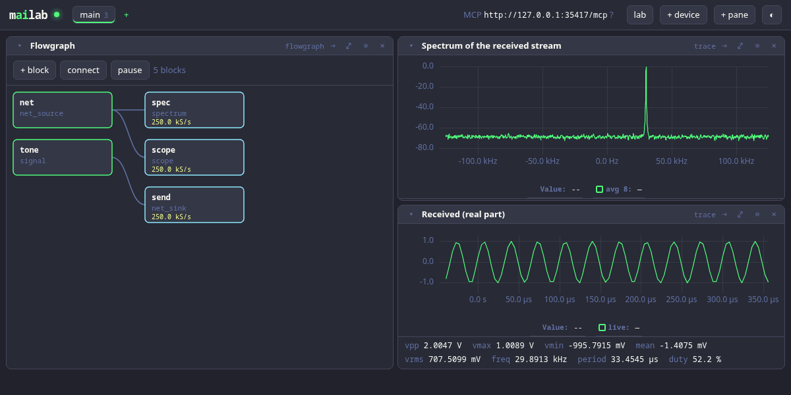

<!-- generated by bin/block-docs.js from the block catalog, about.md and example.json: edit those and run `yarn block-docs` -->

# `net_source`

**source** · Network · [all blocks](../README.md)

> IQ in over TCP/UDP/WebSocket (raw interleaved cf32/cs16/cu8), e.g. from GNU Radio, SDR++ or rtl_tcp-like streams; or logic samples (u8/u16/u32/bits) for decode

Raw samples in over TCP (server or client) or UDP: interleaved IQ as cf32, cs16 or cu8 (GNU Radio's TCP/UDP
sinks, SDR++ network sink, `rtl_sdr -` piped through `nc`), or logic words (u8/u16/u32, packed `bits`) for `decode`.
`rate` tells the graph the stream's sample rate (the network doesn't). Connect a remote SDR, another tool's output or
another mailab graph's `net_sink`.

## Parameters

| name | default | description |
|---|---|---|
| `mode` | `"tcp-server"` | tcp-server\|tcp-client\|udp\|ws-server\|ws-client |
| `host` | `"127.0.0.1"` | bind (server/udp in) or remote host |
| `port` | `5600` | TCP/UDP port (listen port for tcp-server / udp in, remote port otherwise) |
| `format` | `"cf32"` | cf32\|cs16\|cu8 interleaved I/Q, or logic: u8\|u16\|u32 words per sample, bits (packed, MSB first) |
| `rate` | `1000000` | sample rate of the incoming stream |

## Inputs and outputs

- **Input:** none (source)
- **Output:** complex IQ (cf32/cs16/cu8) or logic words (u8/u16/u32/bits) at `rate`

## Example

A self-contained loopback: a tone is sent by `net_sink` (TCP client, cf32) and received by `net_source` (TCP server) on `$PORT`, then shown on a spectrum and scope.

**Needs:** a sender on the port: here the same graph's `net_sink`; replace `$PORT` with a free port (e.g. 5600) and drop `tone` / `send` for an external source.



Ask the AI:

> Listen on TCP port 5600 for cf32 IQ at 250 kS/s and show me the spectrum.

Graph ([example.json](example.json)):

```json
{
  "blocks": [
    {"id": "net", "type": "net_source", "params": {"mode": "tcp-server", "host": "127.0.0.1", "port": "$PORT", "format": "cf32", "rate": 250000}},
    {"id": "spec", "type": "spectrum", "params": {"fft": 1024, "traces": ["avg"]}},
    {"id": "scope", "type": "scope", "params": {"samples": 100, "measure": ["freq"]}},
    {"id": "tone", "type": "signal", "params": {"rate": 250000, "freq": 30000, "noise": 0.01}},
    {"id": "send", "type": "net_sink", "params": {"mode": "tcp-client", "host": "127.0.0.1", "port": "$PORT", "format": "cf32"}}
  ],
  "links": [["net", "spec"], ["net", "scope"], ["tone", "send"]]
}
```

MCP calls:

```
device_add {"id": "fg", "driver": "flowgraph"}
device_command {"id": "fg", "command": "set_graph", "args": {"graph": <the graph above>}}
pane_add {"type": "flowgraph", "title": "Flowgraph", "config": {"device": "fg"}}
pane_add {"type": "trace", "title": "Spectrum of the received stream", "config": {"traces": ["fg_spec"]}}
pane_add {"type": "trace", "title": "Received (real part)", "config": {"traces": ["fg_scope"]}}
```

## Related

- [`net_sink`](../net_sink/README.md): IQ or logic samples out over TCP / UDP
- [`decode`](../decode/README.md): sigrok / builtin protocol decoder on logic samples (UART, SPI, I2C...)
- [`spectrum`](../spectrum/README.md): spectrum analyzer trace: RBW, window, max/min hold, averaging
- [`file`](../file/README.md): plays a raw cf32 IQ recording in real time
