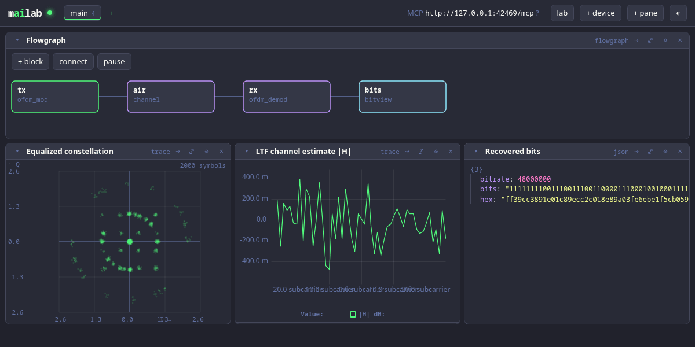

<!-- generated by bin/block-docs.js from the block catalog, about.md and example.json: edit those and run `yarn block-docs` -->

# `ofdm_demod`

**dsp** · Modulation, demodulation and sync · [all blocks](../README.md)

> 802.11a/g-style OFDM receiver: STF autocorrelation packet-detect, coarse/fine CFO estimate+correct (STF then LTF), 64-pt FFT, LTF least-squares channel estimate, per-subcarrier zero-forcing equalize, pilot residual-phase (CPE) correction, QAM demap, descramble -&gt; output bits. Publishes the equalized subcarrier constellation (trace &lt;device&gt;_&lt;id&gt;_const, mode constellation) and the channel estimate magnitude (trace &lt;device&gt;_&lt;id&gt;_chan). Loopback RX for ofdm_mod; set the same scheme, cp_len and n_sym as the transmitter.

The loopback receiver for `ofdm_mod`: STF autocorrelation **packet detection** (`threshold`), coarse/fine
**carrier-frequency-offset** estimate + correction (STF then LTF), 64-point FFT, **LTF least-squares channel
estimate** (published as trace `<dev>_<id>_chan`, |H| in dB per used subcarrier), per-subcarrier **zero-forcing
equalization**, **pilot** residual-phase tracking, QAM demap and descramble → output bits for `bitview` or `ber`.
The equalized subcarrier constellation is published as `<dev>_<id>_const` (trace mode `constellation`). Match
`scheme`, `cp_len` and `n_sym` to the transmitter (n_sym 0 = all symbols after the LTF). In a loopback
`ofdm_mod → channel → ofdm_demod` the bytes come back with BER ≈ 0.

## Parameters

| name | default | description |
|---|---|---|
| `scheme` | `"qpsk"` | bpsk\|qpsk\|qam16\|qam64\|qam256 |
| `mcs` | `""` | alias for scheme |
| `cp_len` | `16` | cyclic prefix samples (match the transmitter) |
| `n_sym` | `0` | OFDM data symbols per packet (0 = all available after the LTF) |
| `threshold` | `0.6` | STF detection metric threshold |
| `const_points` | `2000` | equalized points kept in the constellation trace |
| `publish_channel` | `true` | publish the LTF channel-estimate trace |
| `fps` | `10` | trace updates per second |

## Inputs and outputs

- **Input:** complex IQ (an ofdm_mod output, possibly through `channel`)
- **Output:** recovered bits (to `bitview`/`ber`); traces &lt;device&gt;_&lt;id&gt;_const + &lt;device&gt;_&lt;id&gt;_chan

## Example

OFDM loopback at 25 dB SNR: ofdm_mod recovers its own text bytes (bitview), with the equalized 16-QAM subcarrier constellation and the LTF channel estimate.



Ask the AI:

> Send an OFDM-modulated hex packet through a 25 dB channel and demodulate it back to bytes, showing the constellation and the channel estimate.

Graph ([example.json](example.json)):

```json
{
  "blocks": [
    {"id": "tx", "type": "ofdm_mod", "params": {"input": "hex:48656c6c6f204f46444d21", "scheme": "qam16", "rate": 20000000}},
    {"id": "air", "type": "channel", "params": {"snr_db": 25}},
    {"id": "rx", "type": "ofdm_demod", "params": {"scheme": "qam16"}},
    {"id": "bits", "type": "bitview", "params": {"bits": 192}}
  ],
  "links": [["tx", "air"], ["air", "rx"], ["rx", "bits"]]
}
```

MCP calls:

```
device_add {"id": "fg", "driver": "flowgraph"}
device_command {"id": "fg", "command": "set_graph", "args": {"graph": <the graph above>}}
pane_add {"type": "flowgraph", "title": "Flowgraph", "config": {"device": "fg"}}
pane_add {"type": "trace", "title": "Equalized constellation", "config": {"traces": ["fg_rx_const"]}}
pane_add {"type": "trace", "title": "LTF channel estimate |H|", "config": {"traces": ["fg_rx_chan"]}}
pane_add {"type": "json", "title": "Recovered bits", "config": {"value": "fg_bits"}}
```

## Related

- [`ofdm_mod`](../ofdm_mod/README.md): 802.11a/g-style OFDM transmitter: 64-pt IFFT, 48 data + 4 pilot subcarriers, STF/LTF preamble
- [`channel`](../channel/README.md): AWGN, carrier offset, phase and gain between TX and RX
- [`bitview`](../bitview/README.md): shows the last bits of a stream as binary and hex
- [`constellation`](../constellation/README.md): I/Q scatter of symbols
